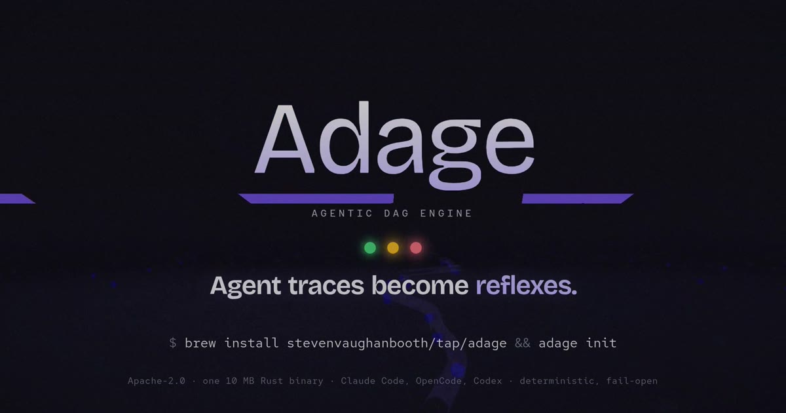

<p align="center">
  
</p>

<p align="center">
  <a href="LICENSE"></a>
  
  
</p>

# Adage

**Learn the repeatable parts of agent work. Reuse them next time.**

Adage is an experiment in a harness that learns from experience. It reads the session history
coding agents already leave on your machine, finds recurring steps, and makes them available in
later sessions as **reflexes**: a condition, a response, and the evidence behind it.

For example, an agent repeatedly tries a test command that fails because it bypasses your
repository's setup. The history shows that `make test` works. Adage can recognize that situation
and offer the known command. With separate approval, supported reflexes can also run a check or
fetch a result for the agent.

The question behind the project is simple: **which parts of an agent's work should it have to
reason through again?** Skills and workflows are useful instructions. Adage explores turning
some of their repeatable steps—and steps learned from actual work—into behavior the harness can
recognize and reuse. The model still handles new problems and judgment.

Adage integrates with Claude Code, Codex and OpenCode. Their capabilities differ; Claude Code
has the most live evaluation coverage. See [harness support](docs/harnesses.md).

## Try it

Adage is experimental. Start in one repository and inspect what it learns. You can get useful
guidance without enabling automatic execution.

### Install

The intended download path is **npm**, with no Rust build or Git checkout:

```sh
npm install -g @adage-sh/cli
cd /path/to/your/repository
adage init
```

**Publication status:** the first npm package and release downloads are being prepared. The
command above becomes usable when `@adage-sh/cli` is published. Until then, the
[source install](docs/usage.md#install) is the available path and requires repository access.

The npm package includes `adage`, the skill compiler, and the execution companion on macOS and
Linux. After installation, `adage init` connects the agents it finds, shows its proposed changes, and offers to
learn from this repository's history. Codex also requires its own hook review in `/hooks`.

```sh
adage doctor                   # check the connection
adage condition --repo-root .  # learn from this repository's existing sessions
adage review                   # inspect reflexes and their evidence
adage                         # see status and recent activity
```

Continue your normal work. After sessions end, background learning can update the repository's
reflexes. `adage update` installs a newer published version. The [first-session guide](docs/first-reflex.md)
covers setup, an empty history, and what to look for in your next session.

## What a reflex does

A reflex matches a situation and supplies a known response. It can be a short piece of guidance,
a sequence of steps, or an approved action. It is not a new model or fine-tuned model weights.

| Situation | Possible response | Where it comes from |
| --- | --- | --- |
| A test command repeatedly fails, then the repository's wrapper succeeds | Suggest the wrapper instead of another failed attempt | Learned session history |
| Editing a schema is consistently followed by code generation | Remind the agent to run the generator | Learned history or a declared dependency |
| Similar tasks repeatedly use the same files and checks | Supply a procedure card with the relevant files and commands | Learned session history |
| A Python command uses the wrong environment | Use the verified project interpreter for supported calls | A built-in instinct |
| A test runner reports that it collected no tests | Ask the agent to inspect test discovery | An optional verification instinct |

These are supported kinds of behavior, not a guarantee that every repository will produce them.
Ambiguous commands, missing outcomes and weak evidence can leave a candidate inactive. A tool
returning successfully also does not prove that the task was completed correctly.

## From history to reuse

```text
Session history → learn patterns → inspect evidence → use matching reflexes
                         ↑                                  ↓
                         └──────── later sessions ──────────┘
```

1. **Read local history.** Import supported agent and subagent sessions, preserving who did what
   and the outcomes the recording actually contains. Related subagents are not counted as
   independent tasks.
2. **Find recurring behavior.** Look for useful commands, failed approaches, verification steps
   and sequences. The learner is deterministic: the same recorded evidence produces the same
   result, without asking a model to invent a rule.
3. **Keep the evidence attached.** `adage review` shows what a reflex is based on. Evidence
   thresholds and review determine what can become active; accepting a reflex does not authorize
   its commands to run.
4. **Match during work.** Hooks connect Adage to the agent's session. Matching runs locally on the
   CPU. Most reflexes supply guidance; supported rewrites and approved actions have separate rules.

No history is a valid starting point. Adage also includes **instincts**: packaged rules that read
facts from files such as `package.json`, a Makefile or a lockfile. They can help before learning
has enough examples. `adage packs` shows which apply and lets you turn them off.

## Skills, reflexes and packs

- A **skill** describes how to do work. The agent interprets it and makes decisions.
- A **reflex** makes a supported part of that work explicit: when it applies, what to do, and why.
  It can be learned from history or authored and reviewed.
- An **instinct** is a packaged reflex template that adapts to facts declared by a repository.
- A **pack** is the versioned, reviewable format used to share reflexes and instincts.

`adage train SKILL.md` can extract supported steps from a skill and attempt a sandbox replay.
It reports what was verified, what was stale and what could not be replayed. Instructions that
require judgment remain instructions; Adage does not compile arbitrary prose into reliable code.

You can [export and import signed packs](docs/marketplace.md), or host their files in a repository.
The built-in marketplace is a pinned catalogue bundled with Adage. Browsing and installing from
arbitrary remote marketplaces is still planned. Sharing a pack never shares execution permission.

## Evidence so far

**Results are promising in some settings and mixed overall. There is no established general
speedup or cost saving.** Learning a pattern, delivering advice, and improving a real task are
three different results.

- In one held-out comparison on Marshmallow with Claude Haiku 4.5, advisory mode used about
  **22% fewer model requests**, with hidden tests passing **19/20 in both arms**. This covered
  four tasks repeated five times, not twenty independent tasks.
- In the same study, optional execution used fewer requests but passed **17/20 versus 19/20**.
  It failed the study's quality rule. An earlier five-repository study also saved cost while
  reducing the pass rate. We retain both results.
- Recent history audits recovered previously missed subagent commands and a custom verification
  candidate. Those are improvements in learning coverage; the new candidate remains inactive,
  with no demonstrated live-agent benefit.

The [evidence page](docs/benchmarks.md) includes the methods, limitations, negative results and
links to the records. Model-request counts and API-list costs are not measurements of energy
use or a promise about a subscription bill. A useful contribution is a reproducible case where
Adage helps, misses a pattern, adds noise, or causes a regression.

## Your data and control

- **History stays local.** Normal learning and matching do not send transcripts to a model or
  service. Hooks make no network requests. A background version check runs at most daily;
  `adage config set update.check off` disables it. Explicit installs, updates and optional live
  evaluations can use the network.
- **Guidance is the starting point.** The agent chooses how to use it. On supported Claude Code
  calls, Adage can also rewrite the Python interpreter to a verified project environment;
  `adage delegate rewrites off` disables that behavior.
- **Execution is a separate choice.** Running commands for the agent requires `adage-exec`,
  machine policy and local approval for each action. It uses an OS sandbox on macOS or Linux.
  Windows execution is unsupported.
- **You can stop it.** `ADAGE_DISABLE=1` or a repository's `.adage/disabled` file disables
  interventions. `adage delegate off --repo .` turns off automatic execution. Setup changes are
  shown before writing and backed up. [Removal instructions](docs/usage.md#removing-adage).

## Documentation

Start with the [documentation index](docs/README.md), or go directly to:

| | |
| --- | --- |
| [First session](docs/first-reflex.md) | Connect an agent, learn from history and inspect the result |
| [How it works](docs/how-it-works.md) | Behavior, permissions and current limits |
| [Usage](docs/usage.md) | Commands, settings, updating and removal |
| [Packs and the marketplace](docs/marketplace.md) | Built-in instincts, sharing and what remains planned |
| [Evidence](docs/benchmarks.md) | Results and their limitations |
| [Architecture](docs/architecture.md) | Components and boundaries for contributors |

## Contributing

Adage is an early experiment, and contributions are welcome. Start with
[CONTRIBUTING.md](CONTRIBUTING.md). Small, reproducible learning failures and honest evaluations
are particularly useful. Please remove private data from shared traces and sign off commits
with `git commit -s`.

Licensed under [Apache-2.0](LICENSE). Third-party notices are in [NOTICE](NOTICE).
