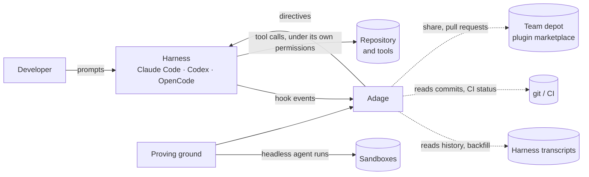
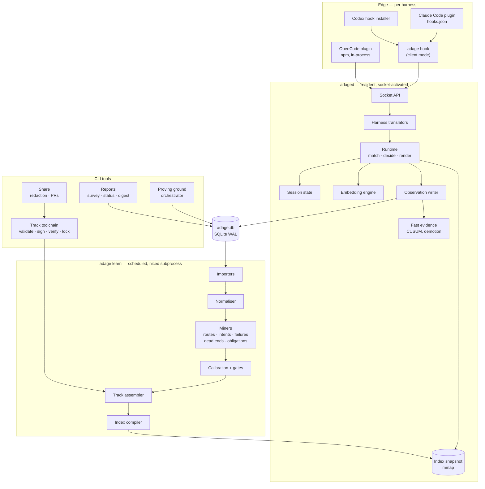
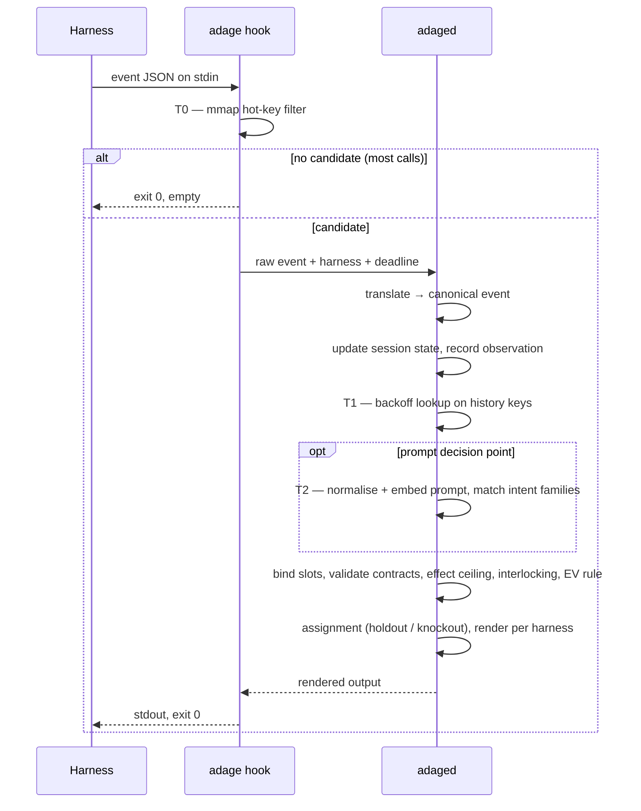
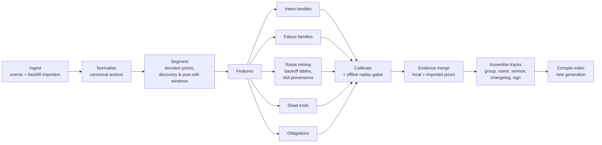
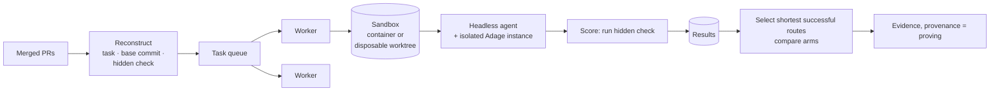

# Adage — Architecture

**Status:** Architecture phase, draft 2 — reviewed; see [§15](#15-review-findings-and-resolutions), which overrides earlier sections where they conflict · **Date:** 2026-09-22 · **Implements:** *Adage — Design Spec*, draft 6

> This document answers *how* Adage is built. It does not revisit *what* Adage does — every
> behaviour here traces to a section of the design spec, cited as **[D§n]**. Architecture decisions
> are numbered **A1…** and collected in [§13](#13-architecture-decisions).

---

## 1. Drivers

### 1.1 Quality attributes, in priority order

| # | Attribute | Requirement | Source |
| --- | --- | --- | --- |
| Q1 | **Fail open** | Any failure yields no directive and no delay; the hook always exits cleanly | D§3.7, D§13.3 |
| Q2 | **Hot-path latency** | No match ≤10 ms p95; structured match ≤15 ms; prompt with intent ≤25 ms — end to end, including process spawn | D§13.2, G6 |
| Q3 | **Determinism** | Same situation + same index generation → same directive, byte for byte | D§3.2 |
| Q4 | **Nothing executes** | No component runs a command, reads a repo file for the agent, or edits anything on the agent's behalf | D§3.1 |
| Q5 | **Local first** | No network listener by default; raw content never leaves the machine; sharing is explicit | D§3.8, D§10.8 |
| Q6 | **Trust** | Every track is verified before it can influence an agent; untrusted text never reaches a directive | D§15 |
| Q7 | **Portability** | Claude Code first; OpenCode and Codex through the same core, differing only at the edges | O8, O14 |
| Q8 | **Low footprint** | Nothing running when no agent is running; bounded memory and CPU when one is | G6 |
| Q9 | **Evolvability** | Harness formats, models, and track schemas change; each is versioned and replaceable independently | D§11, D§13 |

### 1.2 Constraints

- Runs on developer laptops (macOS, Linux) and CI runners. No servers in v1.
- Must install through each harness's supported mechanism: Claude Code plugin, OpenCode npm
  plugin, Codex hook installer (O14).
- Must not require a language runtime the developer doesn't already have.
- Harness hook payloads are the documented interface; transcript formats are unstable and are only
  used for backfill.

---

## 2. System context



Adage has exactly two kinds of output: **directive text** returned to the harness, and **files** — its
own data, tracks, and reports. It has no side effects on the repository, and never acts as the agent.

---

## 3. Components



| Component | Responsibility | Process |
| --- | --- | --- |
| **Edge adapters** | Register hooks in each harness; carry raw events to the core; render nothing themselves | Harness-owned |
| **`adage hook`** | Client mode of the single binary: read stdin, T0 reject, forward over the socket, print the response, exit 0 | Short-lived, per hook call |
| **`adaged`** | The runtime: session state, matching, decisions, rendering, observation logging, fast demotion | Resident while agents run |
| **`adage learn`** | Import, normalise, mine, calibrate, assemble tracks, compile the index | Scheduled subprocess, niced |
| **Track toolchain** | Parse, validate, sign, verify, lock, resolve interlocking | CLI and library |
| **Reports** | Survey, status, weekly digest | CLI |
| **Proving ground** | Reconstruct tasks, run agents in sandboxes, score, emit evidence | CLI orchestrator |
| **Share** | Redaction review, export, team pull requests | CLI |

All Adage-owned components are **one Rust binary** with subcommands (A2). The only other artefacts
are the per-harness adapter files.

---

## 4. Answering the handoff questions

### 4.1 Is a resident daemon needed? — Yes, a small one, socket-activated (A1)

Three things cannot live in a per-call process:

1. **A warm embedding model.** Loading even a small ONNX model takes hundreds of milliseconds; the
   prompt-intent budget is 25 ms.
2. **Session state across hook calls.** Command hooks spawn a fresh process per event, but routes
   depend on what happened earlier in the session: history keys, the carried intent family,
   directives awaiting follow/derail judgement, triggered obligations, stop requests already made.
3. **A single writer** for observations and fast evidence, so concurrent sessions never contend.

But a daemon must not cost anything when no agent runs (Q8). So `adaged` is **socket-activated**:
launchd (macOS) and systemd `--user` (Linux) own the socket and start the daemon on the first
connection. It exits after 30 minutes with no active session. A cold start costs one miss — the first
call after activation returns no directive rather than waiting (Q1).

What the daemon does **not** do: mining, training, clustering, assembly. Those run in `adage learn`,
a separate niced subprocess, so heavy work can never compete with the hot path.

### 4.2 Hook client and delivery per harness (A3)

| Harness | Registration | Transport | T0 reject |
| --- | --- | --- | --- |
| Claude Code | Plugin `hooks/hooks.json`, command hooks → `${CLAUDE_PLUGIN_ROOT}/bin/adage hook claude <event>` | Unix socket | In client |
| Codex | Installer writes `~/.codex/hooks.json` with a stable command path so hash-based trust survives upgrades | Unix socket | In client |
| OpenCode | npm plugin, in-process in the OpenCode server | Unix socket from Bun | In plugin (same index file) |

**Command hooks everywhere in v1**, rather than Claude Code's `http` hooks. `http` hooks remove the
process spawn, but require a TCP listener on localhost, which any local process can reach, and a
bearer token the hook config must reference through environment variables. A Unix socket with
`0600` permissions and peer-credential checks is simpler to secure. A spike measures whether spawn
cost actually threatens the budget; `http` hooks are the optimisation if it does (§12, R2).

**The client is dumb by design.** It reads stdin, extracts only the fields T0 needs, and forwards
the raw payload with the harness name and event. All parsing of native payloads happens in the
daemon's translators, so supporting a new harness version is a daemon update, never a client update.

**Exit discipline**, on every path: always drain stdin; always exit 0; never write to stderr in a
way the harness surfaces to the model; deadline = harness timeout − 500 ms.

### 4.3 The hot path



**Tiering:**

- **T0 (client, ~50 µs).** A memory-mapped binary fuse filter over *(repo key, decision point,
  tool class, template hash)* for every trigger in the active index. A miss exits immediately. The
  filter is part of the index snapshot, so it is always consistent with it.
- **T1 (daemon, <1 ms).** Backoff tables keyed by hashed n-grams of the session's recent templates,
  longest history first.
- **T2 (daemon, ~4–8 ms).** Prompt embedding, only at prompt decision points, only when the repo has
  intent-triggered routes.

### 4.4 Session state

Held in memory by `adaged`, keyed by `{harness}:{session_id}`, with the agent tree for sub-agents:

```rust
struct SessionState {
    key: SessionKey,
    harness: Harness,
    repo: RepoKey,                        // realpath(git root) + hash(normalised origin)
    agents: AgentTree,                    // parent links, agent types, spawn depth
    arm: Arm,                             // holdout or treated, hashed once at first sight
    intent: Option<(IntentFamilyId, f32)>,
    history: Ring<TemplateObs, 16>,       // canonical template + outcome class
    pending: Vec<PendingDirective>,       // awaiting follow/derail judgement
    obligations: Vec<Obligation>,         // finish-line: triggered, met, stop-requested
    directives_emitted: u16,              // per-session cap
    last_seen: Instant,
}
```

Every state change is also written to the observation log, so a daemon restart mid-session rebuilds
state by replaying that session's events. Idle sessions are evicted after 30 minutes.

**Follow and derail detection** runs as observations arrive: a pending directive is *followed* if a
canonically equivalent action appears within its window, *derailed* if a different action does,
and *expired* otherwise. Equivalence uses the normaliser's canonical actions, so `cat a.ts` and
`Read(a.ts)` match.

### 4.5 The index (A4)

The runtime never reads tracks directly. `adage learn` compiles everything the hot path needs into
an **immutable, versioned snapshot**:

```text
index/
├── gen-000142/
│   ├── hotkeys.bin        binary fuse filter for T0
│   ├── routes.bin         compiled routes, backoff tables, calibration, effect ceilings
│   ├── intents.bin        family centroids, per-family thresholds, model id
│   ├── failures.bin       failure-family centroids and thresholds
│   ├── render.bin         directive templates per harness
│   └── MANIFEST           generation, inputs digest, embedding model id, schema version
└── current -> gen-000142
```

- **Zero-copy.** Files are `rkyv` archives, memory-mapped by both the client (for `hotkeys.bin`)
  and the daemon.
- **Atomic swap.** A new generation is written, fsynced, verified, and then `current` is renamed
  into place. The daemon notices the new generation on its next request; in-flight requests finish
  on the old one.
- **Deterministic.** The same inputs produce the same generation bytes. `MANIFEST` records the
  digest of every input, which makes "why did Adage say this?" answerable from the snapshot alone.
- **Scoped.** One index per machine, containing every repo's routes; the repo key is the first
  element of every lookup key, so there is no cross-repo leakage by construction.
- **Fast demotion bypasses rebuilds.** Demotion is urgent; rebuilding is not. `adaged` keeps a small
  in-memory overlay of routes demoted since the snapshot was built (from CUSUM on fast evidence),
  consulted before the snapshot. The next generation absorbs it.

### 4.6 Observations and evidence (A5)

**One database, one writer.** `adage.db` is SQLite in WAL mode. `adaged` is the only writer during
sessions; `adage learn` writes only to its own tables and to new index generations, never to the
observation tables.

| Store | Contents | Writer | Retention |
| --- | --- | --- | --- |
| `events` | Canonical hook events: decision points, tool observations, directives emitted, assignments, propensities | `adaged` | Structured fields 180 days |
| `raw_text` | Prompt text, error heads, tool-output heads — needed to re-mine after a normaliser fix | `adaged` | **14 days**, then deleted |
| `sessions` | Session summaries, outcomes (joined later from git and CI) | `adaged`, `adage learn` | 180 days |
| `evidence` | Per-route sufficient statistics: sessions, days, follows, derails, outcomes, by gauge | `adage learn` | Indefinitely |
| `fast_evidence` | Recent per-route correctness for CUSUM | `adaged` | Rolling |
| `yard` | Installed tracks, versions, digests, signers, state per route | Toolchain | Indefinitely |
| `reviews` | Items waiting in `adage review`, decisions taken | CLI | Indefinitely |

Writes from the hot path go through a bounded in-memory queue drained by a background thread;
under back-pressure, observations are dropped before latency is affected (Q1 beats completeness),
and the drop is counted.

**Evidence is sufficient statistics**, not raw records: Beta counts per route and gauge, CUSUM state,
duration summaries. That keeps it small, mergeable across machines by addition, and safe to share.

### 4.7 The learning pipeline (`adage learn`)

Runs nightly from a launchd/systemd timer, or on demand. Niced, pauses on battery, killable at any
point without harm: every stage writes to new files and commits by rename.



| Stage | Key choices |
| --- | --- |
| **Ingest** | Live events from `adage.db`; importers for backfill (Claude Code JSONL including `subagents/` and `tool-results/`; Codex rollouts; OpenCode SQLite). Importers are versioned, streaming, resumable, and quarantine what they can't parse |
| **Normalise** | tree-sitter-bash; per-command flag grammars; mapping tables per harness version as data; golden fixtures per version (D§11) |
| **Training-data hygiene** | Only untreated sessions, holdout sessions, and treated sessions truncated at their first directive, with inverse-propensity weights (D§11) |
| **Intent families** | Normalise prompts → embed (same model as runtime) → exact cosine kNN + deterministic Louvain over sorted inputs, per repository (S7: HDBSCAN was neither accurate nor order-invariant here) → behavioural purity split/merge → per-family thresholds calibrated on the repository's own prompts (D§8.2.1) |
| **Labels** | Short labels and canonical phrasings written by a language model through the harness's own headless mode, using the developer's existing access; fallback is the family's most central normalised prompt |
| **Route mining** | Variable-length backoff over templates; slot provenance rules; post-edit obligations; dead ends from fail-then-recover patterns |
| **Calibration and gates** | Isotonic calibration per harness and effect class; offline replay on held-out sessions; confidence sequences for promotion (D§10.4) |
| **Assembly** | Group into tracks (D§10.9); diff against the previous version to compute the semver bump and changelog; sign with the machine's local key |
| **Compile** | Build the next index generation; swap atomically |

**Determinism is a pipeline property**: inputs are sorted, every randomised algorithm is seeded, and
every artefact is content-addressed. Running `adage learn` twice on the same inputs changes nothing,
which is what makes automatic assembly idempotent.

### 4.8 Embedding model (A6)

| Choice | Decision |
| --- | --- |
| Model | A small retrieval model in the ~30M-parameter class, 384 dimensions (for example `bge-small-en-v1.5`), exported to ONNX and quantised to int8 |
| Runtime | ONNX Runtime through the `ort` crate, inside `adaged`; one session, intra-op threads capped at 2 |
| Input | Normalised prompt head, ≤128 tokens (D§8.2.1) |
| Latency | ~3–8 ms on a current laptop CPU for ≤128 tokens — to be confirmed by the spike (§12) |
| Distribution | Downloaded on first run, verified by SHA-256, stored under the data directory. Not shipped inside the plugin, to keep the plugin small |
| Pinning | Model id + digest recorded in every index generation; a mismatch disables intent routes until the next `adage learn` re-embeds |
| Fallback | Model missing or cold → intent routes don't fire; structured routes still do (Q1) |

Failure families use the same model in v1. A code-aware model is a later, measured addition.

### 4.9 Track toolchain (A7)

- **Parsing:** `serde` over TOML (manifest) and YAML (routes, intents) (O6). JSON Schemas are
  published for both so editors can validate as people type.
- **Canonical digest:** every file in the track, sorted by path, normalised line endings, hashed.
  Signatures and lockfile entries refer to this digest, never to archive bytes.
- **Signing:** SSH signatures in the same format git uses (`sshsig`), created and verified natively
  through the `ssh-key` crate — no shelling out. Verification uses a `trusted-signers` file in the
  repository or depot, in `allowed_signers` format (O5).
- **Machine keys:** each machine generates a local signing key for auto-built personal tracks. When a
  person shares a track, it is re-signed with their own git signing key.
- **Lockfile:** `.adage/tracks.lock` records name, version, digest, signer, and source per track.
- **Install-time checks:** schema validation; signature against trusted signers; every command
  template re-classified by the normaliser and rejected if its declared effect is lower (D§15.2);
  referenced scripts hashed and pinned; secret scan.
- **Interlocking:** conflicts that are statically detectable (two green steps at the same trigger)
  are resolved when the index is compiled; the remainder at runtime by the precedence rules (D§10.6).

### 4.10 Plugin packaging and pack discovery (A8)

**Adage on Claude Code** is a plugin: `hooks/hooks.json`, the `adage` binary resolved through
`${CLAUDE_PLUGIN_ROOT}`, and a `SessionStart` hook that ensures the daemon's socket unit is
installed on first use.

**Track packs** are plugins too. Each carries its `tracks/` directory and one small `SessionStart`
hook:

```json
{ "hooks": { "SessionStart": [ { "hooks": [ { "type": "command",
  "command": "adage pack register \"${CLAUDE_PLUGIN_ROOT}\"" } ] } ] } }
```

Registration tells `adaged` that this pack is enabled **for this session**, which respects Claude
Code's own per-project enablement without Adage scanning undocumented plugin cache paths. Packs are
verified at registration (digest, signature, trusted signers) and compiled into the index on the
next `adage learn`; until then they are held in the daemon's overlay at probation.

**OpenCode:** Adage is an npm plugin; packs are npm packages or git directories. **Codex:** packs
arrive through git or a depot directory.

### 4.11 Harness abstraction (A9)

The core knows only a canonical model:

```rust
enum DecisionPoint { Prompt, PreTool, Batch, Edit, Stop, SubagentStart, SessionStart, SessionEnd }

struct CanonicalEvent {
    harness: Harness, harness_version: Option<Version>,
    session: SessionKey, agent: AgentRef,        // id, type, parent, depth
    cwd: PathBuf, point: DecisionPoint,
    prompt: Option<String>,
    tools: Vec<ToolObs>,                         // native name, canonical action, outcome, duration
    permission_mode: Option<String>,
    deadline: Duration,
}

enum Output {
    Nothing,
    Context(Vec<Directive>),                     // additionalContext / appended result
    Continue { reason: String },                 // stop-hook request (finish line, D§8.7)
}
```

Each harness contributes exactly two pure functions — **translate** (native payload → canonical
event) and **render** (output → native response) — plus a capability table (does it support
`PostToolBatch`, is context visible to the user, size caps). Translators and capability tables are
versioned data plus code, and both are covered by golden fixtures of real payloads per harness
version. Adding OpenCode is two functions, a capability table, a plugin file, and fixtures.

### 4.12 Proving ground (A10)



- **Reconstruction:** the PR's description becomes the task; the base commit is checked out; the
  hidden check is the tests the PR added or modified, or its CI job. Tasks whose check fails at the
  merge commit are discarded.
- **Isolation:** every run gets a fresh sandbox — a container by default, a disposable worktree as a
  fallback where containers are unavailable. No developer credentials inside; network egress limited
  to the model provider.
- **Agents:** the harness's own headless mode (`claude -p` first). Each run uses a **separate Adage
  instance** with its own data directory and yard, so proving never touches the developer's evidence.
- **Arms:** baseline (no tracks) and candidate tracks, K runs per task per arm, interleaved.
- **Budget:** a token and wall-clock budget per job; runs stop cleanly when it is exhausted; cost is
  reported.
- **Output:** evidence with `provenance = proving`, which enters the yard like any imported prior
  (D§12.2).

The proving ground is a batch tool, not a service. It runs on a developer machine or a CI runner.

### 4.13 Team mode without a server (A11)

v1 has no Adage server. Everything team-related travels through git:

- **Team tracks** live in `.adage/tracks/` or a depot repository.
- **Pull requests** are opened from the developer's machine with their own git and `gh`
  credentials, by `adage share --pr` or the nightly assembler when `auto` policy allows (O12).
- **Pooled evidence** is sufficient statistics, so pooling is addition: each contributor's counts are
  added to the track's `evidence.json` in a pull request, capped per contributor (D§10.5).
- **Trusted signers** is a reviewed file in the repository.

A server, if one is ever needed, would only aggregate what these pull requests already carry.

### 4.14 Experiments (A12)

- **Assignment:** `arm = H(install_salt ‖ session_id) mod 10000` against the configured holdout
  share; route knockouts `H(install_salt ‖ session_id ‖ route_id)`. Deterministic, stateless, and
  reproducible from the log.
- **Exposure logging:** in holdout sessions the runtime still computes the directive it *would*
  have emitted and logs it, then returns nothing.
- **Propensities:** logged with every decision, so off-policy evaluation of new policies is possible.
- **Pilot configuration:** 50/50 (D§14.1); steady state 5–10% plus ~20% per-route knockouts.

### 4.15 Version detection (A13)

- **Harness versions:** read from hook payloads where present, else from the transcript `version`
  field, else from the harness CLI once per day. The capability table is chosen by version range.
- **Unknown shapes:** a payload the translator can't parse produces `Output::Nothing` and a counted
  `unknown_shape` event — never an error surfaced to the harness.
- **Drift alarm:** `adage doctor` and the digest warn when the unknown-shape rate or the
  normaliser's `unknown` rate rises for a harness version, which usually means a format change.

---

## 5. Data model

The canonical records, independent of storage:

```text
Session        key, harness, harness_version, repo, started, ended, arm, outcome_signals
Event          session, seq, ts, point, agent, canonical actions[], outcomes[], directive?
Directive      session, seq, track, route, version, aspect, effect, text_digest, tokens,
               arm, knockout, propensity, would_have (holdout)
Judgement      directive → followed | derailed | expired, at seq
Route          id, track, version, trigger (point, intent?, keys, slots), steps[], exit[],
               state, effect ceiling, last_good_version
Evidence       route, gauge (model, harness range), sessions, days, follows, derails,
               outcome counts, duration summary, CUSUM, provenance
IntentFamily   id, label, phrasings[], centroid, model_id, threshold, purity
FailureFamily  id, label, centroid, model_id, threshold
Track          name, version, digest, signer, source, routes[], intents[], requires, gauge, scope
```

`Event` and `Directive` together are what make every claim reproducible: for any directive, the log
records what the agent had just done, which index generation decided, which arm the session was in,
and what the agent did next.

---

## 6. Interfaces

### 6.1 Client ↔ daemon

A length-prefixed binary protocol over the Unix socket at `$XDG_RUNTIME_DIR/adage/adaged.sock`
(macOS: under `$TMPDIR`), mode `0600`, peer UID checked on every connection.

```text
Request   { protocol: u16, harness, event_name, deadline_ms, raw_payload: bytes }
Response  { output: bytes }       // already rendered for the harness; empty = nothing
```

One request per connection, no streaming, no retries. The client applies its deadline to the whole
exchange; a late response is discarded and the client prints nothing.

### 6.2 OpenCode plugin ↔ daemon

The same protocol from inside the OpenCode server process. The plugin applies its returned text by
appending to the prompt or tool result, as each hook allows.

### 6.3 CLI

| Command | Purpose |
| --- | --- |
| `adage init` | Install the socket unit, register hooks for detected harnesses, download the model |
| `adage survey` | Backfill import and the read-only report |
| `adage learn` | Run the pipeline now |
| `adage status` / `review` / `doctor` | Health, pending approvals, diagnostics |
| `adage share [--pr] [--as-skill]` | Redaction review, export, team pull request |
| `adage add` / `pack register` | Install tracks; register a plugin-shipped pack for a session |
| `adage prove` | Proving-ground jobs |
| `adage off` / `disable` | Kill switches at session, repo, and track level |
| `adage hook <harness> <event>` | Client mode, called by harness hooks only |

### 6.4 Files a user or team edits

| File | Format | Purpose |
| --- | --- | --- |
| `.adage/config.toml` | TOML | Repo policy: enabled, autonomy level, holdout share, green allowlist |
| `.adage/tracks/*/` | TOML + YAML | Team and starter tracks |
| `.adage/tracks.lock` | TOML | Pinned versions and digests |
| `.adage/trusted-signers` | `allowed_signers` | Who may sign tracks for this repo |

---

## 7. Deployment

```text
~/.local/share/adage/                (macOS: ~/Library/Application Support/Adage/)
├── adage.db                         SQLite WAL
├── index/gen-*/, index/current      compiled snapshots
├── yard/                            installed tracks, by digest
├── models/                          embedding model, by digest
├── keys/                            machine signing key (0600)
└── logs/                            daemon and pipeline logs, rotated

Service units
├── adaged.socket + adaged.service   socket activation, idle exit
└── adage-learn.timer                nightly, low priority, on AC power
```

The binary itself lives inside the Claude Code plugin, in the npm package for OpenCode, or at a
stable path written by the Codex installer. `adage init` ensures one copy is registered as the
service binary; version skew between copies is detected by the protocol version.

---

## 8. Security architecture

| Boundary | Control |
| --- | --- |
| Harness → client | Client parses only T0 fields; everything else is forwarded as opaque bytes |
| Client → daemon | Unix socket, `0600`, peer UID check, 1 MB request cap, no network listener |
| Tracks → index | Schema validation, signature against trusted signers, effect re-classification, script pinning — all before compilation |
| Context → directive | Only validated slot values are interpolated into directive templates; free text is never echoed; taint from external content caps a route at yellow (D§15.2) |
| Data at rest | Raw text 14 days; machine key `0600`; share path strips raw content and runs a secret scan |
| Proving ground | Sandboxed runs, no developer credentials, restricted egress, separate Adage instance |
| Supply chain | Reproducible release builds; binaries signed; the plugin pins the binary digest |

The daemon has no code path that spawns a process on the hot path. The only process spawns in the
system are the pipeline's scheduled run, the harness's own headless mode during labelling and
proving, and `git`/`gh` during sharing — all explicit, none triggered by a directive.

---

## 9. Performance budget

| Stage | Budget p95 | Notes |
| --- | --- | --- |
| Harness spawns `adage hook` | 5 ms | Static binary, no runtime to start |
| Client: read stdin, T0 | 1 ms | mmap filter; large tool outputs read but not parsed |
| Socket round trip | 0.5 ms | |
| Translate + session update | 0.5 ms | |
| T1 lookup + decide + render | 1 ms | |
| T2 embed (prompt points only) | 10 ms | Spike to confirm |
| **Total, no match** | **≤10 ms** | Most calls stop at T0 |
| **Total, structured match** | **≤15 ms** | |
| **Total, with intent** | **≤25 ms** | |

**Memory:** daemon ≤150 MB resident with the model loaded; zero when idle-exited. **CPU:** negligible
between events; `adage learn` capped by `nice` and a thread limit.

---

## 10. Observability

- **Local only.** Structured logs, rotated; no telemetry leaves the machine.
- **`adage doctor`:** socket unit present and activatable; hooks registered per harness and matching
  the installed version; index generation current and consistent; model present and pinned;
  unknown-shape and quarantine rates; hot-path latency percentiles; dropped-observation count.
- **Latency histograms** per stage are kept in the daemon and written to the database every few
  minutes, so the performance budget is continuously measured, not asserted.

---

## 11. Research harness

The credibility test (D§16) is an analysis, not a product feature, and needs fast iteration. It runs
in **Python notebooks** over the same data, with one rule: the normaliser is never re-implemented.
The Rust normaliser and feature extraction are exposed to Python through bindings, so research and
product always agree on what a canonical action is. Mining algorithms prototyped in Python are
ported to Rust once they pass the gates.

---

## 12. Risks and spikes

| # | Risk | Spike before implementation |
| --- | --- | --- |
| R1 | Embedding latency on the slowest supported laptop exceeds the T2 budget | Benchmark int8 small models on target hardware; fall back to a static embedding model if needed |
| R2 | Process spawn makes command hooks too slow on macOS | Measure end-to-end hook latency; adopt `http` hooks on Claude Code if p95 exceeds budget |
| R3 | Socket activation behaves differently across launchd/systemd versions | Prototype both units; verify cold-start miss behaviour |
| R4 | Plugin `SessionStart` pack registration timing — packs registered after the first prompt miss that prompt | Measure hook ordering; if needed, persist pack registrations per project |
| R5 | HDBSCAN determinism and scale on hundreds of thousands of prompts | Benchmark on a synthetic corpus of the expected size |
| R6 | Stop-hook semantics differ between harnesses | Verify `Continue` behaviour and loop guards per harness |
| R7 | Harness hook payloads change without notice | Golden fixtures per version in CI; the unknown-shape alarm |

---

## 13. Architecture decisions

| # | Decision | Alternatives considered | Why |
| --- | --- | --- | --- |
| A1 | Small resident daemon, socket-activated, idle-exit | No daemon; always-on daemon | Warm model, session state, single writer — at zero idle cost |
| A2 | One Rust binary for client, daemon, pipeline, and CLI | Bun/TypeScript daemon + Go client; Python | Static binary, no runtime to install, fast start for the client, no GC pauses, native tree-sitter / ONNX / SQLite / SSH signatures |
| A3 | Command hooks + Unix socket everywhere in v1; `http` hooks as a measured optimisation | `http` hooks first | Simpler to secure; uniform across harnesses |
| A4 | Immutable, mmap'd, content-addressed index generations with atomic swap and a demotion overlay | Querying SQLite on the hot path | Latency, determinism, and explainability |
| A5 | SQLite WAL, single writer, sufficient-statistics evidence | Postgres; files | Local-first, no service, mergeable evidence |
| A6 | Small int8 retrieval embedding model in the daemon, downloaded and pinned | Hosted embeddings; static embeddings only | Local, fast, good enough — measured by the intent metrics |
| A7 | Native `sshsig` signing and verification over a canonical digest | Shelling out to `ssh-keygen`; Sigstore | O5, no subprocess, no network |
| A8 | Pack discovery by `SessionStart` registration hook | Scanning plugin caches | Uses documented mechanisms; respects per-project enablement |
| A9 | Canonical event model; per-harness translate/render functions + capability tables | Per-harness runtimes | O8: OpenCode is two functions and fixtures |
| A10 | Proving ground as a batch orchestrator with sandboxed headless runs and isolated Adage instances | A hosted service | No infrastructure; no contamination of personal evidence |
| A11 | Team mode through git and pull requests only | A sync server | No infrastructure; review built in |
| A12 | Stateless hashed assignment with exposure and propensity logging | Stored assignments | Deterministic and reproducible |
| A13 | Capability tables and translators selected by harness version | Assume latest | Harnesses change often |

---

## 14. Handoff to implementation planning

Questions phase 3 must answer:

1. **Order of the spikes** in §12, and what each result changes.
2. **Walking skeleton:** the thinnest end-to-end path — Claude Code hook → client → daemon → a
   hand-written route → directive — before any mining exists.
3. **Where the credibility test runs**, which depends on O9.
4. **Test strategy:** golden fixtures per harness version; replay of recorded sessions through the
   runtime; property tests for determinism; latency regression gates in CI.
5. **Release engineering:** reproducible builds, signing, the plugin, the npm package, the Codex
   installer.
6. **Slices:** which vertical slices deliver the Survey, then the runtime, then automatic tracks,
   then sharing, then the proving ground.

---

## 15. Review findings and resolutions

An adversarial principal-engineer review (2026-09-22) checked this draft against the design spec and
against current harness and crate documentation. Findings are either **accepted** — decided now, and
overriding the earlier sections of this document — or **sent to a spike** in `spikes/`, because the
answer needs measurement. A full rewrite of §§3–13 follows the first wave of spikes.

### 15.1 Facts that changed

| Fact | Consequence |
| --- | --- |
| Claude Code deletes transcripts after **30 days** by default (`cleanupPeriodDays`) | Backfill history is shorter than assumed. Capture must start early, and the credibility test's corpus is at most 30 days deep unless retention is raised on that machine |
| Plugin `bin/` is added to the **agent's Bash PATH**; organisation-distributed plugins may not have a top-level `bin/` | Adage must not ship its binary in `bin/` — the agent could run trust-changing commands |
| `${CLAUDE_PLUGIN_ROOT}` changes on every plugin update | Service units and long-lived paths must never point into the plugin directory |
| Codex Stop `block` turns the reason into a **new user prompt** | Violates W3 (never claim the user asked) unless worded and gated carefully |
| OpenCode prompt-hook edits **persist as user input** | Directives must use the `context` hook instead |
| Claude Code docs warn that imperative out-of-band text can trigger **prompt-injection defences** | The green-directive wording must be tested, not assumed |
| `SubagentStart` carries agent id and type, **not the task description** | The delegation description must be joined from the `Agent` tool call |
| `ssh-key` crate has **no ssh-agent support** | Signing with agent-held, FIDO, or 1Password keys needs another path |
| The Rust `hdbscan` crate uses a kd-tree only, which degrades at 384 dimensions | Clustering at scale needs a different approach |

### 15.2 Accepted now

| # | Finding | Resolution |
| --- | --- | --- |
| F1 | **Client-side T0 filtering throws away the observation stream**, biasing history, follow/derail, obligations, familiar-command counts, and holdout exposure | **Separate observe from decide.** Every event is *observed* without blocking (async hooks on Claude Code; an append-only per-session spool elsewhere). Directives are *decided* synchronously only at `UserPromptSubmit`, `PostToolBatch` (or `PostToolUse` where batches don't exist), `SubagentStart`, and `Stop`. T0 remains only as a fast path for decisions, never for observation. `PreToolUse` is registered only for the `Agent` tool, to capture delegation descriptions |
| F2 | Client deadline of "harness timeout − 500 ms" contradicts the latency budget | Hard per-event deadlines (≈8 / 13 / 23 ms), non-blocking connect; structured routes answered before any model is loaded; pre-warm at `SessionStart`. The first prompt must not be a guaranteed miss |
| F3 | Delivery semantics differ by harness | A **delivery channel** per harness and decision point in the capability table: Claude Code `additionalContext` (including at Stop, preferred over `block`); OpenCode `context` hook; Codex Stop only when `stop_hook_active` is false and with wording that plainly isn't from the user. Wording itself → spike S4 |
| F4 | Plugin packaging is fragile and exposes the binary to the agent | No top-level `bin/`. An exec-form shim in `scripts/` installs a signature-verified binary, named by digest, into the plugin data directory, and runs that. → verified in spike S5 |
| F5 | Pack registration can't find `adage`, is lost at idle exit, and misses T0 | The Adage plugin's own `SessionStart` enumerates enabled plugins through documented means and persists registrations per project. → spike S5 |
| F6 | "Single writer" SQLite is false | **One database file per writer** (runtime events, learning, yard), read-only `ATTACH` across them. Directive, exposure, and judgement rows are never dropped under back-pressure; only raw text may be |
| F7 | Session identity and ordering | Order observations by batch (`PostToolBatch`, or turn and tool-use ids); hash the experiment arm on the **root session lineage** so `/clear` and forks keep their arm; subscribe to model-switch events; persist session state, obligations, and the demotion overlay across restarts |
| F8 | Determinism is overclaimed | Scope the claim to one index generation, one model digest, and one execution provider. Single-threaded deterministic inference; threshold hysteresis; labels cached by content hash; an as-of time in `MANIFEST` |
| F9 | Trust anchors can be subverted by a hostile repository | **Trust-on-first-use approval of each repository's `trusted-signers`, pinned by hash and origin**, like Codex hook trust. The machine key is never valid in a team signer file. **Exit conditions become typed predicates rendered from fixed templates**, not free text from a track — a design-spec change to D§9 and D§10.3 |
| F10 | Adage starts unbounded processes | Labelling runs with tools and hooks disabled, in an isolated config directory, and those sessions are excluded from mining. The proving ground has **no worktree fallback** — containers only. Automatic team pull requests are **prepared** automatically but pushed only after local approval in `adage review` — a design-spec change to D§10.9 |
| F11 | The agent can run `adage` | Commands that change trust or publish refuse to run inside an agent session (detected by harness environment variables) or without a terminal |
| F12 | `<signal source="adage">` can be spoofed by any README or web page | A per-session nonce, announced at `SessionStart`, included in every genuine directive |
| F13 | Model download integrity | The embedding model's digest is compiled into the signed binary |
| F14 | Missing components | Named, persisted components for: **stop-hook bounds** (once per obligation, respecting the harness's own block cap); **familiar-command computation** (excluding steered runs); **change pacing**; **human-edit detection** (`authored`); **last-good-version storage**; **the three-demotion blacklist**; **script-pin checks at runtime**; **a taint lattice** on observations (lookup-script output is external content); **the static-guidance arm** and developer stratification; **`suggest`-mode gating**, the status line, and `/adage off` detection; the **skill-trigger step type** (O15) |

### 15.3 Sent to spikes

| Question | Spike | Decision it settles |
| --- | --- | --- |
| Can process spawn plus socket round trip meet the budget on macOS, and does `http` hook transport matter? | S1 | A2, A3 |
| Are static embeddings good enough for intent families, and what do transformer embeddings cost to load and run? | S2 | A6, and whether A1 needs a daemon at all |
| Can per-session state files with `flock` and append-only spools replace a daemon's memory correctly under concurrency? | S3 | A1, A5 |
| Which directive wordings are followed, and which trip Claude's injection defences? Does Stop `additionalContext` work as a finish-line nudge? | S4 | D§9 wording rules, F3 |
| How do plugin roots, data directories, `SessionStart` ordering, async hooks, and plugin enumeration actually behave? | S5 | A8, F4, F5 |
| Can tracks be signed with keys held in ssh-agent and verified natively against `allowed_signers` with a namespace? | S6 | A7 |
| Which clustering method is deterministic and scales to hundreds of thousands of prompts? | S7 (wave 2) | Intent pipeline |
| How far does tree-sitter-bash plus per-command grammars get on real transcripts? | S8 (wave 2) | Normaliser |

### 15.4 Ratings after review

| Decision | Rating | Note |
| --- | --- | --- |
| A1 Daemon | **Pending S2, S3** | Candidate replacement: daemonless with per-session state files, or a client-spawned daemon (no launchd/systemd), pre-warmed at `SessionStart` |
| A2 Rust | Keep | Separate small hook-client binary in the same workspace |
| A3 Transport | **Changed** (F1) + pending S1 | |
| A4 Index | Changed | Client filter via a checksummed binary fuse filter, not `rkyv`; client passes its generation; overlay persisted |
| A5 Storage | **Changed** (F6) | |
| A6 Embeddings | **Pending S2** | |
| A7 Signing | Changed + pending S6 | Agent-held keys |
| A8 Packs | **Changed** (F5) + pending S5 | |
| A9 Harness layer | Keep | Add delivery channels and session-identity rules (F3, F7) |
| A10 Proving ground | Changed (F10) | Containers only; isolated config; PR text is untrusted |
| A11 Team mode | Keep | Pull requests gated by local approval (F10) |
| A12 Experiments | Keep | Root-lineage hashing, developer stratification (F7, F14) |
| A13 Versions | Keep | |
