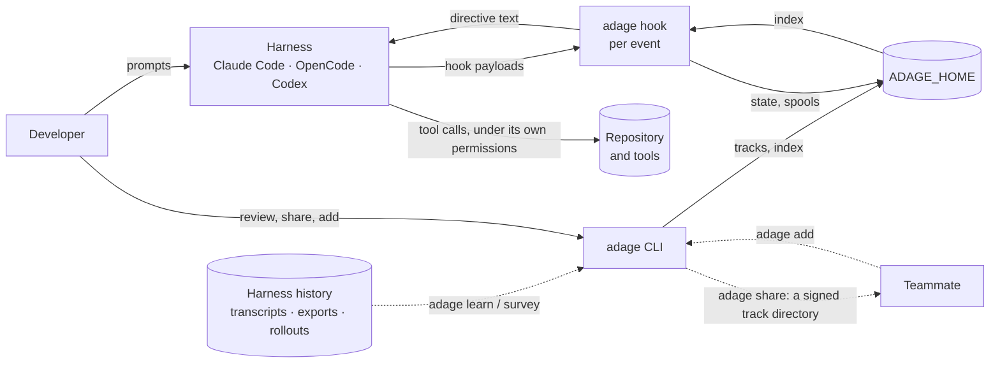
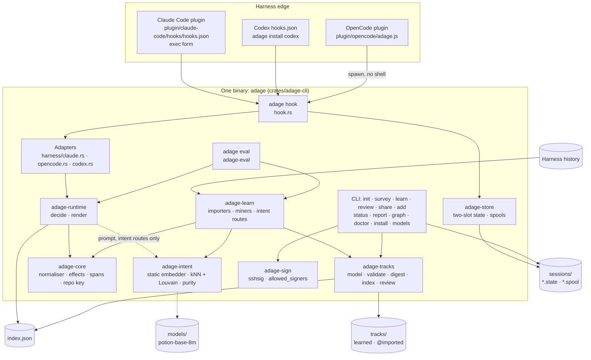
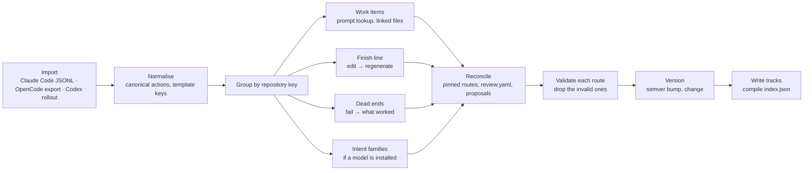

# Adage — Architecture

**Status:** Draft 3, as built. It describes `main` at `cf5cf16`, not a plan · **Date:** 2026-09-23 ·
**Implements:** *Adage — Design Spec*, draft 6 · **Plan:** *Adage — Implementation Plan*, draft 3

> This document answers *how* Adage is built today. Draft 2 was written before any code, and the
> spikes (`spikes/S1`–`S8`) overturned several of its decisions, starting with the daemon. Draft 3
> keeps draft 2's section numbers, because code comments cite them (`§4.7`, `§4.9`, `§4.11`,
> `§6.3`, `§15`, `A12`, `F9`). Design behaviour is cited as **[D§n]**, and plan sections as
> **[P§n]**. Mechanisms cite the file that implements them. Anything designed but not built is
> marked **not built** and collected in [§14](#14-designed-but-not-built). What changed since
> draft 2, and why, is in [§16](#16-changes-from-draft-2).

---

## 1. Drivers

### 1.1 Quality attributes, and how the build meets them

| # | Attribute | Requirement | As built |
| --- | --- | --- | --- |
| Q1 | **Fail open** | Any failure yields no directive and no delay; the hook always exits cleanly | Every error path in `adage hook` returns nothing and exits 0. Panics are caught, and their messages silenced (`crates/adage-cli/src/main.rs`, `hook.rs`). Gaps: a payload over 8 MiB is not drained, and nothing records fail-open incidents yet ([§14](#14-designed-but-not-built)) |
| Q2 | **Hot-path latency** | p95 ≤ 10 ms with no match, ≤ 15 ms for a structured match, ≤ 25 ms with prompt intent, end to end, spawn included [D§13.2] | Measured at 1.76 / 3.18 / 6.39 ms p95 ([§9](#9-performance-budget)) |
| Q3 | **Determinism** | Same situation and same index generation give the same directive, byte for byte | The runtime is a pure function of index, state and event (`crates/adage-runtime/src/lib.rs`). The index is content-addressed. Learning reproduces the live demo index byte for byte ([§11](#11-evals-and-the-harness-simulator)) |
| Q4a | **`adage` spawns nothing** | The `adage` binary and its hooks run no command, read no repo file for the agent, and edit nothing | The runtime has no process spawns. It checks only that bound repository paths exist. Directives are text. CI greps the adage crates (`crates/adage-exec/tests/no_spawn.rs`; the listed exceptions start Adage itself or serve a person at a terminal) |
| Q4b | **`adage-exec` runs only approved, sandboxed routes** | The optional executing binary runs a route only with a matching per-machine approval (every key field, the L-ref script hash re-read at execution), under an enforced OS sandbox, and returns typed, fenced data; any failure delivers E0 exactly | `crates/adage-exec` (`run.rs` gates, `sandbox/`, `hook.rs` for E1 prefetch); the L0-sec escape suite; the golden parity test (`tests/parity.rs`) pins `adage-exec hook` to `adage hook` with nothing approved ([execution](execution.md)) |
| Q5 | **Local first** | No network listener by default; raw content never leaves the machine; sharing is explicit | No listener unless `adage graph --serve` is run, and then only on 127.0.0.1. No telemetry. Spools hold decisions and canonical keys, not prompt text |
| Q6 | **Trust** | Every track is verified before it can influence an agent; untrusted text never reaches a directive | Tracks are validated on every read. Imports need a signature from a trusted signer. Directive text comes only from fixed templates ([§8](#8-security-architecture)) |
| Q7 | **Portability** | Claude Code first; OpenCode and Codex through the same core | Three adapters over one event type ([§4.11](#411-harness-abstraction-a9)). Claude Code runs live; OpenCode and Codex are verified only in simulation. Runs on macOS, Linux and Windows |
| Q8 | **Low footprint** | Nothing running when no agent is running | Nothing resident at all: each hook is a short-lived process |
| Q9 | **Evolvability** | Harness formats, models and track schemas change independently | Command grammar as data (`crates/adage-core/data/commands.toml`), one adapter per harness, the model pinned by digest, tracks versioned by semver |

### 1.2 Constraints

- Runs on developer machines (macOS, Linux, Windows) and CI runners. There are no servers.
- Installs through each harness's own mechanism: a Claude Code plugin, an OpenCode plugin file,
  and Codex `hooks.json` [O14].
- Needs no language runtime on the hook path. Node is used only by the npm launcher (not on the
  hook path) and by OpenCode, which already runs on it.
- Harness hook payloads are the live interface. On-disk histories are read only by `adage learn`
  and `adage survey`. Their formats are undocumented for OpenCode and Codex (docs/harnesses.md).

---

## 2. System context



Adage has two kinds of output: **directive text** returned to the harness, and **files** in its
data directory (`ADAGE_HOME`) and in shared track directories. It has no side effects on the
repository. Sharing is a directory copied by hand. Team depots and pull requests are not built
([§4.13](#413-team-mode-a11)).

---

## 3. Components



| Crate | Responsibility | Key files |
| --- | --- | --- |
| `adage-core` | Canonical actions, the shell normaliser (tree-sitter-bash and a command table as data), effect classes, typed spans, repository identity | `src/shell.rs`, `data/commands.toml`, `src/tools.rs`, `src/spans.rs`, `src/repo.rs` |
| `adage-store` | Per-session two-slot state files and append-only spools; the data-directory layout | `src/state.rs`, `src/spool.rs`, `src/lib.rs` |
| `adage-tracks` | The track and route model, validation (tracks are untrusted input), the canonical digest, the compiled index, review decisions and proposals | `src/model.rs`, `src/io.rs`, `src/index.rs`, `src/review.rs`, `src/proposals.rs` |
| `adage-sign` | Native sshsig signing (ssh-agent first, key file second) and `allowed_signers` verification | `src/lib.rs`, `src/allowed_signers.rs` |
| `adage-intent` | Prompt normalisation, the static embedding model, exact kNN + deterministic Louvain, the behavioural split/merge | `src/model.rs`, `src/cluster.rs`, `src/purity.rs` |
| `adage-instincts` | Instincts: prebuilt routes bound per repository from its declared files (Makefile, package.json, lockfiles, …), with no session history | `data/catalogue.toml`, `src/declared.rs`, `src/detect.rs`, `src/bind.rs` |
| `adage-learn` | Importers (Claude Code, OpenCode export, Codex rollouts), miners, intent routes, instinct binding, versioning | `src/lib.rs`, `src/mine.rs`, `src/intent.rs`, `src/import.rs`, `src/instincts.rs`, `src/opencode.rs`, `src/codex.rs` |
| `adage-runtime` | Hook-time decisions, fixed-template rendering, holdout assignment, follow/derail judgement | `src/lib.rs`, `src/render.rs` |
| `adage-cli` | The `adage` binary: the hook client, harness adapters, every command | `src/main.rs`, `src/hook.rs`, `src/harness/` |
| `adage-eval` | Offline replay eval, datasets, the safety oracle, regression gates, property tests | `src/`, `tests/gates.rs`, `tests/prop_*.rs` |
| `adage-sim` | The harness simulator: one scenario rendered in each harness's native history and hook formats | `src/`, `sim/fixtures/` |

Everything Adage-owned is **one Rust binary** (A2). The only other artefacts are the harness
edge files: the Claude Code plugin with its install shim, the OpenCode bridge plugin, and the npm
launcher ([§7](#7-deployment-and-distribution)).

---

## 4. How it works

### 4.1 No daemon (A1)

Draft 2 argued for a socket-activated daemon, for three reasons: a warm embedding model, session
state across hook calls, and a single writer. The spikes removed each one:

| Draft 2's reason | What replaced it | Evidence |
| --- | --- | --- |
| A warm embedding model | A static model (potion-base-8M) opened in every hook process that needs it | S2: 17 ms cold load in Rust. S7 addendum: the intent hook is 6.39 ms p95 end to end with the model opened per process |
| Session state across hook calls | A per-session two-slot state file under `flock` | S3: 0.54 ms p95 to decide at 16 concurrent sessions, which matches a daemon round trip (0.50 ms) |
| A single writer | Each hook appends its own records to a per-session spool; there is no database | S3: no loss, duplication or tearing under concurrent writers and `kill -9` |

So every hook is a process that the harness spawns, which reads its payload, decides, writes, and
exits. There is no socket, service unit or idle timer. The one process that outlives a hook is a
short-lived learner that a `Stop` hook may start for its repository, which exits when it has
learned ([§4.7.2](#472-live-learning)).

### 4.2 Hook registration per harness (A3)

| Harness | Registration | Invocation | Events Adage registers | Source |
| --- | --- | --- | --- | --- |
| Claude Code | Plugin `hooks/hooks.json`, or `adage install claude-code` into settings | **Exec form** (`command` + `args`): no shell | `SessionStart`, `UserPromptSubmit`, `PostToolBatch`, `PostToolUseFailure`, `Stop`, `SessionEnd` | `plugin/claude-code/hooks/hooks.json`, `crates/adage-hook/src/harness/claude.rs` (`settings`) |
| Codex | `adage install codex` into `.codex/hooks.json` or `$CODEX_HOME/hooks.json` | Shell string with the binary path quoted; Codex has no exec form | `SessionStart`, `UserPromptSubmit`, `PostToolUse`, `Stop`, `SessionEnd` | `crates/adage-hook/src/harness/codex.rs` (`settings`, `sh_quote`) |
| OpenCode | `adage install opencode` writes the plugin to `.opencode/plugins/adage.js`, with the binary's absolute path embedded | The in-process plugin spawns `adage hook opencode <event>` with no shell and a 1 s timeout | `chat.message`, `tool.execute.after`, and on `event`: `session.created`, `message.part.updated` (tool errors), `session.idle`, `session.deleted` | `plugin/opencode/adage.js`, `crates/adage-hook/src/harness/opencode.rs` |

**Exec form matters.** On Claude Code, a shell-form hook costs 10.4 ms p95 against 2.2 ms for exec
form (S1). The plugin always uses exec form. Codex offers only shell strings.

**Decide at the synchronous hooks only.** Claude Code's `PostToolBatch` payload carries every call
and response in the batch (S5 Q5), so the decision hook sees the whole batch. No asynchronous
observation hooks are registered. S5 Q6 found that an async hook fired near session end can be cut
off. `PreToolUse` and `SubagentStart` are not registered ([§14](#14-designed-but-not-built)).

### 4.3 The hot path

```mermaid
sequenceDiagram
  participant H as Harness
  participant A as adage hook (exec form)
  participant D as ADAGE_HOME
  H->>A: spawn with payload on stdin
  A->>A: silence panics, 8 MiB stack, catch_unwind
  A->>A: read ≤ 8 MiB, parse JSON, session_id + cwd
  alt ADAGE_DISABLE=1, .adage/disabled, unknown harness or bad payload
    A-->>H: exit 0, no output
  else
    A->>D: read index.json
    alt no routes for this repository key (the common path)
      A-->>H: exit 0, no output
    else
      A->>A: adapter.translate → Event
      opt the event cannot change a decision (precomputed triggers; may read the state)
        A-->>H: exit 0, no output, nothing written
      end
      A->>D: lock the session's .state file, read the newest valid slot
      A->>A: assign arm on first sight, then decide()
      opt Prompt, and the repository has intent routes
        A->>D: open models/potion-base-8m, embed the normalised prompt
      end
      A->>D: write the older slot, unlock
      A->>D: append the decision record to the session's .spool file
      A->>A: wrap each directive, cap to the harness limit, render the native shape
      A-->>H: stdout JSON, exit 0
    end
  end
```

The steps are in `crates/adage-hook/src/lib.rs`, and the harness-independent core never sees a
native payload. Three shortcuts keep the common path cheap:

- **Repository check.** If the index holds no route for this repository, the hook exits before
  translating anything. Measured at 1.76 ms p95 (S7 addendum). Draft 2's client-side fuse filter
  (T0) was not built.
- **No-match fast path** (Design §13.2). `Index::compile` stores, per repository, what can make
  its routes act (`adage_tracks::triggers::Triggers`: prompt span kinds, intent routes, dead ends
  still to announce, words a matching command must contain, finish-line globs).
  `adage_runtime::fast::skip` rejects an event before the command table, the state lock and the
  spool when it cannot change any decision: session start and end always; a prompt with no
  bindable span, no intent routes and no dead end to announce; a batch or failure with no call
  containing a trigger word or every literal piece of a finish-line glob, while the session has
  no pending judgement or obligation; a stop with no obligation left to request. Runs of a dead
  end's avoided commands are words too, so `adage graph` still counts them; other skipped events
  leave no spool record. The eval replay checks every event of every dataset against the full
  path (`fast_path_changes_no_decision`). A no-match batch costs what a repository without routes
  does: 1.9 ms p50, from 2.8 ms.
- **Lazy model.** The model is opened only at a prompt, and only if the repository has intent
  routes (`embed` closure in `hook.rs`, `match_intent` in `adage-runtime`).

**Exit discipline.** The panic hook is replaced with a silent one, so nothing reaches stderr. The
work runs on a thread with an 8 MiB stack on every platform. It is wrapped in `catch_unwind`, and
the process always exits 0. Hook timeouts in the harness configuration are 5 s (10 s for the
plugin's `SessionStart` shim, 2 s for Codex `SessionEnd`), and are a backstop rather than a
budget. There is no internal per-event deadline.

#### 4.3.1 Matching commands, and interlocking

**One command-pattern algebra** (`crates/adage-core/src/pattern.rs`) decides when an observed
command is "the same command" as a directed one, everywhere: the follow judgement, a finish-line
obligation being met, after-command and after-failure triggers, `adage graph`, interlocking, and
the eval scorer (`score.rs`, `conventions.rs`). A command reads as a *shape*: its program, its
identity (the program and the subcommand it multiplexes to, from a data table: `npm`/`pnpm`/
`yarn`/`bun run <script>`, `make <target>`, `cargo`/`go`/`git`/`just`/`task <sub>`,
`python -m <module>`, `uv`/`poetry run <cmd>`, `npx <tool>`, `docker compose <sub>`,
`gh <group> <sub>`, interpreter flag modes such as `node --test`; an interpreter running a script
is the script), its positionals, and its options. Patterns come at three levels, narrow to broad:

| Level | Matches when | Used for |
| --- | --- | --- |
| Exact | same identity and positionals, and at least the pattern's options | directed commands |
| HeadSub | same identity | a dead end's avoided runner |
| Head | same program | a bare interpreter as a runner |

So a directed D is met by an observed O when O's key equals D's or O adds only options:
`make gen -j4` meets `make gen`, `./scripts/wi-lookup W-1 --json` meets
`python3 scripts/wi-lookup W-1`; `npm run build` does not meet `npm run check`, nor `make test`
`make gen`, nor `pytest tests/a.py` `pytest`. The fast path's trigger words are unchanged: every
command that meets a trigger contains its word.

**Interlocking** (Design §10.6; `crates/adage-tracks/src/interlock.rs`). `Index::compile`
computes a conflict matrix per repository, and `Index::compile_with_conflicts` returns the
conflicts (`adage learn` and `adage doctor` print the count):

- *Polarity.* A dead end (red) that avoids a command another route directs: red beats green,
  whatever the provenance. A directing route that speaks at the prompt, beside a dead end
  announced at the first prompt, is left out of the index; any other is filtered at runtime.
- *Two greens* at one decision point (the same trigger kind, overlapping triggers) directing
  different commands: one stays green, the other is compiled yellow. Learned beats imported or
  authored, then more support, then a higher lower bound.

At runtime `decide` chooses the dead ends to announce first, so the caps never crowd a warning
out (they are still rendered last), and applies **approach locking** after selection: no
directive is emitted that a red directive already emitted in the session, or emitted in the same
decision, avoids; a dropped directive leaves no pending judgement and no obligation. The eval's
safety oracle checks both invariants over every session (`safety::check_interlock`).

**Failure attribution.** A transcript records one result per tool call. When a call with several
sub-actions fails, the learners and the eval attribute the failure to its last sub-action only
(`keys::sub_action_failed`), unless the command has an `||`, where every operand ran and failed.

### 4.4 Session state and spools

Both live in `$ADAGE_HOME/sessions/`, named by the sanitised session id (`adage-store/src/lib.rs`,
`sanitise`: ids that had to be altered get a hash suffix, so no id escapes the directory or
collides with another).

**State: `<session>.state`** (`crates/adage-store/src/state.rs`). Two fixed 64 KiB slots, each
`magic | seq | len | crc | payload`. A write goes to the older slot in one positional write, under
an exclusive lock (`File::lock`: `flock` on Unix, `LockFileEx` on Windows), with no `fsync`. The
reader takes the newest slot whose CRC is valid. The CRC covers the sequence number and length as
well as the payload: covering only the payload let a torn write resurrect a state two writes old
(eval bug 8). If both slots are invalid, or the newest payload no longer parses, the state is
rebuilt from the session's spool (below); with no spool, or one over 4 MiB, it starts again from
its default.

The state (`SessionState` in `adage-runtime`) holds:

| Field | Purpose |
| --- | --- |
| `arm`, `repo` | Experiment arm and repository key, fixed at first sight |
| `prompts`, `batches`, `first_edit_at_batch` | Counters |
| `emitted` | Route ids already delivered (a route fires once per session) |
| `pending` | Directives awaiting follow/derail judgement, with the expected key (met as in [§4.3.1](#431-matching-commands-and-interlocking)), its identity and batches left |
| `obligations` | Finish-line obligations: route, expected key, command, glob, `met`, `stop_requested` |
| `history` | The last 32 canonical template keys |
| `stop_requests` | Stop-hook requests made this session |
| `intent` | The intent family the latest prompt matched |

**Spool: `<session>.spool`** (`crates/adage-store/src/spool.rs`). Append-only records, each
`magic | len | crc | JSON`, written with one `O_APPEND` write (records up to 1 MiB). A reader
resynchronises on the next magic after a torn or corrupt frame, so a crash costs at most one
record. Each hook appends one record:

```text
{ ts, event, kind, arm, repo, generation, harness?, decision: {
    directives, would_have, continue_reason?, would_continue?, judgements, observed } }
```

`observed` holds canonical template keys, not raw commands, and no prompt text is recorded.
`kind` (the runtime event) and `repo` were added for rebuilds; older records are read by their
harness event name.

**Deviation from S3.** S3 recommended treating the state as a cache over the spool: fold spool
records newer than a watermark, and rebuild on a CRC failure. Only the rebuild is built. The state
is authoritative for the session while it can be read, and the spool is an audit log read by
`report`, `graph`, `review` and `doctor`. When the state cannot be read, the hook replays the
spool's recorded decisions under the state lock (`adage_runtime::rebuild`, at most 4 MiB and
10,000 records): arm, repository, counters, emitted routes, history, finish-line obligations
(from the index) and stop requests. An in-flight follow judgement is dropped, and an obligation
re-armed by an edit after it was met stays met, since the spool keeps call keys, not paths: a
rebuilt session can miss a stop request, never make an extra one.

### 4.5 The index (A4)

The runtime never reads track directories. `adage learn`, `adage add` and every `adage review`
decision compile all installed tracks into **one file**, `$ADAGE_HOME/index.json`
(`crates/adage-tracks/src/index.rs`):

- **Content-addressed.** `generation` is the first 16 hex digits of the SHA-256 of the serialised
  routes. The same tracks give the same bytes. Every spool record carries the generation that
  decided.
- **Atomic.** Written to a temporary file and renamed into place. A hook reads either the old
  index or the new one.
- **Fail open.** A missing or unreadable index loads as empty (`Index::load`).
- **Scoped by repository key.** Every route carries the key of its repository, and the runtime
  filters on it (`for_repo`). The key is the normalised `origin` URL, or, when there is no
  `origin`, `<directory name>@<root commit>` (`crates/adage-core/src/repo.rs`). The root commit
  is read from the object store without running git (`gitobj.rs`: loose objects, v2 packs with
  deltas, packed refs, linked worktrees), and remembered per path under
  `$ADAGE_HOME/repo-keys` so a long history is walked once (by `adage learn`, usually). Where it
  cannot be read (no commits, SHA-256, shallow, alternates), the key is `<name>@path-<hash of
  the root's path>`. Clones and copies share routes; unrelated repositories with one name do
  not. A bare directory-name key (from before) is still honoured until a repository of that name
  is re-keyed (`repo::lookup_key`).
- **Live routes only.** `active`, `probation` and `stale` routes are compiled (the last two never delivered green). When a learned route and an
  imported one share an id, the learned one wins. A learned route a person retired still
  suppresses an import of the same id.

There are no memory-mapped generations and no demotion overlay. Reading JSON meets the budget
([§9](#9-performance-budget)).

### 4.6 Observations and evidence (A5)

There is **no database**. Draft 2's SQLite stores, and review finding F6 (one database per
writer), are replaced as follows:

| Draft 2 store | As built |
| --- | --- |
| `events`, `raw_text` | Session spools (decisions and canonical keys only). Learning reads the harness's own history instead of Adage's events |
| `sessions` | Not kept. Outcomes enter learning through `adage learn --outcomes <json>` (session id → success) |
| `evidence` | Stored in each route (`Evidence` in `crates/adage-tracks/src/model.rs`), counted in distinct sessions and recomputed on every learn |
| `fast_evidence` | Not built. Derails are surfaced in `adage review` ([§4.16](#416-review)) |
| `yard` | The tracks directory, with imports under `tracks/@imported/` |
| `reviews` | `review.yaml` and `proposals.yaml` in each track directory |

A route's evidence records opportunities, support, distinct days, successes, deviations that
failed, the support rate, its Wilson 95% lower bound, the median position of the step, estimated
turns saved, provenance and models. Aspects are set from it (`aspect_for` in
`crates/adage-learn/src/mine.rs`), and capped by the effect ceiling:

| Threshold | Default | `--demo` |
| --- | ---: | ---: |
| Minimum distinct supporting sessions | 5 | 3 |
| Wilson lower bound for green | 0.8 | 0.5 |
| Support rate for yellow | 0.5 | 0.5 |
| Rate that keeps an existing route (hysteresis) | 0.3 | 0.3 |

### 4.7 The learning pipeline (`adage learn`)

`adage learn` runs on demand, and automatically when sessions stop or end
([§4.7.2](#472-live-learning)). The nightly timer in draft 2 was not built. It is deterministic
and idempotent: inputs are sorted, clustering is seeded by canonical order, and a second run over
the same history reports "unchanged" (`crates/adage-learn/src/lib.rs`).



| Stage | As built |
| --- | --- |
| **Import** | Through the parse cache (below). Found by content (`read_session`). Claude Code transcripts from `~/.claude/projects` by default (sidechain records skipped). `opencode export` files via `--transcripts` (sub-agent sessions skipped). Codex rollouts via `--codex-sessions` (sub-agent threads and compressed `.zst` rollouts skipped). `--cwd-prefix` filters by recorded working directory |
| **Normalise** | tree-sitter-bash plus the command table ([§4.7.1](#471-the-normaliser)); native tools mapped per harness (`crates/adage-core/src/tools.rs`) |
| **Training hygiene** | A session steered by Adage is recognised from the directives in its transcript, and each miner excludes the sessions whose directives could influence it (`Session::steered_by`, `import::steers`): its own kind, the intent miner also for dead ends, and every miner for a directive of kind `other` or unknown. The kind is read from the wrapper (`kind="…"`), or from the route id in old transcripts. A route learning no longer finds because it steered its own evidence away is kept `stale` ([§4.6](#46-observations-and-evidence-a5); `adage_learn::stale`). Draft 2's truncation with inverse-propensity weights was not built; propensities are now logged for it |
| **Miners** | Four kinds per repository (`crates/adage-learn/src/mine.rs`, `intent.rs`), each a track named `<repo>/<kind>` |
| **Reconcile** | Routes a person pinned (`authored`) are kept, and a materially different mined version becomes a proposal. Decisions in `review.yaml` are re-applied |
| **Validate** | Every mined route is validated alone. One that fails is dropped with a message, rather than failing the repository (eval bug 1) |
| **Version** | Shape changed or removed → major; added → minor; evidence only → patch; nothing → unchanged |
| **Compile** | All tracks re-read, validated, interlocked ([§4.3.1](#431-matching-commands-and-interlocking)), compiled, and written atomically |

| Track | Trigger → step | Aspect ceiling |
| --- | --- | --- |
| `work-items` | A prompt naming a work item → run the lookup, with the ID bound (`lookup-work-item`); that lookup succeeding → read the files it lists, together (`read-linked-files`) | Lookup: green if its effect allows; files: yellow |
| `finish-line` | An edit matching a glob → run the regenerate step; a bounded stop request if it is skipped | Green (regenerate after an edit) |
| `dead-ends` | Announced at the first prompt → avoid these runners, which fail with this signature, and use this instead | Red |
| `intents` | A prompt in an intent family → run the command those sessions ran first | Green only for observe or verify |

#### 4.7.1 The normaliser

`crates/adage-core/src/shell.rs` walks the tree-sitter-bash syntax tree. It unwraps `bash -lc`,
tracks `cd`, splits `&&`/`||`/`;` sequences, keeps pipelines with pure-filter tails read-only, and
parses compound constructs, redirects and heredocs. Flag grammars and effect classes are data in
`crates/adage-core/data/commands.toml`, embedded at build time and parsed at run time. Unknown
commands default to the `environment` effect. S8 measured 98.2% of real calls normalised and
~32,000 calls/s, and its 315 golden fixtures run in `cargo test`. The normaliser's bounds are
security controls ([§8](#8-security-architecture)).

#### 4.7.2 Live learning

Learning runs by itself, per repository, seconds after sessions stop, without a daemon or a timer
(`crates/adage-cli/src/autolearn.rs`; the file contract for tools that watch it is
[docs/live-learning.md](live-learning.md)).

```mermaid
sequenceDiagram
  participant H as adage hook (Stop / SessionEnd)
  participant Q as learn-queue/<repo>
  participant L as adage learn --auto (detached)
  participant D as tracks, index, learn.log
  H->>H: decide and render as always
  H->>Q: write the request marker
  alt a learner holds <repo>.lock, or one is scheduled
    H-->>H: done (the learner re-checks the marker)
  else
    H->>L: spawn detached, stdio null (--after <ms> if inside the interval)
  end
  L->>Q: take <repo>.lock, or exit (single flight)
  L->>L: wait until --after
  L->>D: under tracks.lock: learn this repository only (parse cache), diff its routes
  L->>D: append a learn line (changes) to learn.log
  L->>Q: re-read the marker once; learn again if a request arrived meanwhile
```

- **Trigger.** Every adapter names its end-of-turn and end-of-session events
  (`Adapter::is_learn_point`: Claude Code and Codex `Stop`/`SessionEnd`, OpenCode
  `session.idle`/`session.deleted`). After the normal decision, and only if `learn.auto` is on and
  the repository is not switched off (`.adage/disabled`, `ADAGE_DISABLE`), the hook writes the
  request marker and, unless a learner holds the repository's lock or is already scheduled, starts
  `adage learn --auto --repo-root <root>`: on Unix in its own process group
  (`CommandExt::process_group(0)`), on Windows with `DETACHED_PROCESS | CREATE_NEW_PROCESS_GROUP`,
  with stdin, stdout and stderr null so the harness never waits on an inherited pipe. The trigger
  never changes the hook's output; a failure is recorded in `fail-open.log` (class `learn`). It
  fires for repositories with no routes yet, which is how a repository gets its first ones.
- **Debounce without losing the last session.** At most one learn starts per repository per
  `learn.min_interval_secs` (120 s). A request inside the interval starts a learner that holds
  the lock and sleeps until the interval ends (`--after`), so later requests only refresh the
  marker, and the last session of a burst is still learned.
- **Single flight.** `<repo>.lock` (`File::try_lock`: `flock`, `LockFileEx`) admits one learner
  per repository; the OS releases it when the learner exits, so a crash leaves nothing stuck. A
  separate `tracks.lock` serialises every writer of the tracks directory and index: learners,
  `adage learn`, review decisions and `adage add`. A learner that finishes re-reads the marker
  once, and learns again if a session ended while it ran.
- **Scope.** The learner reads the configured sources (Claude Code history; Codex and OpenCode
  only if configured, plus any transcript a hook named) and keeps only sessions of its
  repository key (`Inputs::only_repo`), so other repositories' tracks are untouched. What it
  writes for the repository is byte for byte what a full `adage learn` writes for it (tested).
  A repository with no usable session is left as it is, index included.
- **Parse cache.** Parsing transcripts is most of learn's cost, and transcripts only grow. The
  cache (`crates/adage-learn/src/cache.rs`, `$ADAGE_HOME/cache/sessions/`) keeps each parsed
  session keyed by (path, size, modification time), in a manifest stamped with the build
  (version, executable size and time; another build empties it). A hit re-derives the repository
  key from the stored root, so cached and uncached learns write identical tracks and index
  (tested). The manifest's roots let the learner skip other repositories' transcripts without
  opening them. The files are a derived copy of harness history (prompts and tool output),
  created owner-only, pruned with their transcripts, and optional (`learn.parse_cache = false`,
  or `adage learn --no-cache`).
- **What changed.** Each learn snapshots the repository's tracks and proposals before and after,
  and `adage_learn::diff` reports one change per route: `new`, `draft` (awaiting approval, O11),
  `retired`, `aspect` (with from/to), `evidence` (support or opportunities moved), `proposal`.
  Every learn, manual or automatic, appends one line per repository to `learn.log` with these
  changes, in fixed templates (`crates/adage-cli/src/learnlog.rs`); failures are `learn_error`
  lines with a fixed class and message. Neither holds prompt text, commands, output or paths.
- **Configuration.** `$ADAGE_HOME/config.toml`, read through one reader
  (`adage_store::config`) by hooks, learners and commands: `learn.auto`,
  `learn.min_interval_secs`, `learn.thresholds` (`default`/`demo`, used by manual learning too),
  the history sources, `learn.parse_cache`, and `runtime.holdout`. Environment variables win
  (`ADAGE_AUTO_LEARN`, `ADAGE_HOLDOUT`). Invalid values fall back to defaults and are reported by
  `adage config` and `adage doctor`; `adage config set` refuses inside an agent session.
- **Experiments.** The demo and live runners set `ADAGE_AUTO_LEARN=0`: their rounds decide when
  learning happens, and the index must not change within one.
- **Instincts** (docs/instincts.md). After mining and review, each repository's *instincts* —
  prebuilt routes from `adage-instincts`, bound from the repository's own files — are written as
  the track `<repo>/instincts` (provenance `instinct:<pack>@<version>`, `Evidence.origin`). They
  need no history, so a repository gets them on day 0 (`adage learn --instincts-only`, or the
  first automatic learn). They have the lowest precedence everywhere: the binder skips anything
  another route covers, the index prefers any other source on an id collision, interlocking
  suppresses an instinct another route contradicts. They are yellow, never make a Stop request,
  say in their wrapper that they are Adage's defaults (never "learned"), and are retired
  automatically when agents follow them into failures (`Judgement::FollowedFailed`, read from the
  spools at learn). `instincts.enabled`, `instincts.packs` and `instincts.disabled` configure them.

### 4.8 Embedding model and intent families (A6)

| Choice | As built |
| --- | --- |
| Model | **potion-base-8M**, a static embedding model: a 29,528 × 256 f32 table (`crates/adage-intent/src/model.rs`) |
| Runtime | Plain Rust: a WordPiece tokenizer, safetensors rows read on demand, and mean pooling. No ONNX, `tokenizers` or `model2vec` dependency. It matches the reference to cosine 1.000000 (S7 addendum) |
| Distribution | Never bundled. `adage models fetch` downloads three files from a pinned Hugging Face revision with `curl` (argv, HTTPS only, size-capped). `adage models install <dir>` takes them from a directory. Both verify each file's SHA-256 against digests compiled into the binary |
| Pinning | The model id is `potion-base-8m@<first 12 hex digits of the table's digest>`, and every intent trigger records it. A different or missing model means intent routes never fire |
| Fallback | No model: `learn` skips intent families, and hooks never match intent routes. Everything else works |

**Intent families** (`crates/adage-learn/src/intent.rs`, `crates/adage-intent/`), per repository:

1. Normalise each session's first prompt (placeholders for IDs, paths and similar) and embed it.
2. Sort by normalised text, then session id. The canonical order makes the result independent of
   input order (S7).
3. Exact cosine kNN (k = 10, edges at cosine ≥ 0.6), then deterministic Louvain (resolution 2.0,
   no randomness) (`cluster.rs`).
4. Label each session with its route: the first observe or verify command it ran before editing
   that is not run by nearly every session.
5. Split, merge and bar by behaviour (`purity.rs`): split a cluster whose route groups the text
   separates; merge clusters with the same route and close centroids; keep a family only if its
   dominant route clears the purity bar.
6. Each kept family becomes a route. Its trigger is the centroid, quantised to integers, plus a
   threshold calibrated on the repository's own prompts (floor 0.5). Its step is one fixed
   command with no slots.

Raw prompts never enter a track, and families carry no labels: the agent sees only the fixed
template. Draft 2's model-written labels are not built. Precision is measured only on synthetic
data: 0.87 of directives correct after split/merge, from 0.57 before (S7; [P§4.3]).

### 4.9 Track toolchain (A7)

**Format** (`crates/adage-tracks/src/model.rs`, `io.rs`) [O6]:

```text
tracks/<repo-slug>/<kind>/        learned; tracks/@imported/<owner>/<name>/ for imports
├── track.toml        manifest: name, semver, description, provenance, scope.repo, gauge
├── routes/<id>.yaml  one route: trigger, step, slots with contracts, effect, aspect, state, exit, evidence
├── review.yaml       a person's decisions, with their basis
└── proposals.yaml    proposed changes to pinned routes
```

A route's parts are typed. Triggers are `prompt`, `after_command`, `after_failure`, `after_edit`,
`session_start` and `intent`. Steps are `run`, `read_batch` and `avoid`. Slots come from a prompt
span or a JSON result field, and each has a contract: an anchored regex, or `repo_path`. Exit
conditions are typed predicates (`intent_changes`, `exploratory_change`), never text.

**Validation** runs on every read of a track, so at learn, at add, at index compile and at every
review decision (`io::validate`). Its checks are listed in [§8](#8-security-architecture).

**Canonical digest** (`io::digest`, S6): every file except `track.sig`, sorted by relative path,
with `\r\n` normalised outside `scripts/`, hashed per file. The digest is the SHA-256 of the
resulting manifest lines.

**Signing** (`crates/adage-sign/`, S6): sshsig over the digest's 32 raw bytes, in namespace
`adage-track`, so a git commit signature can never be replayed as a track signature. Signing
tries ssh-agent first (`ssh-agent-client-rs`), then a key file. A passphrase-protected key is
decrypted in memory with a passphrase asked for at the terminal, echo off (`crates/adage-cli/src/tty.rs`),
and zeroised after use. `ssh-key` is pinned to `=0.6.7` to match the agent crate. Verification is
native, against an `allowed_signers` parser that enforces `namespaces=`, `valid-after=` and
`valid-before=`. No `ssh-keygen` is run. Learned tracks are not signed: signing happens only when
a person shares one. Draft 2's machine keys were not built.

**Sharing** (`adage share <track> --out <dir> [--key <path>]`, `crates/adage-cli/src/share.rs`):

1. Refuse inside an agent session, or without a terminal ([§8](#8-security-architecture)).
2. List the track without following anything. A symlink anywhere refuses the track. Only
   `track.toml`, `routes/*.yaml`, `intents/*.yaml`, `evidence.json`, `CHANGELOG.md` and
   `review.yaml` travel. `scripts/` never travels in a direct share [O3]. At most 256 files of
   1 MiB each.
3. Run the redaction check over exactly those bytes: absolute paths, home-directory paths and
   secret-looking strings (`redact.rs`). Any finding refuses the share, and nothing is written.
4. Write to a staging directory, re-read and re-validate it, and require it to equal the source.
5. Sign the digest into `track.sig`, then rename the staging directory into place.

**Adding** (`adage add <dir> [--trust]`, `crates/adage-cli/src/add.rs`) [F9, O2]:

1. Refuse inside an agent session, or without a terminal. Refuse an unsigned track, and any file
   outside the track format.
2. Copy exactly the listed files to a private staging directory. Compute the digest there, and
   verify the embedded signature against it.
3. Decide trust, in order:
   - `$ADAGE_HOME/trusted-signers`, the person's own `allowed_signers` file;
   - the repository's `.adage/trusted-signers`, for tracks scoped to that repository, **only once
     approved on this machine with `--trust`**, pinned by SHA-256 in `$ADAGE_HOME/trust.json`
     (trust on first use; any change needs approval again);
   - a signer approved earlier with `--trust`, pinned to the repository key.
4. Install at **probation**: green becomes yellow, and retired or demoted routes stay out of
   service. Provenance becomes `imported:…`. The author's `review.yaml` travels but is not
   installed: recipients review for themselves. A re-import keeps the recipient's own decisions.
5. Install under `tracks/@imported/`, which `adage learn` never writes, and recompile the index.

Lockfiles (`.adage/tracks.lock`) and script pinning are **not built**.

### 4.10 Plugin packaging (A8)

The Claude Code plugin (`plugin/claude-code/`) follows S5's recipe:

- **No top-level `bin/`.** A plugin's `bin/` is put on the agent's Bash `PATH`, not on the hook's
  (S5 Q3).
- **A `SessionStart` shim** (`scripts/session-start`, exec form, with `${CLAUDE_PLUGIN_ROOT}` and
  `${CLAUDE_PLUGIN_DATA}` as arguments) makes `${CLAUDE_PLUGIN_DATA}/bin/adage` point at a binary:
  1. The plugin's bundled `dist/<target>/adage`, only if it matches `dist/SHA256SUMS`. It is copied
     in under its digest (`adage-<sha256>`), **run once** (the first execution of a new binary
     costs 119–352 ms on macOS, S1 G), and then symlinked.
  2. Otherwise `adage` on `PATH`. When that is the npm launcher, the shim asks it for the platform
     binary (`ADAGE_NPM_WHICH=1`), so hooks never start Node.
  3. Otherwise it prints a hint to stderr and exits 0. Nothing is downloaded.
- **Every other hook** executes `${CLAUDE_PLUGIN_DATA}/bin/adage` by absolute path. The data
  directory is stable across plugin versions, while the plugin root is not (S5 Q2).
- **`SessionStart` completes before the first prompt** (S5 Q1), so the first prompt is never a
  cold miss.

`plugin/build.sh` stages a host build and its checksums into `dist/`. The marketplace entry is
`.claude-plugin/marketplace.json`, with source `./plugin/claude-code`. CI runs
`claude plugin validate --strict` on both, plus `scripts/check-plugin.mjs`.

**Track packs are not built.** Draft 2's pack plugins and `adage pack register` do not exist.
Tracks arrive by `adage learn` or `adage add`.

### 4.11 Harness abstraction (A9)

The decision core knows one event type and one output type (`crates/adage-runtime/src/lib.rs`,
`crates/adage-hook/src/harness/mod.rs`):

```rust
enum Event { SessionStart, Prompt { text }, Batch { calls: Vec<Call> }, Failure { call },
             Stop { stop_hook_active }, SessionEnd }
struct Call { tool, input, output, failed }
enum Output { Context(String), Continue(String) }
```

Each harness contributes an `Adapter`: `envelope` (session id and cwd), `translate` (native event
→ `Event`), `render` (`Output` → the exact stdout bytes), and `max_context`.

| Normalised | Claude Code | OpenCode (plugin → adage) | Codex |
| --- | --- | --- | --- |
| `SessionStart` | `SessionStart` | `session.created` | `SessionStart` |
| `Prompt` | `UserPromptSubmit` | `chat.message` (the user's own text parts only) | `UserPromptSubmit` |
| `Batch` | `PostToolBatch`, `PostToolUse` | `tool.execute.after` | `PostToolUse` (a batch of one) |
| `Failure` | `PostToolUseFailure` | `tool.execute.after` with exit ≠ 0, or a tool part in state `error` | An exit code in `tool_response`, which no Codex release supplies |
| `Stop` | `Stop` | `session.idle` | `Stop` |
| `SessionEnd` | `SessionEnd` | `session.deleted` | `SessionEnd` |

| Output | Claude Code | OpenCode | Codex |
| --- | --- | --- | --- |
| `Context` | `hookSpecificOutput.additionalContext` | `{"context": …}`: the plugin sends a separate synthetic, `noReply` message at a prompt, and appends to the tool result after a tool | `hookSpecificOutput.additionalContext` (a developer message) |
| `Continue` | Stop `decision: block` with the reason | `{"continue": …}`: the plugin sends the reason as a synthetic prompt | Stop `decision: block`: the reason comes back as a user prompt |

The adapters also do the following:

- **Ignore Adage's own text.** On Codex and OpenCode, a prompt starting with
  `Adage finish-line check:` or `<adage-signal ` is Adage's own text coming back, and is ignored
  (`is_own_text`).
- **Split Codex patches.** `apply_patch` becomes one edit per file named in the patch, so
  finish-line routes trigger on Codex edits (`adage_core::tools::from_codex`).
- **Pin outputs.** Each harness's hook output is pinned byte for byte by
  `crates/adage-cli/tests/golden/{claude-code,opencode,codex}.txt`.

What each harness documents, what was read from source, and what is inferred is recorded in
`docs/harnesses.md`.

### 4.12 Proving ground (A10)

The proving ground is **not built as a product** [P§3]. Two parts exist:

- **Offline replay** (`adage eval`, `crates/adage-eval/`) learns from a train split and replays
  held-out sessions through the real `decide()` in the holdout arm. It scores every would-have
  directive against what the agent did later, and checks it with an independent safety oracle
  ([§11](#11-evals-and-the-harness-simulator)).
- **The live A/B runner** (`evals/live/runner.py`) runs real `claude` agents with and without
  Adage on a sandbox and task set. It is a dry run unless given `--execute`, and it refuses
  `--execute` inside an agent session.

PR reconstruction, containers, per-job budgets and proving evidence entering tracks are
**not built**.

### 4.13 Team mode (A11)

Direct sharing works: `adage share` → a signed directory → `adage add` ([§4.9](#49-track-toolchain-a7)).
Team depots, `.adage/tracks/` in repositories, pooled evidence, and pull requests prepared by
Adage are **not built** [O12, D§10.7; P§8 M5].

### 4.14 Experiments (A12)

- **Assignment.** `arm = Holdout` when the first 4 bytes of `SHA-256("adage-arm:" + session_id)`,
  scaled to [0, 1], fall below the holdout share (`assign_arm`). The share is `ADAGE_HOLDOUT`
  (default 0.1). `ADAGE_ARM=treated|holdout` overrides it. The arm is fixed in the state at first
  sight.
- **Exposure logging.** In both arms, the runtime computes what it would deliver and records it
  as `would_have` and `would_continue`. The holdout arm delivers nothing.
- **Judgements.** A pending directive is **followed** when a later call has the same canonical
  key, or the same command head. It is **derailed** when three batches pass without that. A
  finish-line obligation is **met** when its step runs. In holdout sessions, the same judgements
  measure whether the agent found the path unaided (`adage graph`).
- **Not built:** hashing on the root session lineage (so `/clear` and forks keep their arm), an
  install salt, per-route knockouts, and the static-guidance arm (F7, F14). Every spool record
  carries `propensity`, the probability of its arm at assignment (1 when `ADAGE_ARM` forced it).

### 4.15 Version detection (A13)

Adapters are not selected by harness version. A payload that does not parse, or an event an
adapter does not know, produces no output. The Codex importer reads current and older rollout
shapes, and ignores unknown record types, so a format change degrades to fewer learned steps
rather than errors. Capability tables, the unknown-shape counter and the drift alarm are
**not built**.

### 4.16 Review

`adage review` (`crates/adage-cli/src/review.rs`, `crates/adage-tracks/src/review.rs`) lists the
routes that wait for a person:

| Reason | Meaning |
| --- | --- |
| `new` | Learned and never reviewed |
| `imported` | Installed by `adage add`, never reviewed here |
| `resurfaced` | Rejected, but since strengthened materially |
| `changed` | Decided, but since changed materially |
| `proposed` | Pinned, and the miner's version differs materially (with a diff) |
| Derail flag | ≥ 5 runtime judgements in the spools, and the Wilson lower bound of the derail share ≥ 0.5 |

A change is **material** when a route's shape (trigger, step, slots, effect or exit) or aspect
changes, its Wilson lower bound moves by ≥ 0.10, or its support doubles or halves. Each is judged
against the basis recorded with the decision, so slow drift accumulates.

The decisions are `approve`, `reject` (or `retire`), `demote`, `promote` (within the effect
ceiling only), `pin` and `dismiss`. Each is recorded in the track's `review.yaml`, survives
re-learning, re-validates the track, and recompiles the index. Decisions change trust, so they
refuse to run inside an agent session. Listing is read-only and allowed anywhere.

Learned routes are **delivered before review** (autonomy `auto` for personal tracks, O12). Review
can retire, demote, pin or promote them afterwards.

---

## 5. Data model

The records as built, independent of file format:

```text
Route        id, summary, trigger, step, slots[], effect, aspect, state, exit[], evidence, authored
Evidence     opportunities, support, days, successes, deviations_failed, rate, lower_bound,
             median_position, turns_saved, provenance, models[], exposed, stale_since?
Track        manifest{ name, version, description, provenance, scope.repo, gauge{harness[], models[]} },
             routes[]
Index        generation, routes[{ repo, track, version, route }]
SessionState arm, repo, prompts, batches, emitted[], pending[], obligations[], history[32],
             first_edit_at_batch, stop_requests, intent
SpoolRecord  ts, event, kind, arm, propensity, repo, generation, harness?, decision
Decision     directives[], would_have[], continue_reason?, would_continue?, judgements[], observed[]
Directive    route, track, version, aspect, text, kind
Judgement    followed | derailed | obligation_met, route
Review       decision, by, on, basis (shape hash, aspect, evidence)
```

A spool record ties every directive to the index generation that decided it and to the session's
arm. With the tracks at that generation, it answers "why did Adage say this?". What the agent did
next is in the next records' `observed` keys and judgements.

---

## 6. Interfaces

### 6.1 Harness → `adage hook`

`adage hook <claude|opencode|codex> <Event>`, with the native payload on stdin (≤ 8 MiB) and the
native response on stdout, or nothing. The exit code is always 0. Every payload must carry a
`session_id` and a `cwd` (`Adapter::envelope`).

### 6.2 OpenCode plugin → `adage hook opencode`

The plugin builds its own small payloads from documented hooks. The fields are tabulated in
`crates/adage-hook/src/harness/opencode.rs`. It spawns the binary with no shell and waits at most
1 s. A reply over 64 KiB, a non-JSON reply or a non-string field is ignored. Every hook body is
wrapped in `try`. It never evaluates or executes text it receives.

### 6.3 CLI

| Command | Purpose | Writes | Refuses in an agent session |
| --- | --- | --- | --- |
| `adage init [--repo] [--yes]` | Detect harnesses, print install snippets, offer the model, run a survey | Only with `--yes` (the model) | `--yes` only |
| `adage survey` | Read-only report of what agents do, with candidate routes from learn's dry run | — | — |
| `adage learn` | Import, mine, write tracks, compile the index | Tracks, index, `learn.log`, parse cache | — |
| `adage learn --auto --repo-root <path>` | One repository, quietly: what a hook starts ([§4.7.2](#472-live-learning)) | The same, for that repository; `learn-queue/` | — |
| `adage config [get \| set]` | Show, read and change `config.toml` | `set` only | `set` only |
| `adage status` | Installed tracks, routes, aspects and evidence | — | — |
| `adage report [--json]` | Directives, follows, derails and stop requests from spools | — | — |
| `adage graph [--json] [--serve]` | Situations → routes → steps → responses, split by arm; `--serve` runs the signal box | — | — |
| `adage review [<verb> <track> <route>]` | The review queue, and decisions ([§4.16](#416-review)) | Verbs only | Verbs only |
| `adage share <track> --out <dir>` | Redaction check, copy, sign | Output directory | Yes |
| `adage add <dir> [--trust]` | Verify, install at probation | Tracks, index, `trust.json` | Yes |
| `adage install <harness> [--write]` | Print, or write, one harness's hook registration | Only with `--write` | `--write` only |
| `adage models fetch \| install <dir> \| status` | The optional embedding model | `models/` | — |
| `adage doctor [--json]` | Health checks ([§10](#10-observability)) | A probe file only | — |
| `adage eval <dataset>` | Offline replay eval ([§11](#11-evals-and-the-harness-simulator)) | A temporary home | — |
| `adage hooks-config <path>` | Print a Claude Code hooks block | — | — |
| `adage hook <harness> <event>` | Called by harness hooks only | State, spool; at a stop, `learn-queue/` | — |

### 6.4 Files a person edits

| File | Purpose |
| --- | --- |
| `<repo>/.adage/disabled` | Kill switch for one repository: hooks say nothing |
| `<repo>/.adage/trusted-signers` | Signers for tracks scoped to this repository; counts only once approved with `adage add --trust` |
| `$ADAGE_HOME/trusted-signers` | The person's own `allowed_signers` file |
| `$ADAGE_HOME/tracks/**/routes/*.yaml` | Routes may be hand-edited; `adage review pin` protects them from re-learning |
| `$ADAGE_HOME/config.toml` | The person's settings ([§4.7.2](#472-live-learning), docs/live-learning.md); `adage config set` writes it |

Draft 2's per-repository `.adage/config.toml` and `.adage/tracks.lock` do not exist; the settings
and the tracks lock live in `$ADAGE_HOME`.

### 6.5 Environment

| Variable | Effect |
| --- | --- |
| `ADAGE_HOME` | The data directory. Isolates tests, evals, the demo and the simulator |
| `ADAGE_DISABLE=1` | Kill switch: hooks say nothing |
| `ADAGE_HOLDOUT` | Holdout share, default 0.1 (1.0 for the pilot's shadow phase, [P§5]); wins over `runtime.holdout` |
| `ADAGE_AUTO_LEARN` | `0` or `1`: wins over `learn.auto` (the demo and live runners set `0`) |
| `ADAGE_ARM` | `treated` or `holdout`: overrides assignment |
| `ADAGE_ALLOW_NONINTERACTIVE=1` | Lifts the terminal requirement for CI. It never lifts the agent-session refusal |
| `ADAGE_NPM_WHICH=1` | Asks the npm launcher which binary it runs |

---

## 7. Deployment and distribution

### 7.1 On disk

```text
$ADAGE_HOME        macOS ~/Library/Application Support/Adage · Windows %APPDATA%\Adage
                   elsewhere $XDG_DATA_HOME/adage, else ~/.local/share/adage
├── index.json                 compiled index (atomic rename)
├── tracks/<repo>/<kind>/      learned tracks
├── tracks/@imported/…         imported tracks
├── sessions/<id>.state        two-slot state
├── sessions/<id>.spool        decision log
├── repo-keys/<hash>           root commits found, per repository path (no-origin repository keys)
├── config.toml                the person's settings (optional; `adage config`)
├── learn.log                  one JSON line per repository per learn, manual or automatic, with its
│                              route changes (rotated to learn.log.1 at 256 KiB)
├── learn-queue/<repo>.*       live learning: request marker, lock, last run, remembered sources
├── cache/sessions/            parse cache: manifest.json and one parsed session per transcript
├── tracks.lock                held by whatever writes tracks and the index
├── fail-open.log              hook errors that were swallowed (rotated at 256 KiB)
├── models/potion-base-8m/     manifest.json, model.safetensors, vocab.txt (optional)
├── trusted-signers            the person's allowed_signers (optional)
├── trust.json                 approvals from `adage add --trust`
└── staging/                   transient, for `adage add`
```

There are no service units. Every learn appends to `learn.log` (per repository: sessions read and
used, duration, the tracks written with versions, changes and route counts, and each route that
changed; no prompt, command or path), and hooks append their swallowed errors to
`fail-open.log`; `doctor` reads both.

### 7.2 Channels

| Channel | How the binary arrives | Hooks | Status |
| --- | --- | --- | --- |
| Claude Code | `/plugin marketplace add` → the plugin's shim links a verified bundled binary, or `adage` on `PATH` | Plugin `hooks.json` | Built; the marketplace entry says it needs `adage` on `PATH` |
| npm | A thin main package plus one package per platform, selected by `os`/`cpu` in `optionalDependencies`. No postinstall script and no download (`npm/`) | `adage install …` records the real binary path, so Node is not on the hook path | Built; publishing is off until D1, D3 and `NPM_TOKEN` |
| Homebrew, shell, PowerShell installers | `dist` releases (`dist-workspace.toml`) to tap `stevenvaughanbooth/homebrew-tap` | `adage install …` | Built; the first tagged release waits on secrets and D1–D4 |
| crates.io | `cargo install adage-cli` | `adage install …` | `publish = false` until D1 |
| OpenCode | `adage install opencode --write` | Plugin file | Built; the npm plugin package is planned [P§6.2] |
| Codex | `adage install codex --write`, then approve in `/hooks` | `hooks.json` | Built |

### 7.3 Release engineering

| Piece | As built |
| --- | --- |
| Build profile | `lto = true`, `codegen-units = 1`, `strip`, `panic = "unwind"` (`catch_unwind` needs it) (`Cargo.toml`) |
| Targets | `aarch64`/`x86_64-apple-darwin`, `aarch64`/`x86_64-unknown-linux-musl` (static), `x86_64-pc-windows-msvc` |
| Release | `dist` 0.32.0 generates `.github/workflows/release.yml`: archives, SHA-256 sums, shell/PowerShell/Homebrew installers, GitHub build-provenance attestations (Sigstore), a CycloneDX SBOM per archive. Pull requests run the plan only |
| npm | `.github/workflows/publish-npm.yml`, called by the release: stage the packages, smoke-test through the launcher, publish platform packages then the main package with `--provenance`. Off until `ADAGE_NPM_PUBLISH=true` |
| CI | `.github/workflows/ci.yml`: rustfmt; clippy `-D warnings` and `cargo test --workspace --locked` on macOS arm64 and x64, Linux x64 and arm64, and Windows x64; the OpenCode plugin test under Node; the npm launcher test; the session-start shim test; a static musl build; `cargo deny` (advisories, bans, licenses, sources); plugin structure and `claude plugin validate --strict` |
| Evals | `.github/workflows/evals.yml` (pushes, pull requests, weekly, Linux and macOS): gates, slow property tests, regression tests, reports and replay fidelity, the live runner's dry run |
| Crash diagnosis | `.github/workflows/diagnose.yml` (manual): runs a test binary under gdb on Linux. It found the tree-sitter-bash segfault ([§8](#8-security-architecture)) |
| Cross-checking | `scripts/cross-check.sh` type-checks every release target without its C toolchain |
| Portability | `.gitattributes` forces LF everywhere, because golden files are compared byte for byte |
| Licensing | Apache-2.0 (D1): `LICENSE`, and `NOTICE` generated by `scripts/notice.sh` (cargo-about) and shipped in every archive. Crates stay `publish = false` until crates.io publishing is wanted. npm name `@adage/cli` (D3; fallback `adage-cli`). macOS signing (D4) waits on Apple Developer ID secrets |

---

## 8. Security architecture

The threat model has three hostile inputs: **tracks** (shared by others, or planted in a
repository), **session content** (prompts, tool output, error lines and file lists, all of which
an attacker can influence), and **the agent itself**, which may be steered into running `adage`.

| Boundary | Control | Where |
| --- | --- | --- |
| **Tracks are untrusted** | Validated on every read, and refused whole if any check fails. Names and ids are restricted character sets (no path traversal or attribute spoofing). Versions must be semver. Directed commands are plain argv: `[A-Za-z0-9 _./:=@,+{}-]`, ≤ 200 characters, single spaces, no absolute or `..` paths. Every `{slot}` must be declared, and only a prompt may bind a run step's slots. Contracts must be anchored and must reject 14 hostile probes (space, `;`, `\|`, `$(`, backtick, `&`, newline, `../`, a leading `-`, `<`, `>`, quotes, empty). Globs and signatures are restricted, with no invisible or bidirectional characters. Intent triggers need a unit centroid, 8–1024 dimensions, a threshold in [0.5, 0.99], a pinned model id, and at most 64 per track | `crates/adage-tracks/src/io.rs` (`validate`) |
| **Effect ceilings** | `observe` and `verify` may be green. `regenerate` may be green only after an edit, and is yellow otherwise. `environment` is yellow at most. `author` and `publish` are never directed. A track's declared effect is never trusted: each command is re-classified by the normaliser, and a track declaring less than the command does is refused. An `avoid` step's alternative must be verify or regenerate | `model.rs` (`ceiling`), `io.rs` (`classify`) |
| **Fixed-template rendering** | A track contributes structure, never prose. Directive bodies are fixed templates, and every interpolated field is sanitised: no backticks, angle brackets, quotes, backslashes, controls, line separators or invisible characters, ≤ 200 characters. Exit conditions are typed and rendered from fixed phrases [F9]. Each directive is wrapped in `<adage-signal track=… route=… aspect=…>` and says it was learned by Adage and not requested by the user (W3). The stop reason is one fixed template | `crates/adage-runtime/src/render.rs` |
| **Slot binding** | A bound value must pass its contract and also be a plain token (`[A-Za-z0-9_./:@=+,-]`, ≤ 200, no leading `-`). A `repo_path` must be relative, safe, exist as a file, and still lie inside the repository once symlinks resolve. Intent routes bind nothing | `crates/adage-runtime/src/lib.rs` (`contract_ok`, `plain_token`) |
| **Parser hardening** | Commands over 16 KiB, nesting over 48, or more than 128 pipes outside quotes are not parsed (recorded as unknown). The walk depth is bounded at 96, and `&&`/`\|\|` chains are flattened iteratively. Parsing times out after 50 ms. **The parser only ever sees an ASCII shadow**: every non-ASCII character is replaced by ASCII filler of the same byte length, and text is read back from the original by the same byte ranges. tree-sitter-bash's scanner calls `isdigit()` on full code points, which reads out of bounds in glibc, so any command with `{` followed by a large code point segfaulted the process on Linux | `crates/adage-core/src/shell.rs` (`ascii_shadow`, `too_deep`, `too_many_pipes`, `PARSE_TIMEOUT_MICROS`, `MAX_DEPTH`); commit `dd6a426` |
| **Hook process** | 8 MiB stack on every platform. `catch_unwind` with a silent panic hook. Stdin capped at 8 MiB. Session ids sanitised before becoming file names. Spool records capped at 1 MiB | `main.rs`, `hook.rs`, `adage-store` |
| **Agent-session refusal** | Commands that change trust, publish or install refuse inside an agent session, and without a terminal [F11]. `share`, `add` and review decisions check `CLAUDECODE`. `install --write` and `init --yes` check `CLAUDECODE`, `OPENCODE`, `CODEX_SANDBOX` and `CODEX_SANDBOX_NETWORK_DISABLED`. `ADAGE_ALLOW_NONINTERACTIVE=1` lifts only the terminal check. This guards against steering and is not a sandbox. The live eval runner refuses `--execute` under `CLAUDECODE` | `share.rs` (`require_person`), `install.rs` (`AGENT_ENV`), `init.rs`, `evals/live/runner.py` |
| **Signing and trust** | sshsig in namespace `adage-track`. Trust anchors are the person's own file, or a repository's file only after trust-on-first-use approval pinned by hash. Imports are never green, start at probation, live apart from learned tracks, and lose to a learned route with the same id | [§4.9](#49-track-toolchain-a7) |
| **Share path** | No symlinks, a file allowlist, size caps, a redaction scan over the exact bytes, and re-validation of the copy before signing | `share.rs`, `redact.rs` |
| **Harness configuration** | `install --write` writes only the documented location. It merges JSON, replacing only Adage's own entries, and refuses a file that is not a JSON object. It refuses to write through a symlinked path inside the repository, writes atomically, and replaces the OpenCode plugin only if it is Adage's | `install.rs` |
| **Binary provenance** | The plugin shim links a bundled binary only if it matches `dist/SHA256SUMS`, and never downloads. The model's digests are compiled into the binary, and `models fetch` uses HTTPS only with size caps | `plugin/claude-code/scripts/session-start`, `adage-intent/src/model.rs` |
| **Signal box** | Bound to 127.0.0.1, GET and HEAD only, read-only. Requests whose `Host` is not that address are refused (DNS rebinding). A strict CSP | `crates/adage-cli/src/serve.rs` |
| **Data at rest** | Spools hold decisions, canonical keys and the directive text sent. No prompt text is stored. `survey` prints only short prompt snippets, with home paths and secret-looking strings scrubbed | `hook.rs`, `survey.rs`, `redact.rs` |
| **Supply chain** | `cargo deny` in CI (one advisory ignored with a written reason), `--locked` builds, attestations, SBOMs, npm provenance, no install scripts | `deny.toml`, `dist-workspace.toml` |

**Independent check.** The eval's safety oracle (`crates/adage-eval/src/safety.rs`) re-checks
every directive without using the runtime's code. The adversarial dataset attacks every input
path: 84 directives were checked, with 0 unsafe. The property tests drive random, mostly hostile
tracks through validation and `decide()`, and every output must pass the oracle. They found 8
bugs, all fixed with regression tests (docs/evals.md).

The only processes Adage starts are `curl` (in `adage models fetch`), `stty` (for a passphrase at
a terminal), and, in the OpenCode plugin, `adage` itself. None is triggered by a directive.

---

## 9. Performance budget

Design budget [D§13.2]: p95 ≤ 10 ms with no match, ≤ 15 ms for a structured match, ≤ 25 ms with
prompt intent, end to end, spawn included.

**Hook, end to end** (S7 addendum: `crates/adage-cli/examples/hook_latency.rs`, the release
binary in exec form, 500 runs after 20 warm-ups, Apple M3 Pro):

| `UserPromptSubmit` scenario | p50 | p95 | p99 |
| --- | ---: | ---: | ---: |
| Repository with no routes (the common path) | 1.68 ms | 1.76 ms | 1.81 ms |
| Structured routes only (no model touched) | 3.09 ms | 3.18 ms | 3.32 ms |
| Intent routes, model installed (open, embed, match) | 6.25 ms | 6.39 ms | 6.73 ms |
| Intent routes, model missing (fails open) | 3.09 ms | 3.19 ms | 3.27 ms |

The intent path adds about 3.2 ms per process: 1.25 ms compiling the normaliser's regexes,
1.25 ms building the vocabulary map, and 0.01 ms for the embedding itself.

**Components:**

| Measurement | Value | Source |
| --- | --- | --- |
| Exec-form spawn and exit, the floor | 1.67 ms p50, 2.14 ms p95 | S1 (machine under heavy load) |
| The same, reading 300 KB of stdin | 2.13 ms p95 | S1 |
| Shell form (`sh -c`) instead | 10.4 ms p95, 60 ms max | S1 |
| First execution of a new binary (macOS code-signature check) | 119 ms p50, 172 ms p95, up to 352 ms | S1; absorbed by the shim's pre-run |
| A Node hook client, for comparison | 35 ms p50, 54 ms p95 | S1; ruled out |
| Two-slot state decide, 16 concurrent sessions | 0.54 ms p95 | S3 |
| Parse timeout; worst pathological command after the fix | 50 ms; about 58 ms | docs/evals.md, bug 4 |
| Normaliser throughput | ~32,000 calls/s, one thread | S8 |
| Spool size | 240 KiB per 1,000 events | S3 |
| Intent clustering, per repository | 17 s and 652 MB per 10k prompts; 300k prompts in 8.0 min as one graph | S7 |
| Eval gates | Under a second | docs/evals.md |

**Live learning** (`hook_bench`, release, 300 runs after 20 warm-ups, `Stop` with no obligation;
`learn_bench`; Apple M3 Pro under load from other agents):

| Measurement | p50 | p95 | p99 |
| --- | ---: | ---: | ---: |
| `Stop`, before live learning (the previous binary) | 1.97 ms | 2.04 ms | 2.14 ms |
| `Stop`, `learn.auto` off | 1.99 ms | 2.26 ms | 4.77 ms |
| `Stop`, a learner running: the request is recorded (the steady state) | 2.23 ms | 2.36 ms | 2.42 ms |
| `Stop` that starts a detached learner | 2.47 ms | 2.77 ms | 2.86 ms |

| Learning | No cache | Cold cache | Warm cache |
| --- | ---: | ---: | ---: |
| `adage learn`, 207 real Claude Code transcripts (130 MB, 86 repositories) | 300–670 ms | 337 ms | 60 ms |
| `adage learn`, 600 simulator sessions in 2 repositories (9 MB) | 104–303 ms | 181–226 ms | 62 ms |
| `adage learn`, 4,000 simulator sessions in 4 repositories (61 MB) | 559–896 ms | 1.07–1.32 s | 234–272 ms |
| `adage learn --auto`, one repository of 300 (of 600) sessions, one transcript changed | — | — | 44 ms |
| `adage learn --auto`, one repository of 1,000 (of 4,000) sessions, one transcript changed | — | — | 138 ms |

The parse cache holds 13 MB for the 130 MB of real history. Ranges are repeated runs.

**Limits of these numbers.** Every latency was measured on one Apple M3 Pro, and S1 and S3 ran
while other agents loaded the machine. Hook latency has not been measured on Linux or Windows. A
pathological command can take one hook to about 58 ms, and the pilot's shadow phase checks hook
p95 on real traffic [P§5]. Hook memory has not been measured.

---

## 10. Observability

Everything is local, and nothing leaves the machine.

| Tool | What it shows | Source |
| --- | --- | --- |
| **Spools** | One record per hook call: event, arm, index generation, delivered and would-have directives, stop requests, judgements, observed keys | `sessions/*.spool` |
| **`adage report`** | Totals across spools: directives, would-have, followed, derailed, obligations met, stop requests | `crates/adage-cli/src/main.rs` |
| **`adage graph`** | Situations → routes → steps → agent responses, with live counts **split by arm**. In holdout sessions, "followed" means the agent found the path unaided. JSON for tools | `crates/adage-cli/src/graph.rs` |
| **Signal box** | `adage graph --serve` serves the live page (`assets/brain.html`) and `/graph.json` from the binary | `serve.rs` |
| **`adage review`** | Routes waiting for a person, including derail flags computed from spools | [§4.16](#416-review) |
| **`adage status`** | Installed tracks, aspects, evidence, and whether the intent model is present | `main.rs` |
| **`adage doctor`** | Pass/warn/fail with a fix for each: the binary; the data directory is writable; the index is present, parses, and its generation matches its routes; tracks validate; model checksums; each harness's hook registrations point at an existing adage binary; the plugin's staged binary; kill switches and experiment settings; total spool size (warns over 256 MiB); fail-open errors; `config.toml` problems; live learning: on or off, each repository's last automatic learn and its outcome, a learner holding its lock over 15 minutes, requests left waiting | `crates/adage-cli/src/doctor.rs` |
| **`adage survey`** | What agents actually do, per repository, with learn's candidate routes | `crates/adage-cli/src/survey.rs` |
| **`learn.log`** | One line per repository per learn, manual or automatic: sessions, duration, and each route that changed (`new`, `draft`, `retired`, `aspect`, `evidence`, `proposal`); `learn_error` lines. Tailed with the spools (`adage_store::spool::read_from`) by live views | [§4.7.2](#472-live-learning), docs/live-learning.md |
| **`adage eval`** | Offline precision, recall, turns saved, finish-line accuracy, unsafe count, and replay fidelity against live spools | [§11](#11-evals-and-the-harness-simulator) |

Latency is not recorded at run time. It is measured by the benchmark example, and in the pilot.

---

## 11. Evals and the harness simulator

Draft 2's Python research harness was not built. Its role, a credibility test that uses the
product's own normaliser, is filled by `adage eval`, which is Rust end to end.

**Offline replay** (`crates/adage-eval/`, docs/evals.md):

1. Split sessions deterministically: a named split, `hash:<share>`, or `all`.
2. Learn with the real `adage learn` into a temporary home.
3. Replay each held-out session through `decide()` in the holdout arm. Sessions steered by live
   directives are skipped.
4. Score every would-have directive against what the agent did later, and check it with the
   safety oracle.

The report is byte-identical across runs. Intent routes are not evaluated offline, because no
model is used.

| | Demo round 2 (real) | Synthetic | Adversarial |
| --- | ---: | ---: | ---: |
| Precision, all | 0.73 | 0.91 | 0.73 |
| Recall of key steps | 0.78 | 1.00 | 0.77 |
| Finish-line accuracy | 1.00 | 1.00 | 1.00 |
| Unsafe directives | 0 | 0 | 0 of 84 |

**Fidelity.** Learning from round 2's training split reproduces the live index byte for byte
(generation `8dd5ec01ed76c4bd`). Replay reproduces 36 of 36 sessions' live decisions, and the exact
hook event sequence in 35 of 36. These are gated in `cargo test -p adage-eval --test gates`,
alongside thresholds set at the measured values less a margin.

**Property tests** (`crates/adage-eval/tests/prop_*.rs`) cover the parts every hook runs: the
normaliser (never panics, returns within 2 s on a 2 MiB stack), track validation through
`decide()`, spools and state under tearing and bit flips, and `sanitise`.

**Harness simulator** (`crates/adage-sim/`, `crates/adage-cli/tests/harness_sim.rs`). One
scenario, the acme-billing sandbox, is rendered as each harness records it on disk (12 seeded
sessions per harness, in `sim/fixtures/`) and as each harness's hooks deliver it. The test drives
the real binary: learn from that harness's history, replay a held-out session through
`adage hook <harness> <event>` in both arms, then check every response and `adage graph --json`.
It proves Adage against **our reading** of OpenCode and Codex, not against the harnesses
themselves. A live install is still needed (docs/harnesses.md, Verification). The simulator
found that `graph` keyed sessions by an id prefix that OpenCode and Codex ids share.

---

## 12. Risks

| # | Risk | Status |
| --- | --- | --- |
| R1 | Embedding latency exceeds the intent budget | **Closed.** The static model gives 6.39 ms p95 end to end (S7 addendum) |
| R2 | Process spawn makes command hooks too slow | **Closed.** Exec form gives 2.2 ms p95 (S1). Shell form is slow, and Codex offers only shell form (unmeasured there) |
| R3 | Socket activation differs across launchd and systemd | **Gone.** There is no daemon |
| R4 | Pack registration timing | **Deferred.** Packs are not built. `SessionStart` does complete before the first prompt (S5 Q1) |
| R5 | Clustering determinism and scale | **Closed.** kNN + Louvain is order-invariant, and takes 17 s per 10k-prompt repository (S7) |
| R6 | Stop-hook semantics differ between harnesses | **Mitigated.** Requests are bounded per obligation and per session, and respect `stop_hook_active`. OpenCode has no stop hook (a synthetic prompt at idle); on Codex the reason becomes a user prompt |
| R7 | Harness payloads change without notice | **Open.** Golden outputs and the simulator catch changes on our side only. There is no drift alarm |
| R8 | Intent precision on real history is unknown | **Open.** Measured on synthetic labels only (0.87). If the pilot falls short, the fallback is bge-small (S2: 0.930 vs 0.852 top-1) [P§4.3] |
| R9 | OpenCode and Codex adapters are unverified live | **Open.** Simulation only [P§4.2] |
| R10 | Dead-end routes are keyed by runner, not by failing signature | **Open.** Over-broad warnings [P§4.1] |
| R11 | The parse timeout makes pathological commands machine-dependent | **Open.** The fix is a node-count budget [P§4.1] |

---

## 13. Architecture decisions

| # | Decision | Status | As built |
| --- | --- | --- | --- |
| A1 | Resident daemon | **Replaced** | No daemon. Short-lived hook processes over state files and spools (S2, S3) |
| A2 | One Rust binary | **Kept** | One binary for hooks and every command. Draft 2's separate hook-client binary was not needed (S1) |
| A3 | Transport | **Replaced** | Exec-form command hooks, payload on stdin, no socket (S1) |
| A4 | Index | **Simplified** | One content-addressed `index.json`, renamed atomically. No mmap, fuse filter or overlay |
| A5 | Storage | **Replaced** | No database. Per-session two-slot state and spools; evidence lives in routes (S3) |
| A6 | Embeddings | **Replaced** | Static potion-base-8M in plain Rust, fetched and pinned by digest; optional (S2, S7) |
| A7 | Signing | **Kept, extended** | Native sshsig through ssh-agent or a key file; `ssh-key = 0.6.7` (S6). No machine keys; no lockfile |
| A8 | Packaging | **Changed** | Binary in `${CLAUDE_PLUGIN_DATA}/bin` by digest, verified and pre-run. No pack discovery (S5, S1) |
| A9 | Harness layer | **Kept** | One `Event`/`Output` pair; one adapter per harness |
| A10 | Proving ground | **Partial** | Offline replay eval and a live A/B runner script; no product |
| A11 | Team mode through git | **Partial** | Direct signed sharing only; depots not built |
| A12 | Experiments | **Simplified** | Session-id hashed holdout, exposure and propensity logging; no knockouts |
| A13 | Versioned capability tables | **Not built** | Unknown payloads fail open |
| A14 | Imports live apart | **New** | `tracks/@imported/`, never written by learn; learned wins on id collisions [P§3a] |
| A15 | Review decisions travel with the track | **New** | `review.yaml` per track, judged against a recorded basis; recipients' own decisions kept [P§3a] |
| A16 | Offline replay as the regression gate | **New** | `adage eval` gates in `cargo test` and a weekly workflow |
| A17 | Harness simulator | **New** | Proves adapters and importers against formats read from source, until live installs exist |
| A18 | The parser sees ASCII only | **New** | `ascii_shadow` before tree-sitter-bash (commit `dd6a426`) |

---

## 14. Designed but not built

| Item | Design reference | Where it stands |
| --- | --- | --- |
| **Team depots and lockfiles** | D§10.7, O12; draft 2 A11, §6.4 | Milestone M5 [P§8]. Decide open core (D1) before building depots |
| **Proving ground as a product** | D§12, O7; draft 2 A10 | Offline eval and the live runner exist ([§4.12](#412-proving-ground-a10)); PR reconstruction, containers and budgets do not. M5 |
| **Sub-agent acceleration and pre-emption** | D§13.4 | No `SubagentStart` or `PreToolUse` hooks. Sub-agent records are skipped on import |
| Track packs as plugins, pack registration | Draft 2 A8, F5 | Not built |
| Per-session nonce in directives | F12 | Not built. The wrapper names the track, route and aspect, with no nonce |
| Root-lineage arm hashing, install salt, knockouts, propensities, static-guidance arm | F7, F14; draft 2 A12 | Not built |
| Fast demotion (CUSUM), last-good version, three-demotion blacklist | Draft 2 §4.5, F14 | Not built. Derails are flagged for review |
| Scheduled learning | Draft 2 §4.7 | `adage learn` runs on demand |
| Language-model family labels | Draft 2 §4.7, F10 | Families carry no labels |
| Behaviour-trained intent projection | O13 | Later, by design |
| Skill-trigger steps | O15 | Steps are `run`, `read_batch` and `avoid` only |
| `adage off`, status line, `suggest` mode | D§6 J6, F14 | Kill switches are `ADAGE_DISABLE` and `.adage/disabled` |
| Hard per-event deadlines | F2 | Harness timeouts (5 s), and the parse budget (2^20 lexer reads, 1 s backstop) only |
| Overflow spilled to a file | D§9.3 W8 | Not needed: the largest decision validation allows is 8,287 bytes, under every harness's 9,500 (a test pins it); truncation remains as a backstop |
| Script pinning, `scripts/` in tracks | O3; draft 2 §4.9 | Scripts never travel in a share; nothing runs them |
| Track format version and compatibility policy | P§6.1 | Tracks carry a semver, but no format version |
| Spool retention | Draft 2 §4.6 | None; `doctor` warns over 256 MiB |
| Harness version detection and drift alarm | Draft 2 A13 | Not built |
| Codex after-failure routes | docs/harnesses.md | Not possible until Codex reports failures to hooks; the adapter already accepts an exit code |

**Decisions pending** ([Implementation Plan §9](Adage%20%E2%80%94%20Implementation%20Plan.md#9-decisions-needed-from-you)):

| # | Decision | What waits on it |
| --- | --- | --- |
| **O9** | Employer IP clearance | The pilot on real history (M2), and any public release |
| **D1** | License | ✅ Apache-2.0. Still open: the open-core boundary, before depots |
| **D2** | DCO or CLA | ✅ DCO sign-off, checked in CI |
| **D3** | npm name | ✅ `@adage/cli` after claiming the scope; fallback `adage-cli` |
| **D4** | Apple Developer ID | ✅ Yes; waits on enrolment and signing secrets |
| **D5** | Private or public beta first | Milestone M4 |

---

## 15. Review findings

Draft 2's §15.3, the questions sent to spikes, is closed: every spike has reported, and the board
is `spikes/README.md`.

### 15.1 Facts that changed

These facts from the draft 2 review still hold, and the build follows them:

| Fact | How the build follows it |
| --- | --- |
| Claude Code deletes transcripts after 30 days by default | Backfill is at most 30 days deep unless retention is raised; capture has to start early |
| A plugin's `bin/` is on the agent's Bash `PATH` (and not on hooks', S5 Q3) | No `bin/`; the binary lives in `${CLAUDE_PLUGIN_DATA}/bin` |
| `${CLAUDE_PLUGIN_ROOT}` changes on every plugin update (S5 Q2) | Hooks call the binary in the data directory |
| Codex Stop `block` turns the reason into a user prompt | The reason says plainly that it is from Adage, and the adapter ignores it when it returns |
| OpenCode prompt-hook edits persist as user input | Directives go in as a separate synthetic, `noReply` message |
| `SubagentStart` carries no task description (S5 Q7) | Relevant only once sub-agent routes are built |
| `ssh-key` has no ssh-agent support | `ssh-agent-client-rs` fills the gap (S6) |
| The `hdbscan` crate degrades at 384 dimensions | Clustering is kNN + Louvain (S7) |

### 15.2 Findings F1–F14: disposition

| # | Finding | As built |
| --- | --- | --- |
| F1 | Observe separately from decide | **Superseded.** Decisions read the whole batch from the synchronous `PostToolBatch` payload; no async hooks; `PreToolUse` on `Agent` not registered |
| F2 | Hard per-event deadlines, pre-warm at `SessionStart` | **Partly.** The shim pre-runs a new binary at `SessionStart`; no internal deadlines |
| F3 | A delivery channel per harness and decision point | **Built**, with one change: Claude Code's finish line uses Stop `decision: block`, bounded, instead of `additionalContext` at Stop |
| F4 | No `bin/`; an exec-form shim installs a verified binary by digest | **Built** ([§4.10](#410-plugin-packaging-a8)) |
| F5 | Pack registration | **Not built** |
| F6 | One database per writer | **Superseded.** No database |
| F7 | Batch ordering, root-lineage arms, persisted state | **Partly.** Batches come whole from the payload and state persists; arms hash the session id |
| F8 | Scope the determinism claim | **Built** as scoped: one index generation, one pinned model; single-threaded embedding. Learning's parse timeout is the known exception (R11) |
| F9 | TOFU for repository trusted-signers; typed exit predicates from fixed templates | **Built** (`add.rs`, `render.rs`). Machine keys do not exist |
| F10 | Bound what Adage starts | **Built** by omission: no labelling runs, no proving-ground runs, no pull requests |
| F11 | Refuse trust changes inside an agent session | **Built**, with the env checks listed in [§8](#8-security-architecture) |
| F12 | A per-session nonce | **Not built** |
| F13 | The model's digest compiled into the binary | **Built** (`adage-intent/src/model.rs`) |
| F14 | Missing components | **Built:** stop-hook bounds (once per obligation, two per session), `authored` routes (set by `review pin`). **Not built:** familiar-command computation, change pacing, automatic human-edit detection, last-good versions, the demotion blacklist, runtime script pins, a taint lattice, the static-guidance arm, `suggest` mode, the status line, skill triggers |

---

## 16. Changes from draft 2

| Decision | Draft 2 | As built | Why |
| --- | --- | --- | --- |
| Daemon (A1) | `adaged`, socket-activated by launchd/systemd, idle exit | None | S3: two-slot state decides in 0.54 ms p95 at 16 sessions, as fast as a daemon round trip. S2: a static model loads in 17 ms in Rust. Nothing left needed residency |
| Transport (A3) | Command hooks forwarding to a Unix socket | Exec-form command hooks, all work in-process | S1: exec form is 2.2 ms p95 against 10.4 ms for shell form; without a daemon, a socket has nothing to connect to |
| Hook client (A2) | A separate, dumb client binary with T0 filtering | The one binary does everything; the early exit is "no routes for this repository" | S1: the full binary spawns in about 2 ms; S7 addendum: the no-routes path is 1.76 ms p95 |
| Index (A4) | mmap'd `rkyv` generations, a fuse filter, a demotion overlay | One JSON file, content-addressed, renamed atomically | JSON meets the budget (3.18 ms p95 with structured routes, S7 addendum); without fast demotion there is nothing to overlay |
| Storage (A5, F6) | SQLite in WAL mode, later one database per writer | No database: per-session state and spools; evidence in routes; learning reads harness history | S3: spools survived concurrent writers and `kill -9` with no loss; hooks never touch a database |
| State format | In daemon memory, 16-entry history | Two 64 KiB CRC slots under `flock`; 32-entry history; CRC covers sequence and length | S3's winning design; eval bug 8 (a torn write resurrected an older state) |
| Embeddings (A6) | bge-small ONNX int8 in the daemon, downloaded | potion-base-8M, plain Rust, per process, optional | S2: static is good enough on verb contrast and open-set rejection, and loads in 17 ms; S7 addendum: 6.39 ms p95 end to end. bge-small remains the fallback if pilot precision falls short |
| Clustering | HDBSCAN (already revised in draft 2's table) | Exact kNN + deterministic Louvain per repository, then split/merge | S7: HDBSCAN was neither order-invariant nor able to scale; Louvain is byte-identical under reordering |
| Signing (A7) | `ssh-key` only; machine keys for personal tracks | sshsig through ssh-agent or a key file; only shared tracks are signed | S6: `ssh-agent-client-rs` closes the agent gap; ssh-keygen and Rust verify each other's signatures |
| Packaging (A8) | Binary in the plugin; packs register at `SessionStart` | Binary in `${CLAUDE_PLUGIN_DATA}/bin` by digest, verified and pre-run; no packs | S5: `bin/` is on the agent's `PATH` and the plugin root changes per version; S1: a new binary's first execution costs 119–352 ms on macOS |
| Observation (F1) | Every event observed, async hooks | Decisions at synchronous hooks only | S5 Q5: `PostToolBatch` carries the whole batch; S5 Q6: async hooks near session end can be cut off |
| Finish line on Claude Code (F3) | `additionalContext` at Stop preferred | Stop `decision: block`, once per obligation and twice per session, never while `stop_hook_active` | S4 could not measure Stop `additionalContext` (no model runs completed), so it was never shown to work; slice 6 built bounded Stop blocks instead, and the demo ran with them [P§3] |
| Normaliser hardening | tree-sitter-bash and grammars as data | Plus size, nesting, depth and pipe bounds, a 50 ms parse timeout, iterative chains, and the ASCII shadow | Eval bugs 3 and 4 (a stack overflow, a 0.7 s parse); a glibc segfault in tree-sitter-bash's scanner, found by the Diagnose workflow (commit `dd6a426`) |
| Training hygiene | Truncate treated sessions at the first directive, with inverse-propensity weights | Exclude sessions steered by the same kind of route | Simpler, and propensities are not logged |
| Directive wrapper | `<signal source="adage">` [D§9.2]; overflow spilled to a file | `<adage-signal>` with an attribution line; truncation at 9,500 bytes | The demo followed factual, attributed wording in 36 of 36 directed runs with no suspicion or refusal language [P§1] |
| Imports and review (new) | A yard, and review state on routes | `tracks/@imported/`; `review.yaml` per track | [P§3a]: imports must never be overwritten by learn, and decisions must travel with a track without changing the route schema |
| Codex | `AGENTS.md` fallback considered | Hooks only | [P§3a]: Codex hooks use Claude Code's contract, including `additionalContext` |
| Proving ground (A10) | A batch orchestrator with containers | Offline replay eval and a live runner script | [P§3]: offline replay gates every change for free; the product waits for M5 |
| Research harness (§11) | Python notebooks with Rust bindings | `adage eval` in Rust | The credibility test runs on the product's own code, with no bindings to keep in step |
| Repository key | `realpath(git root)` plus a hash of the origin | The normalised origin URL, else `<directory name>@<root commit>` | Clones share routes; unrelated repositories without an origin no longer share a key by name ([§4.5](#45-the-index-a4)) |
| Scheduling | A nightly launchd/systemd timer | `adage learn` on demand, and live learning: a `Stop` hook starts a detached, debounced, single-flight learner for its repository ([§4.7.2](#472-live-learning)) | No service units exist to host a timer; learning seconds after a session beats learning overnight |
| Platforms | macOS and Linux | Plus Windows, CI-verified | [P§4.4]: the Windows port found two path bugs that stopped finish-line routes from firing there |
| Pipeline storage of raw text | 14 days of raw text for re-mining | No raw text; learning re-reads harness history, through an optional parse cache of the parsed sessions (owner-only, pruned with the transcripts) | Harness history is already on disk; the cache only saves re-parsing it, and `learn.parse_cache = false` turns it off |
