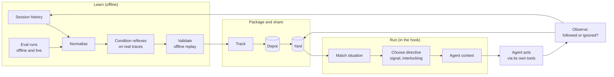
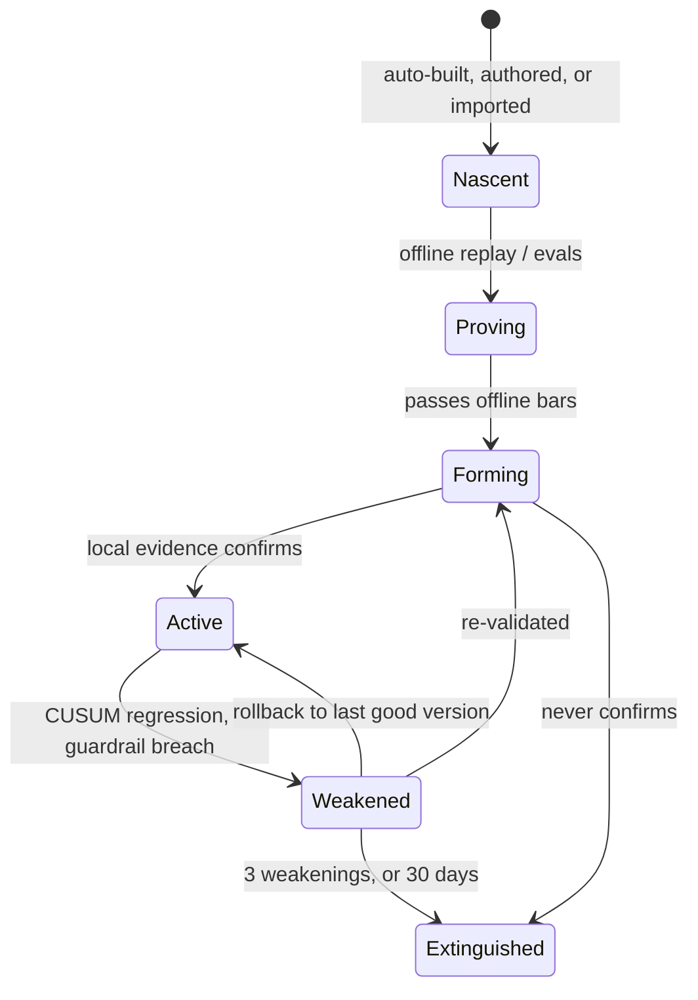
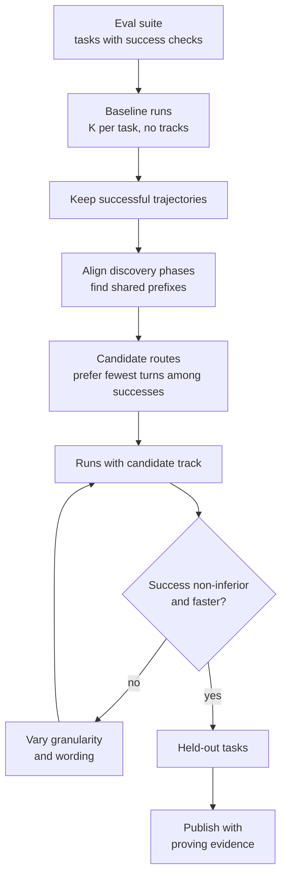

# Adage — Design Spec

**Status:** Design phase, draft 7 — decisions closed except O9; architecture review changes applied · **Date:** 2026-09-22 · **Supersedes:** *Interaction Graph Compiler — Design v2*

> **Adage** — *Agentic DAG Engine.* **Agent traces become reflexes.** An adage is wisdom distilled
> from long experience; a reflex is what your agents' traces distil into. Brand system in
> [§17](#17-naming-and-brand).

---

## 0. Where this document sits

The project moves through four phases. Each one closes decisions and hands a short list of
questions to the next.

| Phase | Output | Answers |
| --- | --- | --- |
| **1 · Design** (this document) | Product behaviour, concepts, the track format, the agent contract, the safety model, the evaluation design | *What* we are building and *why*, and how we will know it works |
| 2 · Architecture | Components, processes, storage, interfaces, technology choices | *How* it is built |
| 3 · Implementation plan | Milestones, sequencing, test strategy, risk burn-down | *In what order* |
| 4 · Slices | Vertical slices, each shippable and measurable on its own | *What we do this week* |

This document is finished when every item in the [§19 decision log](#19-decision-log) is closed. As of
draft 6, all are, except O9 (IP and data policy), which waits on the author's employer.
[§20](#20-handoff-to-architecture) lists the questions it deliberately leaves to architecture.

---

## 1. Summary

**Adage learns the routes your coding agents take to get work done, packages the good ones as
*tracks*, and at each decision point tells the agent — deterministically — what to do next.**

Agents stop re-deciding things that were already decided. They skip the exploration, run the
right command the first time, batch lookups that used to take several turns, and steer around
known dead ends. When they finish, they run the checks this repo always needs — the codegen after
a schema change, the affected package's tests — before CI has to tell them. Tracks are files: you
can read them, review them, commit them to a repo, and share them with a teammate. A team can give
a new hire a set of starter tracks so their agent is on the right path from the first prompt.

> *Agent traces become reflexes.*

Adage never runs the commands it directs. Every command is run by the agent, through the agent's
own tools, under the harness's own permissions, in plain view. Adage only decides what to say, and
when. (Execution, when a person turns it on, is a separate binary, `adage-exec`, that runs only
reflexes approved on that machine, inside an OS sandbox: [execution.md](execution.md).)

---

## 2. The problem

Every organisation running coding agents pays the same tax on every session. Before an agent does
useful work it rediscovers the environment: which script looks up a ticket, which test command
this repo actually uses, which files matter for this area of code, which build target is
correct. That rediscovery costs:

- **Time.** Each exploratory turn is a serial model round trip. Time to first useful edit is
  dominated by turns that produce no code.
- **Tokens.** Each turn re-reads the whole cached context. Removing one turn at 80K context removes
  80K of cache reads, plus the turn's own output.
- **Variance.** The same task takes three turns one day and nine the next. Two engineers get
  different behaviour from the same agent on the same repo. Nobody can predict what the agent will
  do, so nobody can improve it.
- **Dead ends.** Agents repeat mistakes the organisation already paid for: `npm test` in a pnpm
  workspace, the deprecated lookup script, the build target that takes twenty minutes.

The knowledge that would prevent all of this already exists — in the agents' own session logs.
Nobody reads them.

### Why existing tools don't close the gap

| Tool | What it does | Why it isn't enough |
| --- | --- | --- |
| `CLAUDE.md`, `AGENTS.md`, rules files | Static guidance loaded every session | Unconditional: always in context, even when irrelevant. Written from memory. Rots silently |
| Skills | Instructions the model chooses to load | The model still decides whether and when; the body costs context; no evidence it helps; rots silently |
| Prompt caching | Cheaper re-reads | Doesn't remove the turn |
| Workflow engines | Execute a graph you declared | The graph is the input, not something learned from behaviour |
| Speculative tool execution (PASTE, Speculate with Memory, `speculate`) | Pre-runs predicted tool calls, uses the result only if the call matches | Hides tool latency; for coding agents, most tools take milliseconds, and the turn remains |
| Tool-graph shortcuts (AutoTool) | Skips model calls for predictable tool transitions | Benchmarks only; acts on the agent's behalf |

Adage sits in the gap: **conditional, evidence-backed, self-maintaining guidance that the agent
acts on itself.** It's what a skill would be if it knew when it applied, could prove it helped,
and noticed when it stopped working.

---

## 3. Principles

1. **The agent is the only actor, unless you delegate.** The `adage` binary and its hooks never
   run a command, never read a file on the agent's behalf, and never edit anything; they emit text.
   A separate, optional component, `adage-exec`, installed only by a person at a terminal, may run
   a route **only** when all of these hold: this machine holds an approval for that route's exact
   argv, inputs, scripts (by hash), effect and level; an OS sandbox enforces the approved profile;
   and the route's effect is at most regenerate. Output returns to the agent as typed, fenced data,
   never as instructions. Actions with effects (E2) run only from the hooks Adage owns, for a
   reflex a person approved explicitly on this machine, and are staged and verified before
   anything in the worktree changes. Approvals never travel with a track. (Track C §5.1;
   [execution](execution.md).)
2. **Deterministic by construction.** The same situation with the same installed tracks produces
   the same directive. (The one exception, experiment assignment, is itself a deterministic hash of
   the session ID — [§14](#14-measurement).)
3. **One block ahead.** Like railway block signalling, a directive authorises only the next step or
   the next parallel batch — never a multi-step plan the agent could anchor on.
4. **Every route carries its evidence** — where it came from, how often it was right, on which
   model and harness — and every route can be weakened.
5. **Tracks are code.** They are reviewable text, versioned, and signed. Adage builds your own
   tracks automatically; anyone else's are installed deliberately and treated with the same
   suspicion as a dependency.
6. **Never learn from your own influence.** Behaviour Adage steered is not evidence that Adage was
   right.
7. **Fail open.** A crash, a slow index, or a corrupt track has exactly one outcome: the agent
   behaves as if Adage were not installed.
8. **Local first.** Raw session content never leaves the machine. What is shared is templates and
   statistics, after a review the user sees.
9. **Direct the chores, never the work.** Adage may direct looking things up, building,
   testing, and regenerating. It never directs *what code to write*, and never directs anything that
   publishes or can't be undone ([§8.6](#86-effects)).

---

## 4. Goals and non-goals

### Goals

| # | Goal | Measured by |
| --- | --- | --- |
| G1 | Cut time to first useful edit on workflows a track covers | ≥20% reduction in triggered sessions against a randomised control |
| G2 | Make agent behaviour predictable | Lower variance in turns-to-first-edit on covered workflows |
| G3 | Never make outcomes worse | Non-inferiority on user corrections, CI failures, and rework |
| G4 | Make good behaviour portable | A shared or starter track reaches its source's time savings within 2 weeks on the receiving machine |
| G5 | Maintain itself | Routes that stop working are weakened automatically, with no human noticing first |
| G6 | Stay out of the way | No-match overhead ≤10 ms p95 per hook call; zero blocking on failure |
| G7 | Catch the repo's routine checks before CI does | Lower first-push CI failure rate on sessions covered by finish-line routes, against control |

### Non-goals (v1)

- **Executing anything** the user has not approved on this machine, anything outside a sandbox,
  or anything at author or publish effect (Track C §5.1; pre-fetching an approved, observe-only
  lookup is E1, [execution](execution.md)).
- **Directing authorship or publication.** Adage never tells the agent what code to write, and
  never directs commits, pushes, pull requests, deploys, deletions, or writes to shared systems.
- Autonomous edits or multi-step plans.
- A public, cross-organisation track marketplace.
- Training or fine-tuning the agent's model. Adage trains *tracks* — and at most a small
  projection over a frozen embedding model (§8.2.2) — never the agent's weights.
- Replacing skills. A track can point to a skill; skills keep working.
- Harnesses beyond Claude Code, Codex CLI, and OpenCode.

---

## 5. Vocabulary

The theme is the nervous system: traces are experience, reflexes are conditioned responses, and
instincts are innate ones. The canonical word list is [the lexicon](lexicon.md); every
user-facing word follows it. Every term maps to a plain meaning, and code and APIs use whichever
is clearer. Text the agent reads (directives) stays plain and factual: the theme is for people,
not the model.

| Term | Plain meaning |
| --- | --- |
| **Adage** | The system as a whole |
| **Trace** | A session transcript a coding agent left behind |
| **Reflex** | A learned response: a stimulus, a response, typed inputs and evidence. Conditioned on real traces (`adage condition`) or grown from a skill (`adage train`). "Route" in code and on disk |
| **Instinct** | A response that ships with Adage and works on day 0, bound from the repository's own files; never stronger than *prime* on its own, and a learned reflex always overrides it |
| **Reflex arc** | Stimulus → response, in explanations |
| **Stimulus** | What starts a reflex: a prompt that names a work item, a failed command, an edit to a path pattern ("trigger" in the CLI and on disk) |
| **Response** | What the reflex tells the agent ("directive" in the CLI, where precision matters) |
| **Step** | One action the agent should take: a command template, a set of reads, a batch |
| **Strength** | How strongly a reflex speaks: **fire** (do this: strong evidence; shown green), **prime** (consider this: a suggestion; yellow), **inhibit** (don't do this: a known dead end; red) |
| **Lifecycle** | **nascent** (waits for a person's review), **forming** (delivered while evidence builds), **firm** (established), **dormant** (held: its evidence thinned because it was being followed, not because it was wrong), **extinguished** (retired, kept for history) |
| **Judgements** | **followed**; **ignored** (the agent did not follow it: expected, allowed, and measured); **misfired** (followed, and the command failed) |
| **Effect class** | What a step does to the world — observe, verify, regenerate, environment, author, publish — which caps the strongest strength it may be given |
| **Finish-line reflex** | A reflex triggered by edits rather than by the prompt: "after changing these files, this repo needs these checks" |
| **Directive** | The text Adage places in the agent's context |
| **Compiled step** | Several predictable steps collapsed into one command or one parallel batch |
| **Track** | Reflexes and instincts on disk, with a manifest, evidence, and a version |
| **Pack** | The signed, closed form of a track that you review, commit, share and install |
| **Intent family** | Prompts that mean the same thing and lead agents to do the same thing — discovered with embeddings, confirmed by behaviour |
| **Failure family** | Error outputs that describe the same situation, however the exact text varies |
| **Autonomy level** | How far Adage may condition and strengthen reflexes without a person: `off`, `suggest`, `auto` |
| **Familiar command** | A command the repo's agents already ran successfully in many distinct traces — the only kind that may reach *fire* automatically |
| **Control** | The comparison arm: sessions where Adage decides but says nothing, so every effect is measured against them |
| **The map** | The web view of every reflex arc and its live counts (`adage map`) |
| **Delegation** | A person letting approved reflexes act, per machine and inside an OS sandbox (`adage delegate`, `adage review delegate`) |
| **Interlocking** | The rules that stop two installed reflexes from issuing conflicting directives |

The verbs are `adage init`, `sense` (read-only: which reflexes your traces would form),
`condition` (mine traces into reflexes and bind instincts), `train` (grow reflexes from a skill),
`review strengthen` / `weaken` / `extinguish`, `delegate`, `map`, and the unchanged `watch`,
`doctor`, `share`, `add` and `eval`.

---

## 6. User journeys

### J1 · First install — "what does my agent actually do?"

1. `adage sense` imports existing session history and prints a report: the intent families that
   recur, turns before the first edit for each, the exploration that repeats, the dead ends, the
   missed obligations, and the tracks Adage would build. Nothing is installed; nothing changes.
2. `adage init` turns it on. From then on Adage **builds and maintains tracks automatically** from
   the developer's own sessions (§10.9). No adoption step is required for the safe cases.
3. New routes start on **forming**: prime only, until local evidence confirms them. Routes that
   clear the bars strengthen themselves to fire, within their effect ceilings. Anything that needs a
   person's judgement — a command never approved before, a regenerate step, anything from outside —
   waits in `adage review`.
4. `adage status` shows, per track and route: how often it fired, how often the agent followed it,
   time saved against control, and any guardrail warnings. A weekly digest summarises what was
   created, strengthened, and weakened.

### J2 · Sharing with a teammate

1. `adage share work-items` prepares the auto-built track for sharing. It shows a redaction review:
   exactly what will leave the machine — templates, statistics, intent labels and canonical
   phrasings, no prompts, no argument values.
2. The track is committed to a team depot, or directly to the repo under `.adage/tracks/`. In team
   mode Adage prepares the pull request itself (§10.9); it is pushed only after the author approves it
   locally in `adage review`, and a teammate still reviews and merges it.
3. The teammate runs `adage add` or simply pulls the repo. Install shows every command the track
   can direct and every script it depends on, with their content hashes.
4. The track starts forming on the teammate's machine: as prime advice if it is signed by a
   trusted team source, silently otherwise (O2). The author's evidence counts as a prior, not a
   pass. Local evidence decides.

### J3 · Onboarding with starter tracks

A team keeps a curated set of starter tracks in the repository. A new engineer clones the repo, and
their agent immediately follows the team's proven routes — the right test command, the right lookup,
the known dead ends — instead of spending weeks accumulating history. This solves the cold-start
problem: a new person or a new repo has no history to mine, but the team does.

### J4 · Proving a track

A team lead runs `adage prove work-items --suite onboarding-tasks`. The eval loop runs the
agent on eval tasks with and without the track, keeps the successful runs, looks for the shortest
successful route, and reports whether the track improves speed without hurting success. A track
that passes carries `proving` evidence and can be published.

### J5 · A model upgrade

The organisation moves to a new model. Adage detects the gauge change. Routes that encode the
environment ("a work-item prompt needs the work-item lookup") stay active and re-validate quickly.
Routes that encode the old model's habits drop back to forming. `adage status` shows which is
which.

### J6 · Turning it off

`/adage off` in a session, `.adage/config.toml` with `enabled = false` in a repo, or
`adage disable <track>` machine-wide. Each takes effect on the next hook call.

---

## 7. How it works



Three loops run at different speeds:

- **The hook loop**, milliseconds: match the situation, choose a directive, emit it.
- **The evidence loop**, per session: record whether the agent followed the directive and how the
  session turned out; update each route's evidence.
- **The learning loop**, nightly or on demand: discover intent families, mine new routes from
  history and eval runs, validate them offline, and assemble them into tracks automatically.

---

## 8. The route model

### 8.1 Situations

A route fires at a **decision point**: a moment where the agent is about to decide what to do.

| Decision point | When | What Adage can see |
| --- | --- | --- |
| `prompt` | The user submits a turn | Prompt text, repo, branch, dirty files, turn index |
| `batch` | A batch of parallel tool calls returns | Canonical actions, arguments, outcomes, the result bodies |
| `delegate` | A sub-agent starts | Agent type, task description, spawn depth |

The unit is the **batch**, not the single tool call, because agents issue parallel calls and every
saving is counted in turns.

### 8.2 State and intent

Every decision point has two halves, and they need different machinery:

| Half | Question | Nature | Machinery |
| --- | --- | --- | --- |
| **Intent** | What does the user want? | Human language — "pick up W-4821", "look at the auth ticket", "start on the token bug" all mean the same thing | **Embeddings** |
| **Position** | Where is the agent in the work? | Symbols — which command ran, what it returned, in what order, with what exit code | **Exact keys** |

The v2 review rejected embedding the *whole* state as one sentence, because sentence models blur
exactly what decides the next step — the verb, the path, the order, the exit code. It did not
reject embeddings. Embeddings are the right tool for the half that is language, and only that half.

```text
key      (repo, harness, agent_type, decision_point)
intent   intent family + probability, from a prompt embedding       (§8.2.1)
history  canonical action templates, last 1..16, with outcome classes
         → hashed n-gram keys at lengths 1, 2, 4, 8, 16              (TAGE-style backoff)
failure  failure family of the last error, if any, from an embedding  (§8.2.3)
meta     turn index, actions since prompt, dirty-file bucket, model id
spans    typed values found in context: paths, IDs, targets, SHAs
```

#### 8.2.1 Intent families

An **intent family** is a set of prompts that mean the same thing *and lead agents to do the same
thing*. Families are discovered, never declared — there is no intent taxonomy to write or maintain.

**Discovery (offline, as part of mining):**

1. **Collect** every real user prompt from history, and from eval tasks.
2. **Normalise before embedding.** This step matters more than the choice of model:
   - Replace spans with typed placeholders, so the vector carries the intent rather than the
     identifier: *"pick up W-4821"* → *"pick up {work_item}"*.
   - Strip fenced code, pasted logs, and stack traces; record their presence as structured flags
     (`has_stacktrace`, `has_diff`) instead.
   - Keep the head of the prompt — intent almost always sits in the first sentence or two.
3. **Embed** with a small, pinned retrieval embedding model, bundled and run locally. Pinned because
   every stored vector is only valid for the model that produced it.
4. **Cluster** with a density-based method that needs no preset number of clusters and is allowed
   to call a prompt "noise". Most prompts should belong to no family, and that is correct.
5. **Check behaviour.** A family is only useful if the sessions in it behave alike. For each family,
   measure **purity**: the share of its sessions whose discovery phase followed the family's dominant
   route. Split families whose sessions behave differently; merge families whose sessions behave the
   same. Families below the purity bar never trigger routes. *Embeddings propose; behaviour decides.*
6. **Name** each family with a short human label and 3–5 canonical phrasings, written offline by a
   language model from the family's normalised prompts. These appear in the Sense, in `adage
   status`, and in track files.
7. **Calibrate** a similarity threshold *per family* on held-out prompts — the similarity at which
   matching reaches the family's precision target. No global cosine threshold.

**Matching (at runtime, prompt decision points only):**

1. Normalise the incoming prompt exactly as above.
2. Embed it — the only embedding on the hot path, and only at `prompt` decision points (§13.2).
3. Compare against the centroids of families that have active routes in this repository. There are
   tens to hundreds of these, so this is a handful of dot products — no index needed.
4. Convert similarity to a calibrated probability per family. That probability, multiplied by the
   route's own probability, feeds the expected-value rule.
5. The matched family is **carried through the session** as part of state, so later decision points
   know what the session is for. A new prompt can replace it.

A route fires only when intent *and* position agree: the family matches, the required slots bind
(a work-item ID is actually present), and the scope fits (this repo, these paths).

#### 8.2.2 Sharpening intent with behaviour

Off-the-shelf embeddings place "check the ticket" and "close the ticket" close together, because the
sentences are similar. They lead to completely different work. Purity checks (step 5) catch this
after the fact. A later refinement fixes it at the source: a small projection trained on top of the
frozen embedding model, using *behaviour as the label* — prompts whose sessions followed the same
route are pulled together, prompts whose sessions diverged are pushed apart. The embedding model is
never retrained; only the small projection is. It ships only if it beats the plain embedding on the
credibility test (O13).

#### 8.2.3 Failure families

The same machinery recognises *similar failures*. Error output is normalised — paths, line numbers,
hashes, timestamps, and temporary names replaced with placeholders — embedded, and clustered into
**failure families**: "pnpm workspace protocol error", "missing generated types", "port already in
use". Failure families drive switches ("a compile error goes to build; an assertion goes to the
test") and dead-end detection (inhibit signals), where the exact error text varies but the situation
does not.

#### 8.2.4 Intent across machines and harnesses

Prompts are written by people, not harnesses, so intent families transfer across Claude Code, Codex,
and OpenCode unchanged. Across machines, a track carries each family's **label, canonical phrasings,
and — when both sides use the same embedding model — its centroid**. A receiver with the same model
uses the centroid directly; one with a different model re-embeds the canonical phrasings. Either way
the per-family threshold is recalibrated from local evidence. Raw prompts are never included.

### 8.3 Routes, steps, switches

A **route** is a trigger, a sequence of steps, optional switches, and exit conditions.

- A **step template** is a canonical action with named **slots**: `./scripts/wi-lookup {item} --json`.
- Every slot has a **binding rule** that says where its value comes from — a span in the prompt, a
  field in a result the agent observed, the current branch — and a **type contract** it must
  satisfy. If no rule binds a slot, the step cannot be directed; it can only be described.
- A **switch** is a typed choice between successors, made from what the agent just observed:
  "the test failed with a compile error → go to build; with an assertion → read the test". Switches
  are resolved by a pluggable decision backend (§8.5).
- **Exit conditions** are observable facts that mean the route no longer applies: "the work item is
  Closed", "the user asked for something other than implementation". An exit condition is always
  stated to the agent. Exit conditions are **typed predicates** — a result field equals a value, a
  failure family matches, the intent family changes — and Adage renders their wording from its own
  fixed templates. A track never supplies free text that reaches the agent; only validated slot
  values are interpolated (§15). Labels and descriptions in a track are for people and for matching,
  never for the agent's context.

### 8.4 Compiled steps

Directives save turns only where they remove exploration or collapse serial work. A **compiled
step** is the second of those: several steps the agent would have taken one turn at a time, packaged
as one instruction.

| Form | Example | Turns |
| --- | --- | --- |
| **Parallel batch** | "Read these three files together in one turn" | N → 1 |
| **Existing command** | A repo script that already does what four exploratory calls did | 4 → 1 |
| **Track-bundled script** | A reviewed script shipped with a repo-committed track | N → 1 |

v1 supports the first two for all tracks and the third only for tracks committed to the repository
they apply to, where they go through normal code review. A portable, declarative step runner is a
candidate for later ([§19](#19-open-decisions)).

### 8.5 Prediction

The core predictor is a **variable-length backoff table** over step templates — the TAGE and PPM
approach from branch prediction, applied to agent actions. It is cheap, fully interpretable, needs
no GPU, and is also the runtime index.

Switches and route matching sit behind one interface, so better predictors can be added without
changing anything else:

```ts
interface DecisionBackend {
  // A typed choice over known successors, each with a calibrated probability.
  decide(state: State, options: Step[]): { step: Step; p: number }[]
}
```

Candidate backends: the backoff table, a gradient-boosted model over the hybrid state, a small local
model with constrained decoding, a hosted small model, or a dedicated decision model where one is
available. A backend is used only if it beats the backoff table offline by ≥5 points of top-1
accuracy.

### 8.6 Effects

Earlier drafts limited routes to read-only steps, because the daemon executed them outside the
harness's permission system. Now the agent executes everything, under the harness's own
permissions, so the question is no longer "is it safe for Adage to run this?" but **"how
strongly should Adage tell the agent to run this?"** The answer depends on what the step does to
the world.

Every step template declares an **effect class**, and the class caps the strongest strength the step
may ever be given:

| Effect class | Examples | What it changes | Strongest strength |
| --- | --- | --- | --- |
| **Observe** | Read, search, list, `git status/log/diff/show`, lookup scripts | Nothing | 🟢 Fire |
| **Verify** | Build, test, typecheck, lint in check mode | Build outputs and caches; never source | 🟢 Fire |
| **Regenerate** | Codegen, formatters, snapshot updates, lockfile sync | The working tree, deterministically; undoable with git | 🟢 Fire *only* as a finish-line obligation triggered by an edit to the generator's inputs; otherwise 🟡 |
| **Environment** | Install dependencies, start local services, local database migrations | Local machine state | 🟡 Prime, and only on routes a person approved in `adage review` |
| **Author** | Source code edits | The work itself | Never directed. This is the agent's job |
| **Publish** | Commit, push, pull request, deploy, deletes, writes to shared systems, anything touching production | Shared or irreversible state | Never directed. 🔴 Inhibit only — "don't" |

Classification is data, per command template, the same way the normaliser classifies commands
today. Unknown commands default to **Environment**. A track that declares a step as Observe or
Verify when the normaliser classifies it higher is rejected at install.

Verify steps are not read-only — a build runs code from the repository. That is acceptable here
because the agent would run the same build, in the same repository, under the same permissions,
without Adage; Adage only removes the guessing about *which* build. The supply-chain risk of a
track directing an unexpected build target is handled like any other command in a track: declared,
pinned, and reviewed at install ([§15](#15-safety-security-and-privacy)).

Verify steps also have a real cost: time. Every step's evidence records its duration, the
expected-value rule counts it, and routes prefer the narrowest target that does the job — the
affected package's tests, not the whole suite. Steering the agent to the right *scope* is often
worth as much as steering it to the right command.

### 8.7 Finish-line routes

The routes so far fire on the prompt and cover discovery. **Finish-line routes** fire on *edits* and
cover the other end of the session: the obligations a repository imposes once code has changed.

```yaml
id: proto-regen
trigger:
  at: edit
  paths: ["proto/**/*.proto"]
steps:
  - id: regenerate
    effect: regenerate
    strength: fire
    run: "make gen"
  - id: verify
    effect: verify
    strength: fire
    run: "pnpm --filter {affected_package} typecheck"
exit:
  - intent_changes: true              # rendered: "the user asks for something else"
  - intent_family: exploratory-draft  # rendered: "this is a draft or an exploratory change"
```

These are often the most deterministic routes a repository has, and they target a different cost:
not turns at the start, but **CI failures, review round-trips, and rework at the end.** A session
that edits a schema and forgets the codegen fails in CI minutes later, and someone — human or agent —
pays for a whole second loop.

Finish-line routes are mined from the post-edit part of sessions, which earlier drafts ignored:

- **Obligations:** edits to a path pattern followed, in successful sessions, by the same verify or
  regenerate step.
- **Missed obligations:** sessions where that step was skipped and the next CI run failed on a check
  it would have caught.

They are delivered at two points:

1. **After an edit batch**, as the agent works — a fire directive to run the obligation.
2. **At the finish line**, when the agent is about to stop, if an obligation from this session is
   still unmet. On Claude Code and Codex this uses the harness's stop hook, which can ask the agent to
   continue with a reason. It is the one place Adage delays anything, so it is tightly bounded:
   only for obligations that were actually triggered and not met, at most once per obligation per
   session, never looping, and always with an exit condition. Decided: it is used, within
   these bounds (O10).

Finish-line routes widen the product's value from *speed* to *speed and quality*, which is why
first-push CI failure becomes a goal (G7) rather than only a guardrail.

---

## 9. Directives: the contract with the agent

A directive is text in the agent's context. There is no other channel. So the wording *is* the
interface, and it is specified as carefully as an API.

### 9.1 Signals

| Signal | Meaning | When it may be used |
| --- | --- | --- |
| 🟢 **Fire** | "Take this step." Precise, with resolved arguments | Route is `firm`; probability clears the fire bar; every slot bound and validated |
| 🟡 **Prime** | "This is the known route here." Advisory | Route on `forming`, or confidence below the fire bar |
| 🔴 **Inhibit** | "Avoid this; do that instead." | A measured dead end — the avoided action failed repeatedly and the alternative succeeded |

Every strength is also capped by the step's effect class ([§8.6](#86-effects)): no amount of evidence
makes an Environment step fire, and Author and Publish steps are never directed at all.

Fire is deliberately prescriptive. That is the point of rails, and it is a reversal of the v2
guidance to "never phrase it as an instruction". The v2 reviewers were right that instructions steer
the agent — that is exactly why fire is gated behind the strongest evidence, why it only ever
authorises one block ahead, why it always carries an exit condition, and why the guardrails in §14
measure outcomes rather than compliance.

### 9.2 Anatomy

```text
<signal source="adage" track="acme/work-items@1.3.0" route="work-item-context" strength="fire">
Known route for work-item prompts in this repo. Not requested by the user.
Next: run  ./scripts/wi-lookup W-4821 --json
Leave this route if the item is Closed or the user wants something else.
</signal>
```

After the agent runs it, the next directive arrives with the tool result:

```text
<signal source="adage" track="acme/work-items@1.3.0" route="work-item-context" strength="prime">
The lookup lists these files. If you need them, read them together in one turn:
auth/token.rs, auth/rotate.rs
</signal>
```

A dead end:

```text
<signal source="adage" track="acme/payments-dev@2.0.1" strength="inhibit">
Avoid `npm test` in this repo — the workspace uses pnpm and it fails.
Use: pnpm --filter auth test
</signal>
```

### 9.3 Wording rules

| # | Rule | Why |
| --- | --- | --- |
| W1 | **One block ahead.** Direct the next step or the next parallel batch, never a plan | Multi-step plans compound errors and anchor hardest |
| W2 | **Always state an exit condition** in terms of something observable | The agent must know when it's allowed off the rails |
| W3 | **Never claim the user asked** | Otherwise the agent reports back on requests the user never made |
| W4 | **No statistics in the text.** Authority comes from the signal, not "91% of sessions" | Percentages act as social proof, a hidden instruction the model can't weigh |
| W5 | **Commands are exact and copy-ready,** with slots resolved | Removes deliberation, which is the point |
| W6 | **Never repeat free text from external sources.** Only validated slot values appear | Keeps ticket bodies and web pages from gaining the directive's authority |
| W7 | **Identify the track and version** in the tag | Provenance for the agent, the user, and the audit log |
| W8 | **Fit the harness cap** — 10,000 characters on Claude Code, about 2,500 tokens on Codex | Overflow is spilled to a file and the agent sees only a preview |

Wording is itself an experimental variable. The eval loop compares variants offline
([§12](#12-conditioning-on-purpose-evals-and-training)), and the live experiment can carry wording as a factor.

### 9.4 Where the savings come from

Adage doesn't remove the tool call — the agent still runs the command. The saving has to come from
somewhere else, and every source must be measured separately:

| Source | Mechanism | Example |
| --- | --- | --- |
| **Exploration removed** | The agent no longer searches for the right command, script, or file | No `ls scripts/`, no reading the README, no grepping for the test runner |
| **Serial → parallel** | A prime or fire batch collapses several one-at-a-time calls into one turn | Three linked files read in one turn instead of three |
| **Compiled steps** | One command replaces a multi-step discovery | A lookup script instead of four exploratory calls |
| **Dead ends avoided** | Inhibit signals prevent known failures and their recovery turns | `pnpm test` first, not after `npm test` fails |
| **Deliberation** | Less reasoning about what to do next | Fewer output tokens per turn |
| **Right scope** | The narrowest verify target that does the job | The affected package's tests instead of the whole suite |
| **Obligations met** | Finish-line routes catch checks before CI does | Codegen run after a schema edit; no failed CI loop |

A route whose only effect is to tell the agent what it would have done anyway saves almost nothing.
The Sense and the credibility test must show that exploration, serial work, dead ends, and missed
obligations make up a meaningful share of session cost, or the premise fails
([§16](#16-credibility-test)).

---

## 10. Tracks

### 10.1 What a track is

A track is a directory — plain text, diffable, reviewable, hand-editable:

```text
work-items/
├── track.toml         manifest: identity, gauge, scope, requirements
├── intents/
│   └── work-item-start.yaml   label, canonical phrasings, optional centroid + model id
├── routes/
│   └── work-item-context.yaml
├── scripts/           optional; repo-committed tracks only
├── evidence.json      summary statistics, no raw content
├── CHANGELOG.md
└── track.sig          signature over everything above
```

### 10.2 Manifest

```toml
[track]
name        = "acme/work-items"
version     = "1.3.0"
description = "Context gathering for work-item prompts in the payments monorepo"
authors     = ["steven"]

[gauge]
harness = ["claude-code >=2.1.200", "codex >=0.120"]
models  = ["claude-opus-5*", "claude-sonnet-5*"]

[scope]
repos = ["github.com/acme/payments"]   # omit for a portable track
paths = ["services/auth/**"]

[requires]
commands = ["./scripts/wi-lookup"]     # must exist locally; content hash pinned per route
tools    = ["Bash", "Read"]

[provenance]
source   = "desire-path"               # desire-path | proving | authored
evidence = "evidence.json"
```

### 10.3 Route definition

```yaml
id: work-item-context
trigger:
  at: prompt
  intent: work-item-start          # an intent family, defined in intents/
  requires_slot: item
slots:
  item:
    type: pattern
    regex: "^W-\\d{4,9}$"
    from: prompt
steps:
  - id: lookup
    effect: observe
    strength: fire
    run: "./scripts/wi-lookup {item} --json"
    pin: "sha256:9f2c…"
    next: read-linked
  - id: read-linked
    effect: observe
    strength: prime
    batch:
      read: "{lookup.files[*]}"
      contract: repo-path
      max: 5
exit:
  - result: lookup                    # typed predicate over a validated result field
    field: state
    equals: Closed
  - intent_changes: true
```

`{lookup.files[*]}` binds from the result of a command *the agent* ran; Adage reads it from the hook
payload and validates each value against its contract before it appears in any directive.

### 10.4 Lifecycle

Each route has a state; a track's state is summarised from its routes.



| State | Delivered as | Leaves when |
| --- | --- | --- |
| Nascent | Nothing | It is validated offline |
| Proving | Nothing (offline only) | It clears the offline bars |
| Forming | Prime — or shadow only for imported tracks not signed by a trusted team source (O2) | Local evidence confirms it, counted in distinct sessions across distinct days |
| Active | Fire where the fire bar is met | A regression or guardrail breach |
| Weakened | Nothing | Rollback, re-validation, or extinction |
| Extinguished | Nothing; kept for history | — |

Strengthening uses anytime-valid confidence sequences; weakening uses CUSUM on recent accuracy; a
significant regression rolls back to the route's last good version; a context weakened three times
is blacklisted until something structural changes. These carry over unchanged from v2.

### 10.5 Evidence that travels

The author's evidence is useful but was earned on a different machine, repo, and working style. It
arrives as a **prior with a capped weight**, and local evidence decides:

```text
prior        Beta(α₀, β₀) with α₀ = m·p̂, β₀ = m·(1 − p̂),  m = min(n_author, 20)
local        each distinct local session updates the posterior
strengthening    uses the posterior lower bound, like any route
```

A track proven by a thousand of the author's sessions counts, locally, as twenty. Three layers pool
the same way — personal, repository, team — so a team's evidence helps a newcomer without drowning
their own.

### 10.6 Composing tracks: interlocking

Several installed tracks can match the same decision point. The interlocking rules:

1. At most **one fire** directive per decision point.
2. **Inhibit beats fire** when they concern the same action.
3. Otherwise precedence runs **personal → repository → team depot → starter**, then by expected
   value.
4. Two tracks that repeatedly conflict at the same point are reported by `adage doctor`.
5. A per-session cap on directives prevents a pile-up of well-meaning advice.

### 10.7 Distribution

| Channel | v1 | How |
| --- | --- | --- |
| **Repository** | ✅ | `.adage/tracks/` committed; reviewed in pull requests like code; `.adage/tracks.lock` pins versions and hashes |
| **Team depot** | ✅ | A git repository of tracks; `adage add <depot>/<track>` |
| **Direct share** | ✅ | `adage share` produces a signed archive; `adage add ./file` |
| **Plugin marketplace** | ✅ Claude Code | A *track pack* is an ordinary Claude Code plugin with a `tracks/` directory, installed from a team's existing plugin marketplace (§10.10) |
| **Registry** | Later | Search, ratings, and cross-repo evidence aggregation |

Git first, because it already provides review, history, access control, and signing, and teams
already trust it. Tracks are signed with git SSH signatures and verified against a
`trusted-signers` file in the repository or depot (O5). Plugin marketplaces are git repositories too, which is why they fit.

### 10.8 Export and privacy

`adage share` shows a review before anything leaves the machine:

- **Included:** step templates, slot types, contracts, exit conditions, aggregate statistics,
  gauge, provenance, intent labels and canonical phrasings (reviewed line by line — they are the
  closest thing to prompt text a track contains).
- **Never included:** prompt text, argument values, file contents, result bodies, session IDs,
  developer identities beyond the declared authors.
- **Checked:** a secret scanner runs over the whole package; repository-specific paths are flagged
  so the author can choose to generalise or scope them.

### 10.9 Automatic tracks

Adage builds and maintains tracks by itself. People decide only two things: how much authority a
route gets beyond what it may earn automatically, and what leaves the machine.

**Assembly.** Each night, as part of the learning loop, routes are grouped into small, focused
tracks, so each can be reviewed, versioned, and shared on its own:

| Track | Contains | Example name |
| --- | --- | --- |
| One per repository × intent family | Discovery routes for that intent | `payments/work-item-start` |
| One per repository | Finish-line obligations | `payments/finish-line` |
| One per repository | Dead ends (inhibit signals) | `payments/dead-ends` |

Each track is named and described from its intent labels; its changelog is written from the diff
("added a route for flaky-test triage; weakened the lookup route after a regression on the new
model"); and its version is bumped automatically:

- **Patch** — evidence updated, nothing else changed.
- **Minor** — a route added or strengthened.
- **Major** — a trigger, scope, or command changed, or a route removed.

So a teammate who pins a version is never surprised by a change in behaviour.

**Autonomy levels.** A policy per repository, which team policy can override:

| Level | Tracks are created | Directives are delivered |
| --- | --- | --- |
| `off` | Never | Never |
| `suggest` | Automatically | Only after approval in `adage review` |
| `auto` (default) | Automatically | Automatically, within the limits below |

Under `auto`, what strengthens itself and what waits for a person:

| Step | Forming (prime) | Fire |
| --- | --- | --- |
| Observe | Automatic | Automatic, once evidence clears the bars |
| Verify | Automatic | Automatic, once evidence clears the bars **and** the command is *familiar* |
| Regenerate | Automatic | Waits for review |
| Environment | Waits for review (O11) | Never — prime at most |
| Inhibit (dead end) | Automatic | — |

A command is **familiar** when the agent has already run it successfully in this repository in at
least 20 distinct sessions across at least 5 days. Automatic fire is limited to commands the repo's
own agents — under their users' own permissions — already chose to run many times. Adage makes the
familiar deterministic; it never introduces an unfamiliar command with full authority on its own.

Three further limits keep automation honest:

- **Losing authority is always automatic.** Weakening, rollback, and extinction never wait for a
  person.
- **Change is paced.** At most a few routes per repository are strengthened to fire each week, so
  behaviour changes gradually and the control can attribute each effect.
- **Human edits win.** A person can edit any auto-built track. An edited route is marked `authored`,
  and the learner stops overwriting it — it proposes changes in `adage review` instead.

**Tracks as pull requests.** In team mode, when a personal track has cleared its bars and is
portable — its requirements are met by the repository and its scope isn't specific to one person's
habits — Adage prepares a pull request adding it to the repository's `.adage/tracks/`. Nothing is
pushed until the author approves it locally in `adage review`, after seeing the redaction review —
content never leaves the machine on a timer. Think of it as a dependency bot for agent behaviour,
with a human at the gate. The pull request carries the evidence summary, a preview of every
directive, every command with its effect class, and the redaction review. Merging is team adoption;
starter tracks accumulate this way, reviewed through the same process as code. Later evidence from
teammates arrives as further pull requests, usually patch bumps.

Automatic building bypasses none of the safety model: new routes start forming, the control
always applies, evidence is counted in distinct sessions across distinct days, effect ceilings hold,
and nothing Adage steered counts as evidence that it was right.

### 10.10 Tracks, skills, and plugins

Tracks belong to the same family as skills and plugins: packaged, versioned, git-distributed
behaviour for coding agents. That is deliberate. Adage should ride the distribution channels teams
already use, not invent new ones — and it should be clear about what a track adds.

**What a track is, next to a skill:**

| | Skill | Track |
| --- | --- | --- |
| **Who decides when it applies** | The model, from a description | Adage, deterministically, at a decision point |
| **Where it comes from** | Written by a person | Learned from sessions and evals, or written by a person |
| **What it carries** | Instructions | Instructions, plus the evidence that they help |
| **State** | None — the same everywhere | Per machine: forming, active, weakened |
| **When it stops working** | Nobody notices | It weakens itself |
| **Portable standard** | Agent Skills (`SKILL.md`), supported by 40+ tools | Adage's track format |

In the language of the first draft of this design: **skills are the interpreted form; tracks are the
compiled form.** The skill ecosystem also shows why evidence matters. There are tens of thousands of
public skills, and research on them already reports quality "smells" and supply-chain risk. Nobody
can tell which ones actually help. A track answers that question for itself.

**Three bridges between them:**

1. **Tracks can trigger skills.** A route step can be *"use the `db-migrations` skill now"*. The
   biggest weakness of skills — the model deciding whether and when to load them, and often getting
   it wrong — becomes a deterministic, well-timed directive. Loading a skill is already a canonical
   action, so the learner learns *when* a skill helps, and skills gain the evidence they lack.
2. **Tracks can compile down to skills.** `adage share --as-skill` renders a stable track as a
   `SKILL.md`, for tools and teammates that don't run Adage. The result loses conditionality and
   evidence but gains reach. It is the "static guidance" arm of the experiment (§14.1), made
   shippable.
3. **Skills can seed tracks.** A team's existing skills are hand-written hypotheses about good
   routes. The eval loop can test them, and the ones that help become tracks with evidence.

**Riding the plugin channel on Claude Code:**

- **Adage itself ships as a plugin.** Claude Code plugins can carry hooks, so installing Adage
  becomes `/plugin install adage` rather than editing settings files by hand — which also removes
  most of the install and uninstall fragility the v2 review warned about. OpenCode gets the
  equivalent as an npm plugin, and Codex an installer that registers hooks with stable commands so
  its hash-based hook trust survives upgrades (O14).
- **Tracks ship as track packs.** A track pack is an ordinary plugin whose payload is a `tracks/`
  directory. Teams publish it through the plugin marketplace they already run, with its versioning,
  its commit pinning, and its access control. Adage discovers tracks in enabled plugins, and treats
  them exactly like any other imported track: signed, reviewed at install, forming locally.
- **The harness-neutral format stays Adage's own.** The plugin is only the envelope on Claude Code.
  Codex and OpenCode receive the same tracks through their own mechanisms, or plain git.

**Lessons borrowed from plugin and skill ecosystems:**

| Their practice | Adage equivalent |
| --- | --- |
| Namespaced names (`plugin:skill`) | Tracks are always `owner/track` |
| Marketplaces are git repositories with a manifest | A depot is the same shape — and on Claude Code, can literally be a marketplace |
| Community catalogs pin each plugin to a commit and screen it automatically | Depots pin tracks by hash; every command template is screened at install |
| `claude plugin eval` runs prompts with and without a plugin, several times, including when a new model ships | The eval loop (§12) does the same for tracks, and should reuse this where it fits |
| Version bumps gate updates | Automatic semver (§10.9) gates behaviour changes |

---

## 11. Conditioning on real traces

Organic mining from real sessions. This carries over from v2 with one change: nothing Adage steered
counts as evidence that it was right.

- **Normalisation.** Every harness's native tool calls map to one canonical vocabulary. Shell
  commands — 71% of calls in the early sample — are parsed with a real shell grammar: unwrap
  `bash -lc`, follow `cd`, split sequences, keep loops and conditionals whole, use per-command flag
  grammars. Gate: ≥95% of calls normalise, against ≥300 golden fixtures per harness version.
- **Templates.** Arguments are generalised into typed slots. In the early sample this doubled the
  repeat rate, from 37% to 73%.
- **Training data hygiene.** Only sessions from before Adage was installed, control sessions, and
  treated sessions *truncated at their first directive* (weighted by inverse propensity) are used
  for mining. Every directive is tagged, so the partition is exact.
- **Outcome labels** are guardrails in randomised comparisons, not mining filters: final
  test/build status, user interruptions and corrections, edit churn, first-push CI, rework within
  14 days, follow-up fix sessions, reverts.
- **Post-edit mining** covers the end of the session, which earlier drafts ignored: edits to a path
  pattern followed by the same verify or regenerate step in successful sessions become finish-line
  candidates; sessions that skipped it and then failed CI on the check it would have caught are
  the evidence that it matters ([§8.7](#87-finish-line-routes)).
- **Dead-end mining** is new in v3: sequences where an action fails, the agent recovers with a
  different action, and the same pattern recurs across sessions become inhibit-signal candidates.
- **Model and harness churn.** Every statistic is keyed by model, harness version, and effort level.
  Routes are classified as *environment* (survive model changes) or *habit* (return to forming on
  a change), and each route reports its half-life across model generations.

---

## 12. Conditioning on purpose: evals and training

Reflexes conditioned on real traces learn what agents *do*. The eval loop learns what *works* — and finds the beaten
path by stomping it deliberately.

### 12.1 Why it exists

| Problem with organic mining | How the eval loop helps |
| --- | --- |
| Imitates the common route, not the best one | Chooses the shortest *successful* route among many runs |
| Outcome labels are weak and confounded | Eval tasks have ground-truth success checks |
| New repos and new teams have no history | Generates routes before anyone has worked there |
| Anchoring is dangerous to measure live | Deliberately wrong tracks can be tested offline, safely |
| Directive wording can't be A/B tested cheaply live | Wording variants are compared offline first |

### 12.2 The loop



1. **Tasks.** From three sources:
   - *Reconstructed from history:* a merged pull request becomes a task — its description, its base
     commit, and a hidden check (the tests it touched, or CI).
   - *Team scenarios:* onboarding tasks, common chores, known-hard areas.
   - *Public benchmarks*, for portable tracks.
2. **Baseline.** Run the agent K times per task without tracks. Keep the successful runs.
3. **Stomp the beaten path.** Align the discovery phases of successful runs, find the shared
   prefixes, and prefer the **shortest successful** variant — selection among successes, not
   imitation of the average.
4. **Test and iterate.** Run with the candidate track; accept only if success is non-inferior and
   time to first edit improves. Vary route granularity and directive wording between rounds.
5. **Hold out.** Final numbers come from tasks the loop never saw.
6. **Publish** with `proving` evidence, which enters a receiving machine as a capped prior, like any
   other imported evidence. The live control remains the final judge.

### 12.3 Guards

- **Held-out tasks** for every published number; tasks rotate so the suite can't be memorised.
- **Realism check:** eval tasks must resemble live work — compare their Sense profile to live
  sessions and flag drift.
- **Gauge-scoped:** a track proven on one model family is proven only for that family.
- **Sandboxed:** eval runs execute agents that execute code, so every run is isolated (a container
  or disposable worktree with no credentials). This is the only place in the system where anything
  runs, and it runs *agents*, offline, on purpose.
- **Budgeted:** proving costs real inference; each run has a token budget and reports its cost.

### 12.4 Prior art

Agent Workflow Memory induces reusable workflows from successful trajectories; Agentic Plan Caching
reuses plan templates; rejection-sampling methods keep only successful rollouts. The eval loop
borrows the *selection* idea from all three. The difference is the artefact: they change prompts or
weights inside a research harness; the eval loop produces a reviewable track that must then
earn its place against a live control.

---

## 13. Runtime

### 13.1 What runs, and when

| Hook | Claude Code | Codex CLI | OpenCode V2 | Adage does |
| --- | --- | --- | --- | --- |
| Prompt | `UserPromptSubmit` | `UserPromptSubmit` | `session.hook("prompt")` | Match `prompt` routes; emit the first directive |
| After a batch | `PostToolBatch`, `PostToolUse` | `PostToolUse` | `tool.hook("execute.after")` | Observe follow or ignore; resolve switches; emit the next directive |
| Before a tool | `PreToolUse` | `PreToolUse` | `tool.hook("execute.before")` | Observe only — record what the agent is about to do |
| Sub-agent start | `SubagentStart` | `SubagentStart` | Child session | Emit directives *into the child's* context |
| After an edit | `PostToolUse` on edit tools | `PostToolUse` on patch | `tool.hook("execute.after")` | Match finish-line routes; direct the obligation |
| Agent about to stop | `Stop` | `Stop` | Idle event | If a triggered obligation is unmet, ask the agent to continue — once, with a reason ([§8.7](#87-finish-line-routes)) |
| Session end | `SessionEnd` | `SessionEnd` | Event stream | Close the evidence record |

Adage never blocks a tool call and never denies one. The stop hook is the single place it can
delay anything, and only under the bounds in §8.7.

> **Superseded in part (launch):** on Claude Code, `PreToolUse` is no longer observe-only for one
> instinct: U11 rewrites the interpreter word of a Python test run to the project's verified
> environment, or advises when a rewrite is not safe (docs/execution.md, "Rewrites to the
> project's environment"). It never denies a call; `adage delegate rewrites off` turns it off.

### 13.2 Latency

Because nothing executes, the whole hot path is *decide and emit*:

| Path | p50 | p95 |
| --- | --- | --- |
| No match — rejected in the hook client from a precomputed key set, most calls | ≈4 ms | ≤10 ms |
| Match on structured keys | ≈6 ms | ≤15 ms |
| Match needing prompt-intent embedding | ≈10 ms | ≤25 ms |

v2's 2.5-second execution budget and its speculative-prefetch machinery are gone.

### 13.3 Fail-open

Any error, timeout, missing index, invalid signature, or unmet requirement produces **no
directive**. The hook client always exits 0, never writes to stderr in a way the harness would show
the model, and always drains its input.

### 13.4 Sub-agents

Parent links are exact. Claude Code stores each sub-agent's transcript under
`<session>/subagents/agent-<id>.jsonl` with a sidecar recording the spawning tool call, the agent
type, and the spawn depth; Codex and OpenCode provide parent IDs. Routes are scoped by agent type: a
route learned inside a code-search agent never fires in a test-writer.

Sub-agent routes come in two forms:

- **Acceleration:** directives delivered into the child at `SubagentStart`, shortening its own
  discovery phase. The parent is untouched.
- **Pre-emption:** a directive to the parent that a known batch achieves what a delegation usually
  does — "instead of delegating a code search here, read these three files". This changes the
  parent's behaviour most, so it comes last.

---

## 14. Measurement

Every claimed saving is a measured difference between randomised groups.

### 14.1 Design

- **Randomise per session** by a hash of the session ID, stratified by developer; cluster standard
  errors by developer.
- **Log exposure in the control.** In untreated sessions, record the directive Adage *would* have
  given, and analyse triggered sessions only.
- **Knock out routes individually.** In treated sessions, each active route is independently
  withheld with ~20% probability, so each route's own effect can be estimated.
- **A static-guidance arm.** The same knowledge written as unconditional `CLAUDE.md` lines. Adage has
  to beat the simplest thing that could work.
- **Pilot at 50/50,** then a 5–10% global control plus knockouts at steady state.

All assignment is a deterministic function of the session ID and route, so behaviour is
reproducible, and propensities are known exactly.

### 14.2 Compliance is the mechanism; outcomes are the guardrail

In v2, "the agent followed the hint" was a risk signal. With rails, following is the intended
mechanism. What matters is whether following *helped*:

- **Follow rate:** share of directives the agent acted on. Expected to be high for fire.
- **Ignore rate:** share it didn't.
- **Ignore correctness:** when the agent left the route, did the session turn out better or worse
  than sessions that stayed on it? A route the agent keeps rightly leaving is a bad route.
- **Steered outcomes:** comparing p₁ (follow rate, treated) with p₀ (the natural rate in the
  control) identifies the sessions Adage actually changed; their outcomes are reported separately.

### 14.3 Metrics

| Metric | Role | Target |
| --- | --- | --- |
| Wall-clock time to first useful edit | **Primary** | −20% in triggered sessions |
| Variance of turns to first edit | Secondary (determinism) | Lower |
| Exploration turns, serial turns, dead-end turns | Diagnostic (§9.4) | Each lower |
| Follow rate, ignore rate, ignore correctness | Route health | Per route |
| User-correction rate | Guardrail | Non-inferior, +1 point margin |
| CI failure on first push | **Primary** for finish-line routes; guardrail for all others | Lower where finish-line routes fire; non-inferior (+1 point margin) elsewhere |
| Rework within 14 days | Guardrail, lagging | Non-inferior |
| Net session cost, cache-aware | Guardrail | Not worse |
| Verify-step duration | Guardrail | Directed verify steps no slower than the agent's own choices |

### 14.4 Power

Assuming turns-to-first-edit has a standard deviation of about 6, α = 0.05 two-sided, power 0.8:

| To detect | 10% control | 50/50 |
| --- | --- | --- |
| −2 turns to first edit | ~785 triggered sessions | ~285 |
| −1 turn | ~3,100 | — |
| −1 turn, with CUPED (~30% variance reduction) | ~2,200 | — |
| Revert rate 6% → 8% | ~12,300 | ~4,400 |

---

## 15. Safety, security, and privacy

### 15.1 What changed from v2

Removing execution removed most of v2's threat model: no daemon running commands outside the
harness's permissions, no sandbox to escape, no arguments flowing into `execve`, no secrets in
injected output. The harness's own permission system now sees every action, exactly as it would
without Adage.

What remains is sharper: **tracks are a supply chain of instructions.** A track tells an agent to
run commands with the developer's own permissions. In a harness configured to auto-approve commands,
a malicious track is a remote-code-execution vector with a friendly face. Tracks must be treated as
code.

### 15.2 Threats and controls

| Threat | Control |
| --- | --- |
| **Malicious or compromised track** directs a harmful command | Signed tracks; unsigned or unknown-signer tracks refused by default; install shows every command template and script; Adage never adds entries to harness allowlists; team policy can restrict fire directives to an allowlist of command templates |
| **Referenced script changed after the track was proven** | Every referenced script is pinned by content hash; on mismatch the route drops to forming and is never fire |
| **Untrusted text reaches a directive** (ticket body, web page, tool output) | Only validated slot values appear; free text is never echoed; any slot bound from external content caps the route at prime (taint tracking) |
| **Argument injection** through slots | Type contracts per slot; reject values starting with `-`; path slots must resolve inside the repo |
| **Poisoned traces** (e.g. a README that tricks agents into repeating a command) | Evidence counted in distinct sessions across distinct days; new routes start forming; automatic fire only for familiar commands (§10.9) |
| **Privacy leak on export** | Export review; templates and statistics only; secret scan; repo-specific paths flagged |
| **A track mislabels a step's effect** (a deploy declared as "verify") | The normaliser classifies every command template independently; a declared class lower than the computed one rejects the track at install; unknown commands default to Environment (prime at most) |
| **Directed verify steps that are expensive** (a 20-minute build) | Duration recorded in evidence and charged in the expected-value rule; narrowest target preferred |
| **Finish-line loops** (the agent keeps being asked to continue) | Stop-hook requests only for unmet, triggered obligations; at most once per obligation per session; honours the harness's loop guard |
| **Directive overload or prompt stuffing** | Per-decision and per-session directive caps; harness size caps respected |
| **Adage itself compromised** | Hook client runs with the user's privileges only; no network listener; tracks and index verified on load; `adage disable` and repo-level opt-out |

### 15.3 A note on auto-approval modes

Several harnesses offer modes that auto-approve commands. Adage does not change those settings, but
it does change what the agent is likely to ask to run. Two rules follow: a fire directive may only
name a familiar command, one a person approved, or one a signed track declared, and the team policy file can require that
fire directives never name commands outside an explicit allowlist, regardless of harness mode.

---

## 16. Credibility test

Before anything is directed live, history must show the premise holds. This runs over backfilled
logs with no hooks installed.

**Setup.** Split by time — train on months 1..k, validate on the next two weeks, test on the final
four — and separately hold out 20% of developers. Session-clustered bootstrap for every interval.
Baselines: unigram; bigram with backoff (should reproduce the early sample's ≈47%); order-4 backoff;
the v1 embedding design as an ablation.

| # | Metric | Pass bar |
| --- | --- | --- |
| 1 | **Addressable turns** — pre-first-edit turns that were exploration, serial reads that could have been batched, or dead-end recovery | ≥25% of pre-first-edit turns |
| 2 | **Next-step coverage at precision** — steps predicted with template and arguments, within 3 actions | ≥15% at precision ≥0.90 (interval lower bound ≥10%) |
| 3 | **Fire-eligible coverage** — pre-first-edit turns a fire directive could have covered | ≥8% |
| 4 | **Dead ends** — recurring fail-then-recover patterns with a consistent fix | ≥20 distinct patterns across ≥5 repos |
| 5 | **Calibration** on fired predictions | ECE ≤0.03 overall, ≤0.05 per harness |
| 6 | **Stability** across the four test weeks | Precision drop ≤3 points; no week below 0.85 |
| 7 | **Breadth** | ≥50 templates each seen in ≥30 distinct sessions, ≥5 repos, ≥20 developers |
| 8 | **Learned backends** | Must beat order-4 backoff by ≥5 points top-1, or backoff ships |
| 9 | **Missed obligations** — sessions whose first push failed CI on a check a mined finish-line route would have directed | ≥5% of sessions that pushed, across ≥5 repos |
| 10 | **Intent coverage** — first prompts that fall in an intent family with purity ≥0.8, matched at that family's precision target | ≥25% |
| 11 | **Intent lift** — next-step precision with the intent family in state, versus position alone | ≥5 points; otherwise intent is dropped from the trigger and routes key on position and slots |

**Kill criteria, judged separately:**

- *Discovery routes* die if addressable turns are below 10%, or next-step coverage is below 5% at
  0.90 precision.
- *Finish-line routes* die if missed obligations (metric 9) are below 2% of sessions that pushed.

If both fail, the Sense still ships — it is useful on its own. If only one fails, the product
narrows to the other.

---

## 17. Naming and brand

### 17.1 The name

**Adage** — *Agentic DAG Engine.*

An adage is a short piece of wisdom distilled from long experience. That is exactly what a reflex
is: what an organisation's agents learned, the hard way, across thousands of sessions — compiled
from their traces into something the next agent can act on at once. The backronym carries the rest: it is for
*agents*, it models their work as a *decision graph*, and it is an *engine*, not a document.

### 17.2 The system

Four layers, each with one job (revised 2026-09-28):

| Layer | Word | Role |
| --- | --- | --- |
| **Product** | **Adage** | The name on the box |
| **Pitch** | **Agent traces become reflexes** | What it does, in one line. Traces go in (session transcripts); reflexes come out |
| **Units** | **Reflexes** and **instincts** | A *reflex* is a response conditioned on traces — organic history or sessions `adage train` drove from a skill. An *instinct* is a response that ships with Adage and works on day 0 from the repository's own files. Both are compiled skills: typed, deterministic, reviewable |
| **Artefact** | **Tracks** and **packs** | Tracks hold reflexes and instincts on disk; a pack is the signed, closed form you share and install (docs/packs.md) |

"On rails" (the previous idiom) is retired, and with it the railway vocabulary in user copy:
routes, signals and their aspects, the signal box, derails, holdouts and proving grounds became
reflexes, strengths, the map, *ignored*, the control arm and evals (the lexicon has the full
mapping). *Tracks* and *packs* stay, as the nouns for artefacts on disk and in transit. Where a
themed word is less clear than a plain one in a specific sentence, the plain one wins.

### 17.3 Voice

- **Evidence over enthusiasm.** Every claim about a reflex comes with its numbers. "Fired in 412
  traces, saved 1.8 turns against control" — never "supercharges your agent".
- **The agent drives.** Adage responds; it acts only where a person delegated it, reflex by
  reflex, on that machine (`adage delegate`, Track C). Copy should never imply Adage acts on its
  own.
- **Plain, short, calm.** It is infrastructure. It should sound like it.
- **The theme is for people.** Directive text, which the agent reads, stays plain and factual:
  what to run and why, with no themed words. Only the wrapper's markup carries the lexicon, as
  technical labels: its tag name (`adage-reflex`) and its `strength` attribute (§17.4).

**Example lines:**

- *Agent traces become reflexes.*
- *Your agents already know the way. Adage turns it into reflexes.*
- *Skills cost inference every time. Reflexes are compiled once.*
- *The beaten path, proven.*
- *Tracks: what your best traces taught, ready for everyone's next session.*

### 17.4 Names on disk and on the wire

| Surface | Name |
| --- | --- |
| CLI | `adage` — `adage init`, `adage sense`, `adage condition`, `adage train`, `adage review`, `adage delegate`, `adage map`, `adage share`, `adage add`, `adage watch`, `adage doctor`, `adage eval` |
| Repository directory | `.adage/` — `.adage/tracks/`, `.adage/tracks.lock`, `.adage/config.toml` |
| Session command | `/adage off` |
| Directive wrapper | `<adage-reflex track="…@…" route="…" strength="fire\|prime\|inhibit" kind="…">` … `</adage-reflex>` |
| On-disk values | strength `fire` / `prime` / `inhibit`; state `nascent` / `forming` / `firm` / `dormant` / `extinguished`; judgements `followed` / `ignored` / `misfired` / `obligation_met`; arms `treated` / `control` |
| Packages | `adage-ai` on npm and GitHub — both free as of 2026-09-22; the bare `adage` npm name is a small unrelated package |

### 17.5 Clearance and cautions

| Item | Finding | Action |
| --- | --- | --- |
| **"Adage" in developer tools** | No AI or developer tool using the name found | Commission a trademark search before public launch; "adage" is a common English word, so the mark may be narrow |
| **"On rails" as an idiom** | "Claude on Rails" is an existing open-source framework (`obie/claude-on-rails`); "Rails" is a registered trademark of the Ruby on Rails project | Retired as the tagline (2026-09-28). Lowercase in running copy only; never a product, package, or command name, and never "Claude on Rails" as a title |
| **"Reflex" / "instinct"** | Common words; no developer-tool mark found in a quick check | Use as common nouns for Adage's units; not as product names. Include in the pre-launch trademark search |
| **Harness names** | Claude, Codex, and OpenCode are other companies' marks | Descriptive use only — "Adage for Claude Code" — never a combined product name |
| **"Tracks"** | No conflict found | Keep. It is the most important word in the system |

---

## 18. Delivery sequence

Design-level ordering only; the implementation plan (phase 3) owns milestones and slicing.

| Step | Delivers | Gate |
| --- | --- | --- |
| 0 | Importers, normaliser, **Sense** | ≥95% of historical calls normalise; the report is useful to a person on its own |
| 1 | Route mining, dead-end mining, offline replay | Credibility test (§16) |
| 2 | Hook client, exposure logging, randomisation — directives computed but not delivered | Triggered-session analysis works on live traffic |
| 3 | Personal routes, prime and inhibit only, one harness | Follow rate and guardrails measurable |
| 4 | Fire directives, automatic within §10.9 limits | Pilot success criteria |
| 5 | Tracks: automatic assembly, share and add, repository tracks, signing, interlocking | A shared track reaches its source's savings within two weeks (G4) |
| 6 | Evals | Proven tracks beat tracks conditioned on organic traces on held-out tasks |
| 7 | Sub-agent acceleration, then pre-emption | Delegation savings against control |
| 8 | Team depots, then a registry | — |

### Pilot definition

- One high-volume repository, one workflow (the work-item flow is ideal), Claude Code — with the
  harness layer kept generic so OpenCode is the next port (O8).
- Opt-in participants; a status line shows when a directive fired.
- 4–6 weeks at 50/50, at least 1,500 triggered sessions.
- Pre-registered primary: time to first useful edit down ≥20% in triggered sessions.
- Guardrails: non-inferiority on corrections and CI failures (+1 point margin); net cost not worse.

---

## 19. Decision log

All design decisions are closed except O9, which depends on the author's employer rather than on
design. Decided 2026-09-22.

| # | Decision | Outcome | Why |
| --- | --- | --- | --- |
| O1 | Product name | **Adage** (*Agentic DAG Engine*); pitch "agent traces become reflexes"; units are reflexes and instincts; artefacts are tracks and packs (revised 2026-09-28; "on rails" retired as the idiom) | Catchy, carries agent + decision graph; no developer-tool collision found. Trademark search before public launch (§17.5) |
| O2 | Imported-track default | **Prime for tracks signed by a trusted team source; shadow for everything else** | Starter tracks help a newcomer from day one; untrusted text never reaches the agent until local evidence confirms it |
| O3 | Track-bundled scripts | **Repo-committed tracks only** | Every script goes through the repository's own code review; portable tracks reference only commands the repo already has |
| O4 | Declarative step runner (`adage run`) | **Later, only if the Sense shows chained discovery is common** | Avoids building a component that must be safe to run from any track before the data justifies it |
| O5 | Signing | **Git SSH signing**, verified against a trusted-signers file in the repository or depot | Developers already have the keys; no new infrastructure |
| O6 | Track file formats | **TOML manifest, YAML routes and intents** | Strict typing for trust-relevant manifest fields; readable, hand-editable routes. Exact schemas set in architecture |
| O7 | First eval tasks | **Reconstructed pull requests** — description, base commit, hidden check from touched tests or CI | Realistic, automatically checkable, plentiful |
| O8 | Pilot harness | **Claude Code first; OpenCode next.** The harness layer stays generic from the start | Richest hooks today; OpenCode is the first port and the test of the abstraction |
| O9 | IP and data policy | **Open — waiting on the author's employer** | Adage reads session logs containing company code and prompts, and everything derived from them is likely company-confidential. Needs written clearance before it runs on a work machine or touches company sessions. Until then, personal and work data stay fully separate |
| O10 | Finish-line enforcement at the stop hook | **Used, bounded as in §8.7** | It is where missed obligations are actually caught |
| O11 | Environment-class steps in v1 | **In v1: prime only, and only on routes a person approved in `adage review`** | Coverage for common setup steps ("install after pulling") while keeping them advisory and human-gated |
| O12 | Default autonomy | **`auto` for personal tracks; team tracks change only through reviewed pull requests** | Keeps the automation's value locally without changing teammates' behaviour unreviewed |
| O13 | Behaviour-trained intent projection | **Later** — plain pinned embeddings plus purity checks first; projection only if it wins on metrics 10–11 | One less trained component to validate before the pilot |
| O14 | Distribution | **Claude Code plugin for Adage and track packs; first-class install paths for OpenCode (npm plugin) and Codex (hook installer)** | Plugins already solve install, versioning, and team distribution on Claude Code; the other harnesses get equivalent paths |
| O15 | Skill bridges in v1 | **Triggering skills only**; compile-to-skill and skill seeding later | It is one more step type; the other bridges wait for evidence |

## 20. Handoff to architecture

Questions phase 2 must answer:

1. **Is a resident daemon still needed?** With nothing to execute, the hook client might read a
   precomputed index directly and append observations to a log, leaving mining to a batch process.
   The only reason for a daemon may be keeping a prompt-intent embedding model warm.
2. **Index format** for the hook client: memory-mapped, versioned, atomically swapped.
3. **Observation log** schema, and how evidence updates stay consistent across concurrent sessions.
4. **Hook client** language and delivery per harness (`http` hooks on Claude Code; a static binary
   elsewhere).
5. **Track toolchain:** parsing, validation, signing and verification, lockfile semantics,
   interlocking resolution.
6. **Proving ground runner:** isolation, parallelism, cost control, task reconstruction from PRs.
7. **Storage and retention** for raw inputs, observations, and evidence.
8. **Team mode:** what syncs, how pooled evidence is computed, and what never leaves a machine.
9. **Version detection** for harness capabilities and log formats.
10. **Embedding model** for intent and failure families: which model, how it is bundled and pinned,
    and whether it runs in the hook client or a warm process.
11. **Plugin packaging:** how Adage discovers tracks shipped inside other enabled plugins, and the
    equivalent packaging for Codex and OpenCode.
12. **Automatic assembly:** how nightly track building, semver bumps, and team pull requests are
    scheduled, authenticated, and kept idempotent.

---

## Appendix A — What changed since v2

| Area | v2 | v3 |
| --- | --- | --- |
| Runtime action | Pre-execute read-only steps; inject results; lossless MCP prefetch | **Nothing executes.** Directives only; the agent acts (since Track C: opt-in execution of approved reflexes, in a separate binary, `adage-exec`, inside an OS sandbox) |
| Injection classes | A result · B hint (shadow) · C plan (cut) | Fire · prime · inhibit signals; one block ahead |
| Wording | Never instruct | Fire instructs, gated by evidence, with exit conditions |
| Savings | Turns removed by pre-fetched results | Exploration, batching, compiled steps, dead ends, deliberation |
| Anchoring metric | Compliance lift as a guardrail | Compliance is the mechanism; outcomes and ignore correctness are the guardrail |
| Security focus | Sandboxing daemon execution | Tracks as an instruction supply chain |
| Latency | Up to 2.5 s with execution | ≤25 ms p95 worst case |
| Sharing | None | Tracks: versioned, signed, portable, with capped-prior evidence |
| Cold start | Historical import | Starter tracks and the eval loop |
| Learning | Organic mining | Organic (real traces) plus eval-trained (`adage train`) |
| Hints | Shadow-only anti-edges | Inhibit signals, mined as dead ends |
| Step scope | Read-only only | Effect classes — observe, verify, regenerate directable; environment advisory; author and publish never |
| Session coverage | Discovery, before the first edit | Discovery plus finish-line obligations after edits |
| Value | Speed | Speed and first-push quality |
| Name | Interaction Graph Compiler (`icd`, `ic`) | **Adage** (`adage`), artefacts are tracks, idiom is "directed" |

The v2 review consensus (Appendix A of *Design v2*) still stands where it applies: discrete state,
one rule for mining and serving, expected-value decisions, session-level randomisation, no learning
from steered behaviour, and the credibility test before any live delivery.

## Sources

New in this revision:
- `obie/claude-on-rails` — https://github.com/obie/claude-on-rails
- Ruby on Rails trademark policy — https://rubyonrails.org/trademarks
- Claude Code plugins — https://code.claude.com/docs/en/plugins
- Agent Skills standard across harnesses — https://codex.danielvaughan.com/2026/05/05/agent-skills-open-standard-portable-skills-codex-cli-cross-agent/
- SKILL.md smells study — https://arxiv.org/pdf/2607.01456
- SkillTester, utility and security of skills — https://arxiv.org/pdf/2603.28815
- SkillsVote, skill lifecycle governance — https://arxiv.org/pdf/2605.18401

Carried from v2, see *Interaction Graph Compiler — Design v2* for the full list:
- PASTE — https://arxiv.org/abs/2603.18897
- Speculate with Memory — https://arxiv.org/abs/2607.12236
- AutoTool — https://arxiv.org/abs/2511.14650
- speculate — https://github.com/lukebward/speculate
- Agent Workflow Memory — https://arxiv.org/abs/2409.07429
- Agentic Plan Caching — https://arxiv.org/abs/2506.14852
- Claude Code hooks — https://code.claude.com/docs/en/hooks
- Codex hooks — https://learn.chatgpt.com/docs/hooks
- OpenCode V2 plugins — https://opencode.ai/v2/docs/build/plugins
