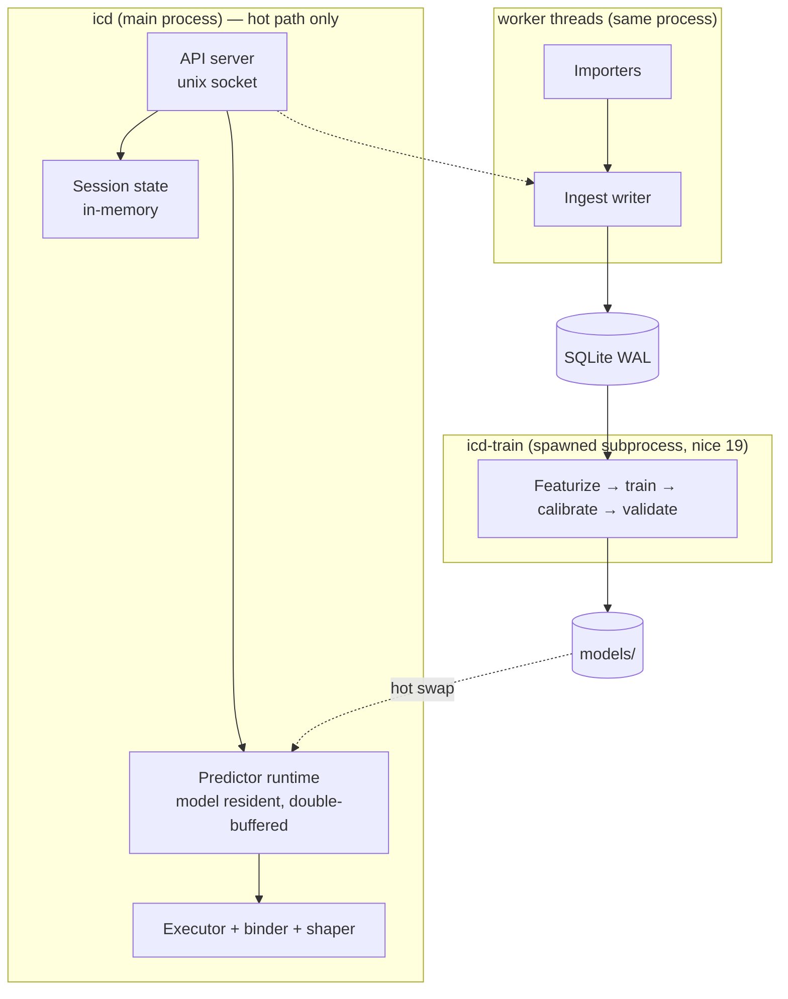

# Daemon and API Contract

2026-09-22 · companion to *Interaction Compiler — Design Spec*

> Naming is unsettled (`Hotpath` / `Lode` are the front-runners). This document uses `icd`
> for the daemon and `ic` for the CLI, matching the original spec, so a rename is a
> mechanical find-and-replace rather than a rewrite.

## What changed, and why the daemon changes with it

The original spec put a **miner** offline and a **matcher** on the hot path: extract entities
with strict regexes, look up paths by entity type, execute. Cheap, but the intelligence lived
entirely offline.

We have since moved to a **predictor-centric** design. The gate is a learned next-action
predictor over session state, not a regex match over prompt text. That single change has four
consequences the daemon must absorb:

| Consequence | Requirement it creates |
|---|---|
| A model runs on every trigger | The API process must hold it resident and warm; cold-start blows the budget |
| The predictor consumes *session state*, not just prompt text | The daemon must own session state so the adapter stays dumb and the call stays small |
| Training is now ML, not set-mining | The trainer must be a killable subprocess, not a worker thread sharing the hot path |
| Firing is an expected-value decision, not a boolean match | Per-path economics must be live in memory, and thresholds derived rather than configured |

Two invariants from the design discussion are enforced structurally here, not by convention:

1. **Guards gate; bindings are never guessed.** The predictor decides *whether* a path applies.
   Every value that reaches `execve` or a file read passes a type contract first.
2. **Propose with intelligence, validate with types.** A binding may be proposed from anywhere —
   prompt, branch name, session history, prior step output. It must still satisfy its contract.

---

## Process model



**The isolation rule that matters:** the trainer is a *separate process*, spawned on demand or
by timer, resource-limited, and killable at any moment without touching the hot path. The
original spec made the miner a worker thread; that was defensible for set-mining over SQLite
and is not defensible for model training.

| Component | Process | Isolation rule |
|---|---|---|
| API server | main, single event loop | Never does blocking I/O; never waits on ingest, import, or training |
| Predictor runtime | main, resident | Model in memory at all times; swaps are atomic pointer flips |
| Executor | main, bounded pool | Global concurrency cap (default 8); deadline-aware |
| Session state | main, in-memory + periodic flush | Capped ring buffers; loss on crash is acceptable |
| Ingest writer | worker thread | Batched, WAL; drops live events under back-pressure before slowing the API |
| Importers | worker thread per harness | Parser error quarantines the file, never the daemon |
| Trainer | **subprocess**, `nice 19`, cgroup/`ulimit` capped | Killed on battery, on hot-path pressure, or on shutdown; never holds a write txn |

---

## Session state is daemon-owned

The adapter sends only what the harness alone knows. Everything else the daemon derives and
caches. This keeps the trigger payload small (the socket write is measurable at this budget)
and means adding a feature to the predictor does not require shipping new adapters.

```ts
interface SessionState {
  key: string                        // "{harness}:{nativeSessionId}"
  harness: HarnessId
  repo: RepoKey                      // realpath(gitroot) + hash(normalized origin)
  cwd: string
  model: string
  agent: string
  turn: number
  startedAt: number

  actions: RingBuffer<CanonicalAction>   // last 64, normalized
  entities: Entity[]                     // accumulated, deduped
  firstWriteAt?: number                  // closes the discovery window

  fired: Map<PathId, { version: number; turn: number; tokens: number }>
  injectedTokens: number                 // session budget, cap 25K

  repoSnapshot: RepoSnapshot             // shared, cached per repo
}

interface RepoSnapshot {
  branch: string
  headSha: string
  dirtyPaths: string[]
  recentCommits: { sha: string; subject: string; files: string[] }[]
  computedAt: number
}
```

`RepoSnapshot` is cached per repo and invalidated by a filesystem watch on `.git/HEAD` and
`.git/index`, with a 30s TTL floor. Computing it costs a few `git` calls; doing that on every
trigger would eat the entire decide budget on its own.

Session state is evicted 30 minutes after last activity, or on `session.end`.

---

## The trigger contract

One latency-critical endpoint. Everything else is administrative.

```ts
interface TriggerRequest {
  protocol: 1
  harness: HarnessId                 // "opencode" | "claude-code" | "codex"
  sessionKey: string
  site: "admission" | "continuation"
  turn: number
  cwd: string
  budgetMs: number                   // adapter's remaining budget; daemon never exceeds it
  capabilities: Capability[]
  policy: SessionPolicy

  // exactly one of these, by site:
  prompt?: string
  result?: {
    tool: string
    input: unknown
    output: string                   // truncated by the adapter at 256KB
    status: "completed" | "error"
  }
}

interface SessionPolicy {
  networkAllowed: boolean | "unknown"   // "unknown" is treated as false
  permissionMode?: string
  repoRoot?: string                     // daemon resolves from cwd if absent
}

type Capability =
  | "inject.admission"
  | "inject.continuation"
  | "inject.silent"
  | "session.end"
```

```ts
interface TriggerResponse {
  protocol: 1
  status: "complete" | "partial" | "skipped"
  skipReason?: "cold" | "no-paths" | "no-model" | "disabled" | "policy" | "budget"

  injections: Injection[]
  shadowed: PathId[]                 // run silently for scoring

  decision: {
    predictorVersion: string | null
    evaluated: number                // paths scored
    fired: number
    timings: { featurizeMs: number; predictMs: number; bindMs: number; executeMs: number }
  }
}

interface Injection {
  pathId: PathId
  version: number
  channel: "context"                 // reserved: "control" for escalate (see Effects)
  text: string
  tokens: number
  confidence: number                 // calibrated p(match) that fired this
}
```

### `/v1/trigger` always returns 200

Unless the request body is malformed, this endpoint returns `200` with an in-band `status`.
Daemon overload, missing model, dead trainer, policy refusal, budget exhaustion — all are
`200 { status: "skipped", skipReason: … }`.

This gives every adapter exactly one code path: read `injections`, emit them, exit 0. It removes
the temptation to write retry or error-handling logic into a component that runs inside the
user's prompt latency. Fail-open stops being a behaviour adapters must implement correctly and
becomes a property of the contract.

---

## Latency budget and tiered admission control

The budget splits into a **decide** phase and an **execute** phase with very different profiles.
Decide is CPU and must be bounded hard; execute is I/O and gets whatever remains.

| Stage | Target (p95) | Notes |
|---|---|---|
| Socket accept + JSON parse | 0.3 ms | Payload capped at 1 MB |
| Tier-0 admission check | 0.05 ms | In-memory counters only |
| Featurize | 0.5 ms | Repo snapshot cached; session features are already in memory |
| Predictor forward | 1–10 ms | Backend-dependent (see Guard backends) |
| Score + EV threshold | 0.1 ms | N dot products over active paths |
| Bind + validate | 0.5 ms | Type contracts, path resolution, deny-list |
| **Decide total** | **≤ 15 ms** | Hard ceiling; exceeded → skip, never queue |
| Execute | `budgetMs − decide` | Parallel; unfinished work dropped at the deadline |

### Tiered admission control

The continuation site fires on *every tool result*, which is an order of magnitude more traffic
than prompts. Running the predictor on all of it is waste. Three gates, cheapest first:

- **Tier 0 — counters (≈50 µs).** Does this repo have any active path in scope for this site?
  Is the session under its injection budget? Is the daemon warm? A cold repo costs one hash
  lookup and returns `skipped/no-paths`. This is the common case and must be genuinely free.
- **Tier 1 — cheap state delta (≈200 µs).** For continuation only: did this result change
  anything the predictor could act on? An `exec(vcs-read)` returning 40 bytes does not warrant
  a forward pass. Gate on tool class, output size, and whether any in-scope path declares a
  continuation trigger.
- **Tier 2 — predictor.** Only what survives.

### Deadline-aware queueing

The predictor is single-threaded. Under concurrent sessions, requests queue. The queue is
**admission-controlled against the deadline**: if current depth × mean forward time would exceed
the caller's remaining decide budget, the request is rejected immediately as
`skipped/budget` rather than queued and dropped later. Never accept work you cannot finish — a
late skip costs the user latency for nothing.

---

## Binding, type contracts, and the safety boundary

This is the part where the design's central safety claim is made mechanical.

The predictor may propose a binding from anywhere. Before any value becomes an argv element or
a resolved path, it satisfies a **type contract** declared in the IR:

```ts
type TypeContract =
  | { kind: "pattern"; regex: string }                      // anchored full match, RE2
  | { kind: "repo-path"; mustExist: boolean }               // realpath inside repoRoot, deny-list
  | { kind: "enum"; values: string[] }
  | { kind: "integer"; min?: number; max?: number }
  | { kind: "sha"; length: [number, number] }

type Arg =
  | { literal: string }
  | { binding: Binding; contract: TypeContract }            // contract is REQUIRED
```

**Load-time rejection:** a path document containing a non-literal `Arg` without a `contract` is
refused by the registry. This is a schema invariant, not a runtime check — it cannot be forgotten
by an author or emitted by a trainer.

**Runtime order** is fixed and non-negotiable:

1. Predictor proposes → 2. Contract validates → 3. Path resolution + symlink realpath →
4. Deny-list (`.env*`, `*.pem`, `*.key`, `id_*`, `**/secrets/**`, `**/credentials*`) →
5. argv array construction (never a shell string) → 6. execute.

A failure at any step drops that step and its dependents. It does not repair, coerce, or retry
with a near-miss value.

The contract applies identically to values bound from prior step output. Lookup results are
external data too — a `linked_files` array from a ticket system is exactly as untrusted as the
prompt.

---

## Effects and the `escalate` seam

`escalate` is deferred, but the schema carries it from the first commit so adding it is not a
migration.

```ts
type Effect = "read" | "infer" | "write"

interface StepBase {
  id: string
  effect: Effect                     // REQUIRED on every step, v1 must be "read"
  outcomes: string[]                 // v1: always ["ok"]; edges route on these
}
```

Three forward-compatibility decisions, all cheap now and expensive later:

1. **Every step declares an effect.** The daemon reads `allowedEffects` from config; v1 ships
   `["read"]` and rejects anything else at registry load. Adding `escalate` later is a config
   change plus an executor case, not a schema break.
2. **Steps declare outcomes and edges route on them.** v1 has exactly one outcome per step, so
   the DAG behaves as today. But "all steps always run" is never encoded structurally.
3. **Injection is a channel, not a string append.** `Injection.channel` is `"context"` in v1.
   `escalate` will return `channel: "control"`, which hands control back rather than appending
   text. Adapters that don't understand a channel ignore that injection — forward compatible by
   construction.

---

## Guard backends

Resolved at runtime by availability, mirroring the adapter capability pattern. No backend is a
hard dependency; a path declares what it needs and is simply not run where that isn't available.

```ts
interface GuardSpec {
  kind: "choice" | "bool" | "score"
  options?: string[]
  inputs: Binding[]
  minConfidence: number              // below → skip (v1) / escalate (v2)
  backends: GuardBackend[]           // ordered preference, first available wins
}

type GuardBackend = "speculate" | "rules" | "classifier" | "slm" | "remote"
```

| Backend | Latency | Resident | Notes |
|---|---|---|---|
| `speculate` | 0 | — | ≤3 read-only branches: run them all, let shaping trim. Preferred wherever it fits |
| `rules` | µs | — | Mined predicate, fully auditable |
| `classifier` | µs | yes | Per-path head over shared features, trained on mined traces |
| `slm` | 10–50 ms | yes | Local 1–3B, constrained decoding over the enum; logits give calibration free |
| `remote` | ~300 ms | no | Small hosted model with structured output, or Jev if it ever lands |

`GET /v1/guards/backends` reports which are present, their measured p50/p95, and whether each is
warm. A path whose `backends` list has no available entry shows as *not deliverable here* in
reports, rather than silently never firing.

**Prefer fewer decisions over better ones.** Where branches are read-only and few, `speculate`
beats every model in the table on latency, cost, and auditability.

---

## Full API surface

Unix socket at `$XDG_RUNTIME_DIR/icd.sock`, mode `0600`, peer UID checked on every connection.
HTTP/1.1 + JSON. No remote listener in local mode.

| Route | Mode | Purpose |
|---|---|---|
| `POST /v1/trigger` | sync, budgeted | **The hot path.** Decide, bind, execute, return injections |
| `POST /v1/sessions/{key}/events` | async 202 | Batch of live records (only where no transcript exists to tail) |
| `POST /v1/sessions/{key}/end` | async 202 | Close session; enqueue scoring + outcome labeling |
| `GET /v1/sessions/{key}` | sync | Debug: current state, fired paths, budget remaining |
| `POST /v1/import` | async 202 | `{ harness, path, mode: "once" \| "watch" }` |
| `GET /v1/import/status` | sync | Per-importer offsets, progress, quarantine rate |
| `POST /v1/train` | async 202 | Spawn trainer; optional repo scope, optional `--dry` |
| `GET /v1/train/status` | sync | Running job, progress, last completion, validation metrics |
| `DELETE /v1/train` | sync | Kill the trainer subprocess |
| `GET /v1/models` | sync | Available predictor versions, which is active, calibration curve |
| `POST /v1/models/{version}/activate` | sync | Validate against fixtures, then hot-swap |
| `GET /v1/paths` | sync | List by status, with live stats and economics |
| `GET /v1/paths/{id}` | sync | Full IR document + history |
| `PUT /v1/paths/{id}` | sync | **Author or overwrite a path.** Schema-validated, enters `shadow` |
| `POST /v1/paths/{id}/status` | sync | Manual promote / demote / retire |
| `POST /v1/paths/{id}/approve` | sync | Approve exec steps, pinned to executable content hash |
| `GET /v1/guards/backends` | sync | Availability, latency, warmth |
| `GET /v1/report` | sync | Fleet + per-path report |
| `POST /v1/purge` | sync | `{ before? , session? , all? }` |
| `GET /v1/health` | sync | Liveness, warmth, model version, hot-path percentiles, quarantine rate |

**`PUT /v1/paths/{id}` is the mining/authoring seam.** A hand-written path and a trained one are
the same document and enter the same lifecycle. An authored path still goes to `shadow` and still
has to clear the promotion gate — the human author is not trusted more than the trainer.

---

## Model lifecycle

```
models/
  2026-09-22T031500-a3f1/       version = timestamp + content hash
    predictor.onnx
    heads.bin                   per-path logistic heads
    calibration.json            reliability curve per path
    features.json               featurizer version + schema
    metrics.json                held-out PR curve, ECE, per-path AUC
  active -> 2026-09-22T031500-a3f1
```

**Training** runs in the subprocess, reads SQLite through a separate read-only connection, and
writes a new version directory. It never mutates the active pointer.

**Activation** is explicit (`POST /v1/models/{version}/activate`) or automatic if
`autoActivate` is set *and* the candidate clears gates: held-out PR-AUC not worse than active,
expected calibration error under threshold, and a fixture replay producing no new false fires on
a curated negative set.

**Hot swap** is a pointer flip behind a double buffer. Load into slot B, warm it with N synthetic
featurizations, validate, then swap. The hot path never blocks and never sees a half-loaded model.

**Warmth** is a first-class health field. On startup the daemon loads the active model and warms
it before accepting Tier-2 work; until then `/v1/trigger` returns `skipped/cold`. A cold daemon
degrades to zero injections, which is exactly the harness's normal behaviour.

**Featurizer versioning matters more than model versioning.** A model is only valid for the
featurizer it was trained against. `features.json` carries a schema hash; a mismatch refuses
activation rather than silently producing garbage predictions.

---

## Failure semantics

The invariant from the original spec holds and is now enforced at the contract level: *a failure
anywhere degrades to the harness's normal behaviour, never to a blocked or slower session.*

| Failure | Adapter sees | Daemon does |
|---|---|---|
| Daemon down | Connect refused → exit 0, no output | Service manager restarts |
| Daemon cold | `200 skipped/cold` | Warming; accepts Tier-0/1 only |
| No model | `200 skipped/no-model` | Serves nothing; health warns |
| Predictor queue saturated | `200 skipped/budget` | Rejects at admission, does not queue |
| Step fails or times out | Partial injections | Drops dependents; counts toward demotion |
| Binding contract fails | That path absent | Logged as `bind-reject` with the contract that refused |
| Trainer OOM / killed | Nothing | Active model unchanged; health warns; retry next window |
| Featurizer/model mismatch | `200 skipped/no-model` | Refuses activation; keeps prior model |
| SQLite busy | Nothing | Hot path is in-memory; ingest backs off |
| Malformed request | `400` | Only non-200 case; indicates an adapter bug, surfaces in CI |

---

## Storage deltas from the original spec

The original schema stands. Additions for the predictor-centric design:

```sql
create table models     (version text primary key, features_hash text, created_at timestamptz,
                         metrics jsonb, active bool default false);

create table predictions(session_id text, seq int, path_id text, model_version text,
                         p real, fired bool, ev_threshold real,
                         primary key (session_id, seq, path_id));

create table bind_rejects(session_id text, seq int, path_id text, step_id text,
                          contract jsonb, value_hash text, reason text);

alter table paths add column economics jsonb;   -- savings_usd, mean_injected_tokens, price
alter table paths add column authored_by text;  -- null = trained, else the human
```

`predictions` is what makes calibration measurable: every scored path, its probability, the
threshold it faced, and whether it fired. Joined against `windows.matched` from the holdout, it
yields the reliability curve with no extra instrumentation.

`bind_rejects` is the security telemetry. A spike in rejects for one contract is either a
predictor regression or someone probing the boundary; both are worth an alert.

---

## Open questions

- [ ] Does the decide budget hold on the slowest target machine, or does `slm` need to be
      opt-in per repo rather than per path?
- [ ] Should `PUT /v1/paths/{id}` accept a path whose guard names a backend the daemon lacks —
      store it as not-deliverable, or refuse it at write time?
- [ ] Does the trainer need the DB at all, or should it read a periodically-exported feature
      table? (Decouples training cadence from ingest, at the cost of staleness.)
- [ ] Where does per-repo config live — `.hotpath/config.json` in the repo, daemon config, or
      both with repo-wins precedence?
- [ ] Continuation-site volume is unmeasured. If Tier-1 rejects under ~90% of tool results,
      the site may need its own budget rather than sharing the admission one.
