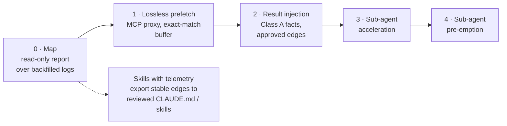
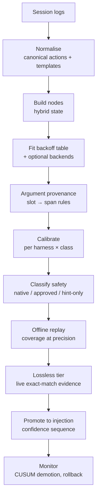

# Interaction Graph Compiler — Design v2

Sep 22, 2026 · Reviewed draft · Supersedes *Interaction Graph Compiler — Design*

> This revision consolidates a four-lens review (prior art, learning and statistics, runtime
> and security, product and model behaviour). Each reviewer voted independently on nine
> contested decisions; the tally and resolutions are in [Appendix A](#appendix-a--review-consensus).
> Corrections to factual claims in v1 are in [Appendix B](#appendix-b--corrections-to-v1).

---

## Vision

Every organisation running coding agents pays, in minutes, for the same rediscovery on every
session: the agent reads the ticket, finds the test, runs the build — and only then starts the
work. Those regularities are sitting in the session logs, unread.

The Interaction Graph Compiler learns them from your own history. First it produces a **measured
map** of what your agents actually do: which steps are predictable, which are dead ends, and what
each costs. Then, where a step is read-only and near-certain, it runs that step before the model
asks and hands over the result with its provenance attached, so the agent starts working on turn
one. Every compiled step carries its own evidence, is measured against a randomised holdout, and
demotes itself when a new model, a new harness, or a changed codebase makes it wrong.

Skills are guesses, written once. This is behaviour, measured continuously.

**One-line pitch:** *Your coding agents rediscover the same things at the start of every session.
This learns what they need from your own logs, fetches it before they ask, and proves with a
holdout that it helped.*

---

## The problem, precisely

An agent turn is expensive in three ways that compound:

- **Latency.** Each turn is a serial model round trip. Discovery turns — look up the ticket, find
  the file, run the lookup — happen before any useful thought and cannot overlap with each other.
- **Context re-reads.** Each turn re-reads the whole cached prefix. Removing a turn at 80K context
  removes 80K of cache reads, plus that turn's output tokens.
- **Wandering.** Each turn is another chance for the agent to take a detour.

Inference prices for a fixed capability are falling roughly an order of magnitude a year. Serial
round trips are not. That is why this document leads with **time to first useful edit**, and
treats dollar cost as a guardrail that must not get worse rather than the headline.

Early evidence from a small personal corpus (one harness, a few thousand tool calls) is
directionally encouraging and sets expectations for what the work corpus must show:

| Observation | Value | Implication |
| --- | --- | --- |
| Share of tool calls that are shell commands | 71% | Shell normalisation is the critical path, not a detail |
| Action repeat rate, literal → templated arguments | 37% → 73% | Argument templates carry the signal |
| Next-action top-1, unigram → bigram with backoff | 31% → 47% | Even one step of history is informative |
| Discovery windows hitting an 8-action cap | 44% | Windows are longer than assumed; cap must rise |

---

## Where this sits among existing systems

The v1 claim that this combination "is not published anywhere" does not survive review. Four
systems already mine agent traces and pre-execute predicted read-only calls:

| System | What it does | Delivery | Reported result |
| --- | --- | --- | --- |
| **PASTE** (2026) | Mines recurring tool-call patterns; speculatively executes predicted tools while the LLM is still generating | **Lossless** — result used only if the real call matches | 43.5% lower task completion time |
| **Speculate with Memory** (Salesforce, 2026) | Contrastive transition table + episodic memory + confusion tracker drive a small speculator model | **Lossless** — trajectory identical to non-speculative run | 19–39% relative gain in action-prediction accuracy |
| **AutoTool** (AAAI 2026) | Builds a tool-transition graph from trajectories and issues "inertial" calls with no LLM in the loop | **Lossy** — removes model calls | Up to 30% lower inference cost |
| **speculate** (open source) | Local MCP proxy that learns per-workspace call sequences and prefetches `readOnlyHint` calls into a single-use buffer | **Lossless** — buffer consumed only on an exact-match call | Reports useful, wasted, and time saved |

The useful distinction is **lossless versus lossy**. Lossless speculation hides tool latency and
cannot change agent behaviour. Lossy speculation — putting results into the model's context —
removes turns, and therefore *can* change behaviour.

What remains genuinely new here:

1. **Turn elimination inside commercial coding harnesses.** For coding agents, `Read` and `Grep`
   take milliseconds; hiding their latency buys little. The prize is the turn, not the tool wait.
   Only AutoTool removes turns, and only on benchmarks.
2. **Deployment against real organisational logs with a randomised holdout,** so every claimed
   saving is a measured causal difference rather than a projection.
3. **Sub-agent acceleration and pre-emption.** No prior art was found. A delegation is a whole
   nested session; predicting its discovery phase is worth far more than predicting a `read`.

The design therefore adopts lossless speculation as **its own first runtime tier** and as the
baseline every lossy tier must beat.

### Mechanisms borrowed, and the lesson each carries

| Source | Mechanism | Lesson adopted here |
| --- | --- | --- |
| Feedback-directed prefetching | Throttle on accuracy, timeliness, and pollution separately | Measure all three; accuracy alone hides waste and lateness |
| Markov / correlation prefetchers | Issue several candidates in priority order | Keep top-k successors, not one "dominant" edge |
| Temporal streaming | Amortise lookup over a stream of prefetches | Chains are valuable, but only in lossless form at first |
| TAGE branch predictor | Tagged tables at several history lengths with backoff | Variable-length history with PPM-style backoff, not a fixed "last 3" |
| Confidence estimators | Confidence from recent per-entry correctness | Adapt quickly to drift; a lifetime bound reacts too slowly |
| Speculative Actions | Launch when hit-probability × saving > marginal cost | Fire on expected value, not a fixed threshold |
| PASTE, AutoTool | Structured signatures; explicit argument provenance | Every argument has a declared source rule |
| Speculate with Memory | Confusion tracker; learn from misses | Mispredictions repeated ≥3 times become hard suppressions |
| AutoTool | Never chain automatic calls; cap their share | Bound automatic actions per session |
| vCache | Per-entry learned similarity threshold with an error bound | No single global cosine threshold |
| LuaJIT | `hotexit`, `tryside` — blacklist traces that keep aborting | After N demotions, blacklist the context instead of re-mining forever |
| SQL Server automatic tuning | Force last known good plan on significant regression | Keep each edge's last good version; roll back automatically |
| Postgres generic plans | Generic plan only after it is shown not to be worse | Promote only against a measured uncached baseline |
| Process mining | Directly-follows graphs mislead under concurrency | Agents issue parallel calls; model the batch, not a strict sequence |
| Recommender systems | Degenerate feedback loops; propensity logging | Never learn from sessions you steered without correction |

---

## Design principles

1. **Lossless before lossy.** Speculate without changing behaviour first. Inject only once an edge
   has proven itself losslessly and offline.
2. **Facts, not advice.** Inject data that was fetched, never recommendations about what to do.
3. **Discrete where discrete, embeddings only for intent.** Actions, exit codes, and order are
   symbols; match them exactly. Use embeddings for the free-text part of the prompt.
4. **One rule everywhere.** Mining, shadow scoring, and serving use the same lookup and the same
   probabilities. No statistic is estimated on one population and applied to another.
5. **Act on expected value.** Every firing decision weighs calibrated probability, saving, token
   cost over the rest of the session, and the harm of being wrong for that injection class.
6. **Never learn from your own influence.** Training data excludes steered behaviour unless it is
   explicitly corrected for.
7. **Off the critical path, fail open.** A crashed daemon, a slow index, or a hung prefetch has
   exactly one outcome: the agent behaves as if the compiler does not exist.
8. **Every edge carries its evidence and its last good version.** Regressions roll back; repeat
   offenders are blacklisted.

---

## The product ladder

Each rung is independently valuable and gates the next. A pilot can stop on any rung and still
have shipped something useful.



| Rung | Changes agent behaviour? | Value | What it proves for the next rung |
| --- | --- | --- | --- |
| **0 · Map** | No | Turns-before-first-edit per workflow, recurring discovery sequences, dead-end loops, cost per behaviour | Whether predictable structure exists at all |
| **1 · Lossless prefetch** | No | Hides latency of slow read-only tools (MCP lookups, ticket systems) | Live exact-match accuracy on real sessions |
| **2 · Result injection** | Yes | Removes discovery turns | Causal time-to-first-edit reduction against holdout |
| **3 · Sub-agent acceleration** | Yes, inside the child | Shortens a delegated session's own discovery phase | Delegation-level savings, attributable |
| **4 · Sub-agent pre-emption** | Yes, removes a spawn | Replaces a predictable delegation with its predicted result | — |

**The Map is the wedge.** It installs no hooks, changes nothing, and answers the credibility
question directly. It is also the most defensible artefact: an auditable, measured account of what
an organisation's agents do and what each behaviour is worth.

**Skills with telemetry** is a side-branch worth naming. The plainest competitor to this system is
a person who reads the Map and writes one line into `CLAUDE.md`. That should be supported, not
fought — stable edges can be exported as reviewed guidance that keeps its decay monitoring — and it
should be an explicit arm in the experiment, because the compiler must beat it on conditionality,
measurement, and self-demotion to justify itself.

---

## The model

### Nodes

A **node** is a point in a session where the agent is about to decide something.

| Kind | Created when | Carries |
| --- | --- | --- |
| `prompt` | User submits a turn | Prompt text, repo, branch, dirty-file bucket, turn index |
| `tool_batch` | A batch of parallel tool calls returns | Canonical action templates, outcome classes, previous history |
| `delegate` | A sub-agent is spawned or returns | Agent type, task description, spawn depth, result summary |

v1 used `tool_complete`. Agents issue parallel calls within one turn, and savings accrue per turn,
so the unit is the **batch**.

### State representation

v1 serialised the whole state into text and embedded it with frozen `all-MiniLM-L6-v2`. All four
reviewers rejected that as the primary representation:

- It truncates at 256 word pieces and was trained at 128.
- It splits paths and build targets like `//auth/...` into subword noise.
- Mean pooling discards order, so `search → read → exec` and `read → search → exec` embed almost
  identically.
- The shared template scaffolding in every serialised node (`intent: … recent: …`) inflates
  baseline similarity, so a cosine threshold mostly measures the template.
- Independent work finds frozen embeddings put "check email" and "send email" at about 0.91
  cosine. The verb is exactly what must not be blurred.

v2 uses a **hybrid state**, discrete where the signal is discrete:

```text
key      = (repo, harness, agent_type, node_kind)
history  = canonical action templates, last 1..16, with outcome classes
           → hashed n-gram keys at lengths 1, 2, 4, 8, 16   (TAGE-style)
meta     = turn index, actions since prompt, dirty-file bucket, model id
intent   = small sentence embedding of the prompt text only
result   = code-aware embedding of the head of the last result or error (optional)
spans    = typed values present in context: paths, IDs, targets, SHAs
```

### Prediction target

The target is not a verb — "next is `exec`" is not executable. It is a **template plus slot
bindings**:

```text
y = ( template_id,  slot → span pointer )
    e.g.  exec[lookup] ./scripts/wi-lookup {slot0} --json
          slot0 → span "W-4821" in the prompt
```

Every slot must point at a span already present in the context or in a prior result. Argument
provenance is a mechanism, not a filter: if no rule binds a slot, the edge is not executable.

### Predictor

The core predictor is a **variable-length backoff table** over templates — TAGE and PPM applied to
agent actions. It is cheap, interpretable, needs no GPU, and doubles as the fast-path index at
runtime.

Everything else sits behind one interface:

```ts
interface Predictor {
  // Typed choice over candidate successors, each with a calibrated probability.
  predict(state: State, candidates: Template[]): { template: Template; p: number }[]
}
```

Backends are pluggable and must *earn* their place offline: a gradient-boosted model over the
hybrid features, a small local model with constrained decoding, a hosted small model, or a
dedicated decision model if one becomes available. A backend replaces the backoff table only if it
beats it by at least 5 points of top-1 accuracy on held-out sessions.

### Edges

An **edge** is the human-readable view of what the predictor has learned — "in this context, this
template follows, with this probability, on this evidence". Edges are what `ic edges` lists, what
the Map reports, what humans approve, and what gets demoted. They are the audit surface; the
predictor is the engine.

---

## Learning pipeline

All offline. Nothing here is on the agent's critical path.



### Normalisation

Shell commands are parsed with a tree-sitter-bash AST: unwrap `bash -lc`, track `cd` chains,
split sequences, keep compound constructs (`for`, `if`) opaque rather than shredding them, strip
`VAR=value` prefixes, and use **per-command flag grammars** — `-n` takes a value for `head` but not
for `rg`, and a shared table silently corrupts templates.

Gate: at least 95% of calls normalise to a non-`unknown` action, verified against 300+ golden
fixtures per harness version. The canonical vocabulary also needs a category for harness-control
tools (tool search, planning, messaging) that are neither context-gathering nor mutation.

### Training data: never learn from your own influence

Once injection starts, steered sessions no longer show natural behaviour. Re-mining on them makes
edges confirm themselves. Training data is restricted to:

- sessions from before the compiler was installed,
- holdout sessions,
- lossless-tier sessions, which by construction did not change behaviour,
- treated sessions truncated at their first injection, weighted by inverse propensity.

Every injected node is tagged, so this partition is exact rather than inferred.

### Outcome labels

v1 used git outcomes as a mining filter. Next-action prediction is self-supervised and does not
need them, and git labels are confounded: short, easy sessions are the ones that get labelled, so
"outcome correlation" mostly measures task difficulty. In v2, outcomes are **guardrails in
randomised comparisons only**, built from several weak signals:

- final test or build status after edits,
- user interrupts, rejected tool calls, "no, not that" follow-ups,
- edit churn within the session,
- CI green on first push, review comment count,
- line survival or fix-forward within 7 days,
- a follow-up fix session on the same files,
- revert, kept as a lagging signal.

A Snorkel-style label model combines these, calibrated against a few hundred hand-labelled sessions.

### Promotion, demotion, rollback

- **Count evidence in distinct sessions across distinct days,** never raw instances. One session
  looping build → test 25 times is one observation.
- **Promote with anytime-valid confidence sequences** or a sequential probability ratio test, not a
  Wilson bound re-checked nightly — repeated peeking inflates false promotions.
- **Demote with CUSUM** on recent per-edge accuracy, which reacts to drift quickly.
- **Roll back** to the edge's last good version on a statistically significant regression, rather
  than dropping it.
- **Blacklist** a context after three demotions; stop re-mining it until something structural
  changes (a new model, a new repo layout).
- **Suppress repeated misses:** any mispredicted successor seen three or more times in a context
  becomes a hard constraint for that context.

### Model and harness churn

Some edges encode the environment ("a prompt naming a work item leads to its lookup") and survive a
model upgrade. Others encode one model's habits ("grep before read") and do not.

- Key every statistic by (model id, harness version, effort level).
- Detect regime changes — including undeclared ones — with CUSUM on per-edge accuracy and on the
  distribution of action bigrams.
- On a change, keep environment-type edges active and re-validate them against a discounted prior.
  Send habit-type edges back to the lossless tier.
- Report each edge's **half-life across model generations.** The durable part of the Map is the
  product; the rest is cache.

---

## Deciding to act

v1 scored candidates with `sim × conf_LB × log(1+n)` and fired above fixed thresholds. That
formula multiplies quantities with different units, counts support twice, and ignores cost. Worse,
its thresholds run opposite to the risk: a read-only prefetch should need little evidence, a hint
that steers the agent should need a lot.

v2 fires on **expected value**, per injection class:

```text
EV  = p_lo · S  −  C_inject  −  (1 − p_lo) · H_class

p_lo      conservative calibrated probability (posterior lower quantile, session-counted)
S         saving if right: the turn's cache reads + its output tokens + latency value
C_inject  injected tokens × (cache-write price + cache-read price × E[remaining turns])
H_class   harm if wrong: ≈0 for lossless, moderate for facts, high for anything steering
```

Two consequences matter:

- **Injected tokens persist.** Every injected token joins the cached prefix and is re-read on every
  later turn. A 400-token injection in a 60-turn session costs about 2.9K token-equivalents. Hints
  that do not help pile up.
- **Lossless speculation is almost always worth it.** With no harm term, it breaks even at a hit
  rate of a few percent, which is why it runs broadly and injection runs narrowly.

A turn is only saved if **every** call in it was covered. A prefetch that covers two of three
parallel calls saves nothing.

---

## Runtime

### Architecture

```mermaid
sequenceDiagram
  participant H as Harness
  participant C as Hook client
  participant D as icd daemon
  participant X as Sandboxed executor
  H->>C: PreToolUse (call about to run)
  C->>C: T0 hot-key check (mmap), exit on miss
  C->>D: predict successor
  D->>X: start speculative prefetch (async)
  C-->>H: exit 0, no output
  Note over H: tool runs; prefetch overlaps it
  H->>C: PostToolUse / PostToolBatch
  C->>D: ready results for this session?
  D-->>C: injection if ready and EV > 0
  C-->>H: additionalContext, exit 0
```

The key change from v1: **speculation starts at `PreToolUse` and delivers at `PostToolUse` or
`PostToolBatch`.** The prefetch overlaps the tool's own execution and the result is only injected
if it is ready. v1 ran the prefetch synchronously inside `PostToolUse`, adding up to 2.5 seconds to
the agent loop on every match.

### Tiered admission

Most hook calls must not reach the embedding model.

- **T0 — hot-key set (client side).** The hook client reads only the event name, tool name, and a
  few fields, and checks an mmap'd set of keys built by the miner. On a miss it exits without
  contacting the daemon. This is the common case.
- **T1 — exact template match (daemon).** Backoff-table lookup.
- **T2 — embedding (daemon).** Only for prompt nodes and T1 survivors that need intent; int8 model,
  one warm thread, results cached by node hash.

### Latency budget

| Stage | p50 | p95 |
| --- | --- | --- |
| Process spawn + client start | 3 ms | 8 ms |
| Read stdin (tool responses can be large) | 0.2 ms | 2 ms |
| T0 miss → exit (most calls) | 0.1 ms | 0.3 ms |
| **End-to-end, no match** | **≈4 ms** | **≈10 ms** |
| Socket round trip | 0.1 ms | 0.5 ms |
| T1 template match | 0.2 ms | 1 ms |
| T2 embedding (int8, ≤128 tokens) | 4 ms | 12 ms |
| Scoring | 0.3 ms | 1 ms |
| **End-to-end, match, no execution** | **≈10 ms** | **≈25 ms** |
| Result delivery from speculative buffer | ≈1 ms | — |
| Blocking prefetch (prompt nodes only, where no overlap is possible) | — | ≤1,500 ms |

On Claude Code, `http` hooks remove the spawn cost entirely and fail open natively; command hooks
should use exec form to skip `/bin/sh`. The static Go client remains for Codex.

### Lossless tier

The lossless tier is an **MCP proxy** in front of slow read-only tools, following `speculate`:
predicted calls execute into a short-lived, single-use buffer, consumed only by an exact-match
call; a mutating call clears the server's buffer. It works identically in all three harnesses,
because all three speak MCP.

It is worth more than its latency savings. Every buffer hit is exact-argument evidence gathered
from live, *unsteered* sessions — precisely the evidence needed to promote an edge to injection,
and uncontaminated training data besides.

### Components

| Artifact | Role |
| --- | --- |
| `icd` | Daemon and CLI: importers, normaliser, miner, predictor, executor, reports |
| `icd-hook` | Static Go hook client with T0 hot-key check |
| `icd-mcp` | MCP proxy for the lossless tier |
| `@ic/opencode-plugin` | OpenCode in-process adapter |
| Embedding model | Bundled ONNX, pinned version — a silent upgrade invalidates every stored vector |

Storage lives under `~/.local/share/icd/`; the socket is mode `0600` with peer-credential checks;
there is no remote listener.

---

## Harness integration

Verified against current documentation and local installs on 2026-09-22. Hook capabilities vary by
version, so the adapter must detect them rather than assume them.

| Capability | Claude Code | Codex CLI | OpenCode V2 |
| --- | --- | --- | --- |
| Adapter | Command or `http` hook | Command hook | In-process plugin |
| Prompt injection | `UserPromptSubmit` → `additionalContext` | `UserPromptSubmit` → `additionalContext` | `session.hook("prompt")` |
| Post-tool injection | `PostToolUse`, `PostToolBatch` → `additionalContext` | `PostToolUse` → `additionalContext` | `tool.hook("execute.after")` mutates the result |
| Pre-tool | `PreToolUse`: `additionalContext`, `updatedInput`, decision | `PreToolUse`: `additionalContext`, `updatedInput` | `tool.hook("execute.before")` |
| Pre-request | — | — | `session.hook("context")` — append to tail only |
| Sub-agent events | `SubagentStart` (context goes to the child), `SubagentStop` | `SubagentStart`, `SubagentStop` | Child sessions |
| Session end | `SessionEnd` (short shared budget) | `SessionEnd` (main thread, ≤3 s) | Event stream |
| Silent to user | Yes | Assume **visible** | Unverified |
| Context size cap | 10,000 chars; overflow spilled to file | ≈2,500 tokens; overflow spilled to file | — |
| Parent link for sub-agents | **Exact** — see Sub-agents | Present (`session_id`) | `parent_id` |
| Hook trust | — | Hash-pinned; new or changed hooks need user review | — |

Integration notes that change the implementation:

- **Matcher.** The Claude Code sub-agent tool is now `Agent`, not `Task`. A matcher containing
  regex metacharacters is an unanchored regex, so `Task` would also match `TaskCreate` and
  friends. Anchor it.
- **Codex trust.** `ic install` cannot silently enable hooks in Codex; changing the command string
  forces re-review. Keep the command path stable.
- **Exit codes.** The client must never exit 2 — on `PostToolUse` that surfaces stderr to the model
  — and must always drain stdin.
- **Live capture** should use hook stdin payloads, which are documented, rather than tailing
  transcripts, whose formats both vendors describe as unstable.
- **Prompt caching.** Hook context is appended at the tail on every major provider, so it never
  invalidates the cached prefix. The cost is persistence, not invalidation — see *Deciding to act*.
  In OpenCode, never edit the system prompt from the `context` hook.

---

## Agent interaction model

An injection is text in the model's context. There is no special channel, so the wording carries
the entire contract. The review found v1's wording rules only partly supported by research.

### What survives

- **Never claim the user asked.** Strongly supported. The agent otherwise reports back on lookups
  the user never requested.
- **Never phrase it as an instruction.** Supported, but with a caveat that changed the design:

### What changed

- **No percentages.** "91% of sessions ran `bazel test` next" is not neutral evidence; research on
  social-proof cues finds models heavily swayed by such statistics. It works as a softer
  instruction. Use a coarse label ("routine lookup") plus provenance instead.
- **Permission-to-deviate clauses are weak.** Instructions like "ignore this if it doesn't apply"
  measurably fail to de-anchor models. They stay, but they are not a safety mechanism.
- **Irrelevant context is not free.** Models adopt plausible-but-wrong retrieved context over their
  own correct prior more often than not, and a single irrelevant sentence measurably lowers
  reasoning accuracy. v1's "irrelevant pre-fetch → agent ignores it" is too optimistic.
- **Don't invite a re-fetch.** "Verify before relying on it" makes the agent re-run the lookup and
  erases the saving. Instead include the exact command and a timestamp, so re-verifying is cheap
  *when* the agent has reason to.
- **Influence is measured by behaviour, not by what the agent writes.** Models rarely mention the
  inputs that biased them, so "visibly relies on it" cannot be read from the agent's text.

### Injection classes in v2

| Class | v1 | v2 |
| --- | --- | --- |
| **A — Result** | Ship | **Ship**, facts only, schema-extracted fields, approved edges |
| **B — Hint** | Ship | **Shadow only**, re-scoped to *anti-edges* (dead-end avoidance) |
| **C — Plan** | Ship | **Cut** from v1 |

**Why B is re-scoped.** A hint for a step the agent takes 91% of the time only changes behaviour in
the other 9% — exactly where following it is most likely wrong — and it saves no turn, because the
agent still has to run the command. The one hint with real information content is a dead end:
*"`npm test` fails in this repo; successful sessions use `pnpm test`."* That is procedural
knowledge the agent cannot derive, and it is where hints will earn their place.

**Why C is cut.** Chained errors compound, joint confidence cannot be validated at pilot volumes,
and plans carry the highest anchoring risk. Plan-caching research shows modest gains on short
tasks. It returns only in lossless form, as a prefetch chain.

### The Class A format

```text
<compiled-context source="icd" edge="wi-lookup@v3" fetched="2026-09-22T14:02:11Z">
Routine lookup, run automatically for this prompt. Not requested by you.
Command: wi-lookup W-4821 --json

id: W-4821
title: Auth token refresh fails on rotation
state: In Progress
files: auth/token.rs, auth/rotate.rs
</compiled-context>
```

Only schema-extracted fields are injected — never free text from tickets, web pages, or MCP
payloads (see *Security*). Delimiters inside the payload are escaped.

One harness constraint limits Class A for files: Claude Code's `Edit` requires an actual `Read` of
the file earlier in the session. Prefetching a file the agent will *edit* saves nothing. Class A
file reads pay off for files that are read but not edited — context, not targets.

---

## Sub-agents

Delegation is the highest-value target: a spawn is an entire nested session with its own context
window and its own discovery phase.

### Parent links are exact

v1 said Claude Code provides no parent link and proposed reconstruction by timestamp and cwd. That
is wrong, and verified locally:

- Sub-agent transcripts live at `<project>/<sessionId>/subagents/agent-<id>.jsonl`.
- Every record carries the parent's `sessionId`, plus `agentId`, `isSidechain`, `parentUuid`.
- A sidecar `agent-<id>.meta.json` records `agentType`, `description`, `toolUseId` (the exact
  `Agent` call in the parent), `parentAgentId`, and `spawnDepth` (depths 1–3 observed).
- Large tool outputs are stored in a sibling `<sessionId>/tool-results/` directory, which the
  importer must read.

No heuristic is needed. Capture these links from step one — they cost nothing.

### The sub-agent ladder

1. **Capture.** Child sessions are first-class sessions, scoped by agent type: edges mined inside a
   `code-search` agent never apply to a `test-writer`, however similar the contexts look.
2. **Acceleration.** `SubagentStart` context goes *into the child*. Prefetch the child's own
   predictable discovery phase there. This removes turns inside the delegation without removing the
   delegation — the parent's reasoning is untouched.
3. **Pre-emption.** Replace a predictable delegation with its predicted result. This requires
   denying the `Agent` call at `PreToolUse`, which changes the parent's behaviour, so it comes last
   and only with measured evidence that the 10–30× saving is real.

Acceleration is new in v2 and captures much of the value of pre-emption at a fraction of the risk.

---

## Safety and security

Pre-execution happens outside the harness's own permission system. The daemon must therefore be
stricter than the harness, not merely as strict.

| Threat | v1 exposure | v2 control |
| --- | --- | --- |
| **"Read-only" commands that aren't** | v1's flagship examples fail its own filter: `bazel build/test` run repo-controlled code and write outputs; `wi-lookup` makes network calls. A malicious branch edits `BUILD` and the daemon runs it | Only **daemon-native readers** run without approval: file read, ripgrep, an allowlist of `git` read commands (`-c core.pager=cat`, no hooks). Anything else needs human approval pinned to realpath, executable sha256, argv template, and environment allowlist, re-checked every run |
| **Harness policy bypass** | Daemon ignores harness deny rules | Refuse anything the harness's own deny or ask rules would have stopped |
| **Indirect prompt injection** | Untrusted ticket and web text re-emitted inside a trusted-looking wrapper, with a confidence score | Inject schema-extracted fields only; escape delimiters; **taint tracking** — any node whose arguments came from external content may be a hint at most |
| **Argument injection** | IDs from prompts flow into argv; a value like `--config=/x` or a symlink to `~/.ssh` | `execve`, never a shell; per-slot type validators learned from observed values; reject leading `-`; insert `--`; open paths with `openat` + `O_NOFOLLOW` under a repo-root handle |
| **Secrets in injected output** | Persisted in transcripts, spill files, and `icd.db` | Secret scanner (patterns + entropy) before injection; deny `.env`, `*.pem`, `~/.aws`; store only payload hashes |
| **Cross-repo or cross-session leakage** | Results keyed by origin URL shared across clones | Result cache keyed by (repo realpath, HEAD, session); filter the index by repo *before* nearest-neighbour search |
| **Graph poisoning** | A README that makes agents repeat a command can plant an edge | Signed index; support counted in distinct sessions across distinct days; human approval before any executing edge activates |
| **Sandbox escape** | None | Network off, read-only filesystem scoped to the repo: `sandbox-exec` on macOS, Landlock + seccomp + network namespace on Linux |

**Automatic-action limits** (from AutoTool): never chain two injected actions without an
intervening model turn, and cap injected actions per session.

---

## Measurement

Every claimed saving is a measured difference between randomised arms. Nothing is estimated.

### Design

- **Randomise per session,** by hashing the session ID at `UserPromptSubmit`, stratified by
  developer, with standard errors clustered by developer. A separate holdout per edge does not work:
  with hundreds of active edges almost no session is untreated, and edges change each other's state
  distributions.
- **Log exposure in the holdout.** Record "would have injected edge E" in untreated sessions and
  analyse triggered sessions only. Otherwise the effect is diluted by every session no edge touched.
- **Log propensities.** In treated sessions, fire stochastically with probabilities clipped to
  [ε, 1−ε] and log them. This enables off-policy evaluation of new policies before they ship.
- **Knock out edges individually.** Within treated sessions, disable each active edge independently
  with ~20% probability. This factorial design estimates each edge's own effect; the global holdout
  estimates the total.
- **Include a static-guidance arm.** Stable edges written as `CLAUDE.md` lines. The compiler must
  beat the simplest thing that could work.

### The anchoring metric

v1 said "genuinely deterministic" and "the agent stopped thinking" look identical in aggregate. They
don't, with the right comparison. For each edge, compare how often the predicted step is taken in
triggered holdout sessions (p₀, the natural rate) with treated sessions (p₁). **p₁ − p₀ is the share
of sessions the injection steered.** Report outcomes for that steered group separately. An edge with
high compliance lift and worse guardrails is harmful, however well it predicts.

### Metrics

| Metric | Role | Target |
| --- | --- | --- |
| Wall-clock time to first edit | **Primary** | −20% in triggered sessions |
| Turns to first edit | Secondary | Lower, and lower variance |
| Net session cost, cache-aware | Guardrail | Not worse |
| Compliance lift (p₁ − p₀) | Guardrail | < 5 points per edge |
| User-correction rate | Guardrail | Non-inferior, +1 point margin |
| CI failure on first push | Guardrail | Non-inferior, +1 point margin |
| Rework within 14 days | Guardrail (lagging) | Non-inferior |
| Accuracy, coverage, timeliness, pollution | Predictor health | Tracked separately |

### Power

Assuming turns-to-first-edit has a standard deviation of about 6, two-sided α = 0.05, power 0.8:

| Question | 10% holdout | 50/50 split |
| --- | --- | --- |
| Detect −2 turns to first edit | ~785 triggered sessions | ~285 |
| Detect −1 turn | ~3,100 | — |
| Detect −1 turn with CUPED (~30% variance reduction) | ~2,200 | — |
| Detect revert rate 6% → 8% | ~12,300 | ~4,400 |

A permanent 10% holdout cannot detect quality harm at pilot volumes. **Run the pilot at 50/50,**
then move to a 5–10% global holdout plus per-edge knockouts at steady state. Use each developer's
pre-period mean as the CUPED covariate.

**Novelty effects** are in the developers, not the model: people start writing terser prompts or
trusting output more. Compare weeks 1–2 with weeks 3+. Don't rely on self-report — developers have
been measured believing they were faster while being slower.

---

## Build plan

The sequence matters more than the timeline. Each step gates the next, and the first three need no
hooks and change nothing.

| Step | Delivers | Gate to pass |
| --- | --- | --- |
| **0** | Importers, normaliser, **the Map** | ≥95% of historical calls normalise; the report is useful to a human on its own |
| **1** | Backoff predictor, argument provenance, calibration, offline replay | **The credibility test** (below) |
| **2** | Exposure and propensity logging, randomisation, holdout harness | Triggered-session analysis works on live traffic with nothing injected |
| **3** | Lossless MCP tier | Live exact-match accuracy measured; buffer hits feed promotion evidence |
| **4** | Class A injection, native readers + approved edges, one harness | Pilot success criteria (below) |
| **5** | Anti-edge hints, live | Compliance lift and guardrails measurable |
| **6** | Sub-agent acceleration via `SubagentStart` | Delegation-level savings against holdout |
| **7** | Sub-agent pre-emption | Measured savings justify the behaviour change |

### The credibility test (step 1)

This replaces v1's gate of "at least one edge clears support 30 and confidence 0.75", which a single
build-then-test loop would pass.

**Setup.** Split by time: train on months 1..k, validate on the next two weeks, test on the final
four. Separately hold out 20% of developers entirely. Session-clustered bootstrap for all intervals.

**Baselines.** Unigram; bigram with backoff (should reproduce ≈47%); order-4 backoff over templates
plus repo; and the v1 design (MiniLM + 0.85 clusters) as an ablation.

| # | Metric | Pass bar |
| --- | --- | --- |
| 1 | **Coverage at precision** — share of read-only pre-first-edit actions predicted, template + arguments, within 3 actions, resource unmutated before use | ≥15% at precision ≥0.90; interval lower bound ≥10% |
| 2 | **Turn coverage** — pre-first-edit turns where *every* call is covered at ≥0.90 | ≥8% |
| 3 | **Timeliness** — predictions that would arrive before the agent's own call | ≥80% |
| 4 | **Pollution** — unused injected tokens, including re-reads in later turns | <2% of session input tokens |
| 5 | **Calibration** — expected calibration error on the fired subset | ≤0.03 overall, ≤0.05 per harness |
| 6 | **Stability** — precision across the four test weeks | Drop ≤3 points; no week below 0.85 |
| 7 | **Net value** — simulated under the cost model | >0 at the 10th bootstrap percentile |
| 8 | **Breadth** | ≥50 templates, each firing in ≥30 distinct sessions, across ≥5 repos and ≥20 developers |
| 9 | **Learned backends** | Must beat order-4 backoff by ≥5 points top-1, or backoff ships |

**Kill criterion:** coverage below 5% at 0.90 precision means the premise fails. If so, ship the Map
alone — it is still useful.

### The pilot (step 4)

- **Scope:** one high-volume repo, one workflow. The work-item lookup is ideal: environment-
  determined, read-only, easy to verify.
- **Harness:** Claude Code — richest hooks, silent `additionalContext`, exact sub-agent links.
- **Participants:** opt in knowingly; a status line shows when an injection fired.
- **Design:** 4–6 weeks, 50/50, at least 1,500 triggered sessions.
- **Pre-registered primary:** wall-clock time to first edit down ≥20% in triggered sessions.
- **Guardrails:** non-inferiority on user-correction rate and CI failure (+1 point margin); compliance
  lift below 5 points on every edge; net cost not worse.

### Cut from v1

Class C · live Class B (shadow anti-edges only) · sub-agent pre-emption and sidechain
reconstruction · cross-harness mining (one harness first) · Codex and OpenCode adapters until after
the pilot · per-repo threshold tuning · the `exec` approval UI beyond a hand-maintained allowlist.

---

## Risks and open questions

### Risks

- **The distribution may be bimodal.** A tiny head so obvious a human writes it into `CLAUDE.md` in
  an afternoon, and a long tail that is genuinely reasoning-dependent, with nothing between. The
  credibility test measures this directly, and the static-guidance arm measures it live.
- **Edges may not outlive the model.** Measured, not assumed, via half-life across model
  generations.
- **Plausible-but-wrong context is followed, not ignored.** Mitigated by facts-only injection,
  compliance lift as a guardrail, and an offline replay suite that includes deliberately wrong
  injections — offline only, never in production.
- **Harnesses may absorb this.** Prefetch and speculative context are obvious features for harness
  vendors to build. The defensible part is what vendors will not do: mining one organisation's own
  long tail, with causal measurement.
- **Trace capture is a hard sell** in exactly the organisations with enough volume. Local-first,
  hashes-only in team mode, no per-person reporting.

### Decisions for the author

- [ ] Work or side project — IP clearance is required before any company session is used as data.
- [ ] Which harness and version the pilot population actually runs.
- [ ] Whether interaction records may be stored under data policy, and at what granularity.
- [ ] Who approves executing edges during the pilot.
- [ ] Name. `Hotpath` and `Lode` were earlier candidates; the lossless/lossy framing may suggest
      something better.

---

## Appendix A — Review consensus

Four reviewers voted independently. **K** = keep, **C** = change, **X** = cut.

| # | Decision | Prior art | Learning | Runtime | Product | Resolution |
| --- | --- | --- | --- | --- | --- | --- |
| D1 | Unit of learning: edges over embedding clusters | C | C | C | K | **Change.** Variable-length backoff table over templates is the core; learned models are pluggable backends that must beat it; edges remain the readable, approvable view. *(All four agree on backoff as core or baseline.)* |
| D2 | Frozen MiniLM over serialised state | C | C | C | C | **Change, unanimous.** Structured exact-match keys; embed prompt intent only. |
| D3 | Cluster at 0.85, predict via kNN at 0.82 | C | X | C | C | **Change, unanimous.** One rule for mining, shadow, and serving; no global cosine threshold. |
| D4 | Ship classes A, B, C in v1 | C | C | C | C | **Change, unanimous.** Ship A; B shadow-only as anti-edges *(3 of 4; runtime would ship B)*; cut C. Add lossless tier *(prior art)*. |
| D5 | Sub-agent pre-emption late | K | K | K | K | **Keep, unanimous.** Capture exact parent links from step one; add acceleration via `SubagentStart` before pre-emption. |
| D6 | Thresholds 0.75 / Wilson 0.94 / n≥50 | C | C | C | C | **Change, unanimous.** Wilson ≥0.94 is unreachable at n=50 (50/50 gives 0.929). Expected-value gate per class; session-counted evidence; sequential tests. |
| D7 | Permanent 10% per-edge holdout | C | C | C | C | **Change, unanimous.** Session-level global randomisation; 50/50 pilot; exposure and propensity logging; per-edge knockouts; auto-rollback. |
| D8 | Value framing | C | C | C | K | **Split 2–2.** Learning and prior art favour net dollars; runtime and product favour wall-clock time. Resolved as: wall-clock time to first edit is primary, cache-aware net cost is a hard guardrail. Latency is only credible because v2 moved prefetch off the critical path. |
| D9 | Build order, offline miner as step-3 gate | K | C | K | C | **Keep sequence, replace the gate.** Add the Map as step 0; coverage-at-precision gate with a kill criterion; logging before any injection; lossless before lossy. |

## Appendix B — Corrections to v1

| v1 claim | Finding |
| --- | --- |
| The combination "is not published anywhere" | PASTE, Speculate with Memory, AutoTool, and `speculate` all mine traces and pre-execute read-only calls |
| R2V and AgentDiet study pattern reuse | R2V routes steps between models; AgentDiet compresses trajectories. Neither mines reusable patterns |
| Claude Code sub-agents have no parent link | Exact links via `sessionId`, `toolUseId`, `parentAgentId`, `spawnDepth` — verified locally |
| MiniLM separates "look up" from "create" | Frozen embeddings put paired verbs like "check" and "send" at ~0.91 cosine |
| `PreToolUse` can only block or rewrite | It also supports `additionalContext` on Claude Code and Codex |
| `PreToolUse` injection would invalidate the cache | It lands in the same tail position as `PostToolUse` |
| Codex has no `SessionEnd`; no `additionalContext` on `PreToolUse` | Both exist in current Codex |
| Matcher `Task` captures delegations | The tool is now `Agent`; the unanchored regex also matched unrelated `Task*` tools |
| 5 ms p95 total with no match | Contradicted by the doc's own 10 ms embedding budget; achievable only with client-side T0 rejection |
| Wilson LB ≥0.94 at n ≥ 50 | Unreachable at n=50; needs 61 straight hits, or ~214 observations for an edge that is truly 0.97 |
| "The ranking function subtracts injection cost" | The v1 score formula had no cost term |
| `bazel build/test` and `wi-lookup` as safe Class A examples | Both fail v1's own read-only filter |
| 92/100, 40–60% Unknown, 10–30× sub-agent savings | Unsourced; treated as hypotheses to measure |

## Sources

Competitor entries were checked directly against their primary sources. Other citations were
gathered during the review and should be spot-checked before external circulation.

**Nearest neighbours**
- PASTE — https://arxiv.org/abs/2603.18897
- Speculate with Memory — https://arxiv.org/abs/2607.12236
- AutoTool — https://arxiv.org/abs/2511.14650
- speculate — https://github.com/lukebward/speculate
- Speculative Actions — https://arxiv.org/abs/2510.04371
- Agent Workflow Memory — https://arxiv.org/abs/2409.07429
- Agentic Plan Caching — https://arxiv.org/abs/2506.14852
- vCache — https://arxiv.org/abs/2502.03771

**Systems analogues**
- Feedback-directed prefetching — http://hps.ece.utexas.edu/pub/srinath_hpca07.pdf
- TAGE — https://jilp.org/vol8/
- LuaJIT tuning parameters — https://luajit.org/running.html
- Postgres prepared statements — https://www.postgresql.org/docs/current/sql-prepare.html
- SQL Server automatic tuning — https://learn.microsoft.com/en-us/sql/relational-databases/automatic-tuning/automatic-tuning
- Process mining pitfalls — https://www.vdaalst.rwth-aachen.de/publications/p1101.pdf

**Model behaviour**
- Retrieved context vs model prior — https://arxiv.org/abs/2404.10198
- Irrelevant context and reasoning — https://arxiv.org/abs/2302.00093
- Context rot — https://www.trychroma.com/research/context-rot
- Unfaithful explanations — https://arxiv.org/abs/2305.04388
- METR developer productivity study — https://metr.org/blog/2025-07-10-early-2025-ai-experienced-os-dev-study/

**Harnesses**
- Claude Code hooks — https://code.claude.com/docs/en/hooks
- Codex hooks — https://learn.chatgpt.com/docs/hooks
- OpenCode V2 plugins — https://opencode.ai/v2/docs/build/plugins
- Anthropic prompt caching — https://platform.claude.com/docs/en/build-with-claude/prompt-caching

**Statistics**
- CUPED — https://robotics.stanford.edu/~ronnyk/2013-02CUPEDImprovingSensitivityOfControlledExperiments.pdf
- Epoch, LLM inference price trends — https://epoch.ai/data-insights/llm-inference-price-trends
