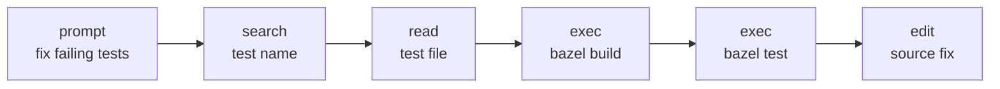
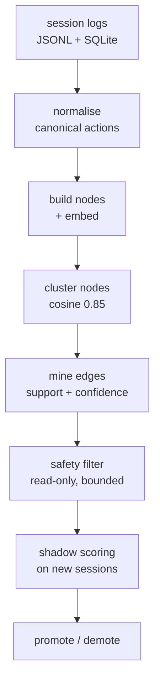
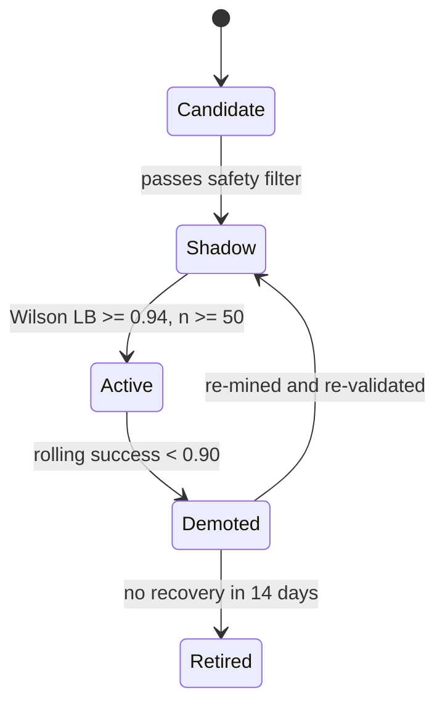
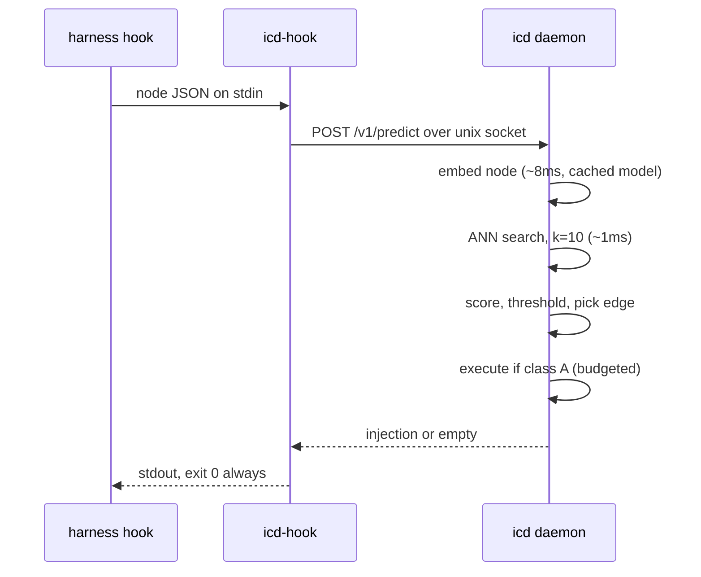
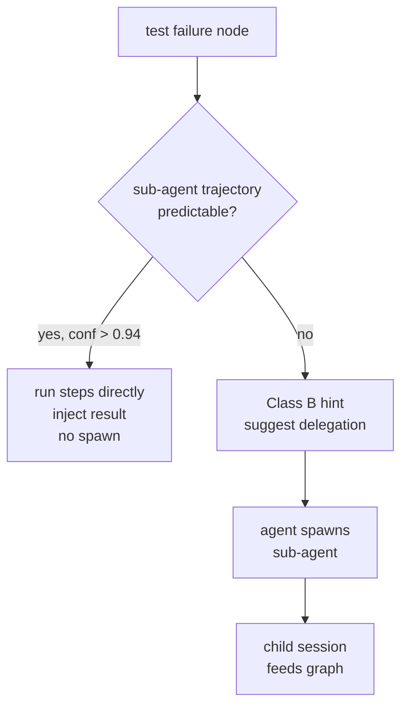

# Interaction Graph Compiler — Design

Sep 22, 2026 · @Someone

The system learns a directed graph of agent state transitions from your own session logs, then predicts and pre-executes the next node before the model reasons about it. The unit is the edge — prompt to tool, tool to tool, tool to sub-agent — not the session.

## Thesis

Agents solve problems in repeatable ways, and that repeatability is measurable. After a successful Bazel build in this repo the agent runs tests 92 times out of 100. After a prompt naming a work item it reads the same cache file. Those regularities are already sitting in your session logs; nobody is using them.

The compiler mines them into a directed graph of state transitions and then runs one step ahead of the agent. When a node is reached, the daemon looks up the likely successor, executes it if it is read-only and safe, and puts the result in context before the model spends a turn deciding it needs it.

Three properties make this different from a script cache:

- **The unit is the edge, not the session.** Prompt to tool, tool to tool, tool result to sub-agent spawn. A session is just a walk through the graph.
- **Nothing is hand-declared.** No entity taxonomy, no regex for ticket formats, no list of intents. Similarity in embedding space does the grouping; frequency and outcome do the scoring.
- **Every edge carries its own evidence.** Success rate, sample size, confidence bound, last-validated date. An edge that stops working demotes itself without anyone noticing it rotted.

The saving is turns, not tokens. A turn re-reads the whole cached context, so removing three discovery turns from the front of a session removes three full context reloads, three latency stalls, and three chances for the agent to wander.

## Prior art and borrowed primitives

Nothing here is new math. The design is four well-understood mechanisms pointed at a new substrate.

| Primitive | What it contributes | Where it comes from |
| --- | --- | --- |
| Branch prediction | Predict the successor from recent history; execute speculatively; discard cheaply when wrong | CPU architecture (two-level adaptive predictors, TAGE) |
| Cache prefetch | After seeing an access pattern, fetch the next item before it is requested | L2/L3 stride and correlation prefetchers |
| Plan caching | Recognise a query shape seen before, reuse the plan, re-validate when statistics drift | Database query optimisers (Postgres generic plans, Oracle cursor sharing) |
| Process mining | Recover a workflow graph from event logs where no graph was ever declared | Alpha/Heuristics miners, van der Aalst |
| Sequential pattern mining | Find frequent ordered subsequences with support and confidence thresholds | PrefixSpan, SPADE |

The closest single analogue is the **correlation prefetcher**: it keeps a table of "address A was followed by address B", indexes it by the address just seen, and issues B speculatively. Swap addresses for agent states and you have the runtime.

What exists already but does not do this:

- **Prompt caching** removes the cost of re-sending context. It does not remove the turn.
- **Model routing** picks a cheaper model per request. The request still goes through inference.
- **Skills and tool descriptions** are hand-authored and sit passive until the model chooses them. They encode a human's guess about when they apply, and they rot silently.
- **Workflow engines** (Temporal, Airflow, LangGraph) execute a graph you declared. The graph is the input, not the output.
- **Agent trajectory research** (AutoTool, R2V, AgentDiet) studies pattern reuse in benchmarks, without live validated deployment against proprietary harnesses.

The gap being filled: a learned, continuously re-validated transition graph, mined from one organisation's real sessions, that intercepts and pre-executes inside commercial agent harnesses. Each ingredient is off the shelf. The combination is not published anywhere.

## The graph

A **node** is a point in a session where the agent is about to decide something. Three kinds:

| Node kind | Created when | Carries |
| --- | --- | --- |
| `prompt` | User submits a turn | Prompt text, repo, branch, dirty files, open session history |
| `tool_complete` | A tool call returns | Canonical action, arguments, outcome, truncated result, the 3 actions before it |
| `delegate_complete` | A sub-agent returns | Sub-agent type, its task description, its result summary |

An **edge** is an observed transition between consecutive nodes in one session, annotated with whether that session ended well.



Each arrow is an edge instance. Thousands of sessions produce millions of instances; the miner collapses them into a few hundred scored edges.

### State representation

A node is serialised into a short canonical text, then embedded. The serialisation is the only place harness differences are erased.

```
intent: fix the failing auth tests
recent: search(content) -> read -> exec
current: exec bazel build //auth/...
outcome: success, 0 errors, 42 targets
repo: metadata-platform
```

That string goes through a local sentence embedding model (`all-MiniLM-L6-v2`, 384 dimensions, roughly 30 ms on CPU). Two things matter about this choice:

- **Frozen weights, no training.** The model already knows that "look up work item W-1234" and "fetch ticket ABC-99" are near each other, and that both are far from "create a new work item". That separation is what replaces a hand-written intent taxonomy.
- **The whole context is embedded, not the entity.** A work-item ID appearing in a lookup prompt and in a creation prompt lands in different regions, because the surrounding words dominate the vector. This is why entity classification is unnecessary.

### Canonical actions

Before embedding, every harness's native tool call is mapped to one vocabulary: `read`, `search(content|filename)`, `list`, `exec`, `edit`, `patch`, `fetch`, `mcp`, `delegate`, `skill`, `unknown`. Shell commands are parsed with a tree-sitter-bash AST, never regexes — unwrap `bash -lc`, track `cd` chains, split on `&&`, classify each segment, detect mutation via redirects, `tee`, `sed -i`, `rm`, or git write subcommands.

Quality gate: at least 95% of calls in the corpus must normalise to something other than `unknown`, verified against 300+ golden fixture commands per harness. Cross-harness mining is worthless if this layer is sloppy — a Codex `cat file.rs` and a Claude Code `Read(file.rs)` must produce the same node text.

## Learning pipeline

All of this runs offline, nightly or on demand. Nothing in this section is on the agent's critical path.



### Outcome labelling

The weakest link, and worth over-engineering. An edge is only worth learning if the sessions containing it ended well, and "ended well" has no explicit signal in any harness.

| Label | Rule |
| --- | --- |
| Success | A commit touching the session's edited files lands within 2 hours and is not reverted within 24 |
| Failure | The session edited files and the working tree was reset, or the branch was abandoned |
| Unknown | Everything else |

Unknown sessions still feed edge discovery — they show what the agent *does* — but are excluded from success statistics. Roughly 40–60% of sessions land in Unknown in practice, which is acceptable because edge mining needs volume more than it needs labels.

A second, weaker signal supplements this: **did the agent immediately undo the action?** A `read` followed by the same `read` with different arguments, or an `edit` reverted two turns later, marks the edge as low quality regardless of session outcome.

### Mining

For each cluster of similar source nodes, count what came next:

1. **Support** — how many instances in the cluster. Below 30, discard.
2. **Confidence** — share of instances taking the dominant successor. Below 0.75, discard; the cluster is genuinely ambiguous.
3. **Lift** — is the successor more likely here than at baseline? A `read` that follows everything is not a pattern.
4. **Outcome correlation** — success rate of sessions taking the edge versus sessions in the same cluster that did not.

Edges surviving all four become candidates.

### Safety filter

A candidate is only executable if every condition holds:

- Read-only. No `edit`, `patch`, `exec` with mutation, or network write.
- Bounded. Completes within 3 seconds at p95 in historical data.
- Arguments derivable from the source node with no reasoning — a path, an identifier, a string already present.
- Arguments resolve inside the repo root after symlink resolution.

Edges failing the filter are not discarded; they become **hint-only** edges, which suggest rather than execute. That distinction drives the three injection classes in the agent interaction model below.

### Validation and lifecycle



Shadow mode runs the prediction on live sessions and records whether it would have been right, without injecting anything. Promotion needs a Wilson lower bound at 95% confidence of at least 0.94 across 50 or more shadow observations.

Every active edge keeps a permanent **10% holdout** — one session in ten is never injected into, for the life of the edge. Without it there is no way to separate "the agent did what we predicted" from "the agent did what we told it". The holdout is the only honest measurement of savings.

## Runtime prediction

The hot path runs inside a hook, which means a hard wall clock budget. If it misses, the session proceeds unchanged.



### Budgets

| Stage | p95 target | On overrun |
| --- | --- | --- |
| Embed node | 10 ms | Return empty |
| Index lookup | 2 ms | Return empty |
| Score and select | 1 ms | Return empty |
| Execute prefetch | 2000 ms | Kill, return hint-only |
| Total, no match | 5 ms | — |
| Total, with execution | 2500 ms | Hard deadline, partial results discarded |

The hook client passes a deadline equal to the harness timeout minus 500 ms. It always exits 0. A crashed daemon, a corrupt index, or a hung prefetch produces exactly one outcome: the agent behaves as if the compiler does not exist.

### Index

Active edges are held in memory as an HNSW index over source-node embeddings — a few hundred edges, a few megabytes. It is rebuilt atomically by the miner and swapped in under a pointer flip; the API server never blocks on a write.

Lookup is `k=10` nearest source nodes, filtered to `status = active`, then scored:

```latex
score = \text{sim} \times \text{conf}_{LB} \times \log(1 + n_{\text{support}})
```

The top edge fires only if cosine similarity is at least 0.82 and the confidence lower bound is at least 0.94. Both thresholds are tunable per repo and start deliberately conservative — a missed prediction costs nothing, a bad one costs context and trust.

## Hook points

Three interception points, each mapping to a node kind. Not every harness supports all three.

| Capability | Claude Code | Codex CLI | OpenCode V2 |
| --- | --- | --- | --- |
| Adapter form | Command hook in `settings.json` | Command hook in `~/.codex/hooks.json` | In-process TS plugin |
| Prompt-node injection | `UserPromptSubmit` → `additionalContext` | `UserPromptSubmit` → `additionalContext` | `prompt` hook, appended to prompt |
| Tool-node injection | `PostToolUse` → `additionalContext` | `PostToolUse` → `additionalContext` | `tool.hook("execute.after")` |
| Pre-tool interception | `PreToolUse` | `PreToolUse`, no `additionalContext` | `tool.hook("execute.before")` |
| Silent to the user | Yes | **No** — rendered as a visible developer message | Yes |
| Session end | `SessionEnd` | Absent; inferred from rollout file | Event stream |
| Live capture | Tail `transcript_path` | Tail rollout JSONL | Plugin hooks + SQLite tail |

`PreToolUse` is deliberately unused for injection in v1. It is the most tempting point — you can see the exact call about to be made — but interfering there means either blocking the call or rewriting its arguments, both of which change agent behaviour in ways that are hard to attribute. It is used only for capture.

Codex visibility is the real constraint. Injections there are seen by the user as developer messages, so they must be compact and legible. This is a feature in the pilot phase: it makes the system auditable by whoever is running it.

### Claude Code registration

```json
{
  "hooks": {
    "UserPromptSubmit": [
      { "hooks": [{ "type": "command", "command": "icd-hook claude prompt", "timeout": 5 }] }
    ],
    "PostToolUse": [
      { "matcher": "Read|Grep|Glob|Bash|Task|mcp__.*",
        "hooks": [{ "type": "command", "command": "icd-hook claude post-tool", "timeout": 3 }] }
    ],
    "SessionEnd": [
      { "hooks": [{ "type": "command", "command": "icd-hook claude end", "timeout": 2 }] }
    ]
  }
}
```

Codex uses the same schema shape at `~/.codex/hooks.json`, minus `SessionEnd`. OpenCode gets an npm plugin rather than a hook command, which also gives it the cleanest live capture.

`icd-hook` is a small static Go binary — roughly 5 ms cold start, one Unix socket round trip, stdout, exit 0 unconditionally. Keeping it separate from the Bun-compiled daemon matters: the hook runs on every tool call, and a 200 ms runtime startup would be more expensive than the thing it is saving.

## Agent interaction model

An injection is text appended to the model's context by a hook. The model has no special channel for it and no API for "pre-fetched data". So the entire contract is carried by the wording, and the wording has to do four jobs: say what it is, say where it came from, say how much to trust it, and say what the agent is free to do about it.

### The three classes

**Class A — Result.** The edge passed the safety filter and the daemon already ran it. The data is present.

```
<compiled-context source="icd" edge="wi-lookup" confidence="0.96">
Pre-fetched because this prompt matches 143 prior sessions that began
with the same lookup. Not requested by you. Verify before relying on it.

$ wi-lookup W-4821 --json
{"id":"W-4821","title":"Auth token refresh fails on rotation",
 "state":"In Progress","assignee":"steven",
 "files":["auth/token.rs","auth/rotate.rs"]}
</compiled-context>
```

**Class B — Hint.** The edge was not safe to execute, or the arguments were not derivable, but the successor is predictable. No data, just a pointer.

```
<compiled-hint source="icd" confidence="0.91">
In 91% of sessions reaching this point, the next step was `bazel test //auth/...`.
Skip if your plan differs.
</compiled-hint>
```

**Class C — Plan.** A chain of three or more edges with joint confidence above threshold. Presented as a known-good route, not a mandate.

```
<compiled-plan source="icd" confidence="0.88" observed="64 sessions">
Common route from here: read the failing test, grep the symbol it asserts on,
build, then test. Deviate freely if the failure points elsewhere.
</compiled-plan>
```

### How the model is expected to treat it

The honest answer is that you cannot make a model treat context a particular way; you can only make the right treatment the obvious one. Four wording rules do most of the work:

- **Never phrase it as an instruction.** "Run bazel test next" hijacks the plan. "91% of sessions ran bazel test next" is evidence the model weighs. The first produces compliance, the second produces reasoning.
- **Always state provenance and confidence.** A model given an unattributed JSON blob will either trust it completely or ignore it. Given a number and a source, it calibrates — and will re-fetch when the number is low.
- **Always grant permission to deviate.** One clause. Without it, a wrong prediction drags the agent down the wrong path because nothing licensed it to stop.
- **Never claim the user asked.** If the agent believes the user requested a lookup, it will report back on a lookup the user never made. Class A explicitly says *not requested by you*.

### What this looks like from the agent's side

Without the compiler, a work-item prompt costs four turns before the first useful thought:

| Turn | Without | With Class A |
| --- | --- | --- |
| 1 | Reason: "I need the work item details" | Reason over data already present |
| 2 | Call the lookup tool | Begin the actual task |
| 3 | Read the result | — |
| 4 | Reason: "now I can start" | — |

The model does not need to understand that it was optimised. It sees relevant context, uses it, and proceeds — the same way it uses a file the user pasted. The provenance tag matters only for the cases where the data is stale or wrong, which is exactly when the model needs to know it can discard it.

## Effect on inference

What changes is the shape of the search, not the quality of the reasoning.

- **Turns removed at the front.** Discovery turns disappear when the data is already there. This is the whole of the cost saving, and it compounds: each removed turn is also a removed cache read of the full context.
- **Narrower option space.** A hint does not remove options, it re-weights them. The model still considers alternatives and still picks something else when the evidence points elsewhere.
- **Cache position moves.** Class A injections land at a prompt or tool boundary, which is a cache-friendly position. A mid-turn injection would invalidate the suffix; this is another reason `PreToolUse` injection is avoided.
- **Tokens added, not removed.** Every injection costs input tokens. A 400-token pre-fetch that saves two 12,000-token turns is a large win; a 400-token hint that changes nothing is pure loss. This is why the ranking function subtracts injection cost, and why the holdout measurement is non-negotiable.

### When the prediction is wrong

| Failure | What the agent does | Cost | Mitigation |
| --- | --- | --- | --- |
| Irrelevant pre-fetch | Ignores it, proceeds normally | Wasted input tokens | Similarity threshold; demote on low use rate |
| Stale data | May act on outdated state | Potentially a wrong edit | TTL per edge; freshness stamp in the tag |
| Confidently wrong hint | May follow it and waste a turn | One or two turns | Permission-to-deviate clause; confidence in the tag |
| Anchoring | Stops considering alternatives | Degraded solution quality | Holdout comparison on solution quality, not just cost |

**Anchoring is the serious one.** The others are cheap and self-correcting. Anchoring is not: an agent that would have found the real bug in `rotate.rs` may instead accept the pre-fetched pointer to `token.rs` and stop looking. It is invisible in cost metrics — the session looks faster and cheaper — and only shows up as a worse outcome.

The holdout is the only defence. Measure solution quality on holdout sessions against injected ones: revert rate, follow-up session rate, review comments per PR. If injected sessions are cheaper but get reverted more often, the edge is harmful and demotes regardless of how well it predicts.

### Metrics

| Metric | Definition | Target |
| --- | --- | --- |
| Pre-write cost | Dollars spent before the first edit, injected vs holdout | −30% |
| Turns to first edit | Count, injected vs holdout | −2 |
| Use rate | Share of Class A injections the agent visibly relies on | > 0.70 |
| Deviation rate | Share of Class B hints not followed | Watch, not target |
| Revert rate delta | Injected minus holdout | ≤ 0 |

Deviation rate is deliberately not a target. A hint that is followed every time is either a genuinely deterministic edge, or the agent has stopped thinking. The two look identical in the aggregate and are told apart only by the revert delta.

## Sub-agents

Delegation is the highest-value target in the whole system. A sub-agent spawn is not one turn — it is an entire nested session with its own context window, its own discovery phase, and its own token bill. Predicting one correctly saves ten to thirty times what predicting a `read` saves.

It is also the hardest, because a delegation is opaque: the parent sees a task description going in and a summary coming out.

### Delegation as a node

`delegate` is a canonical action like any other. The node text captures the task description, and the result node captures the summary. This makes two patterns minable:

1. **Predicting the spawn.** "After a failing test in this repo, the agent delegates a codebase-search sub-agent 84% of the time."
2. **Pre-empting the spawn.** If the sub-agent's *own* internal trajectory is itself predictable — it always runs the same three searches and returns a file list — then the parent never needs to spawn it. The daemon runs those three searches directly and injects the result the sub-agent would have produced.

The second is where the money is. A delegation that reliably costs 15,000 tokens and reliably produces a list of candidate files is a compiled path waiting to happen.



### Child sessions in the graph

Child sessions are mined as first-class sessions, with a parent link where the harness provides one.

| Harness | Child representation | Parent link |
| --- | --- | --- |
| Claude Code | Separate transcript file, lines carry `isSidechain: true` and `agentId` | Absent — must be reconstructed by timestamp and cwd |
| Codex | Separate thread | Present in rollout |
| OpenCode | Child session rows | Present via parent session id |

The Claude Code gap is real work. Reconstruction matches a sidechain file's start time and cwd against the parent's `Task` tool call window. It is heuristic and will mis-attribute under concurrency; sidechains that cannot be attributed with confidence are mined as standalone sessions rather than guessed at.

### Scoping rules

- A sub-agent's own nodes are tagged with its agent type. Edges mined inside a `code-search` sub-agent are not applied to a `test-writer` sub-agent, even at high similarity — the contexts look alike and behave differently.
- Injections are delivered to the level that will act on them. A prediction about what the sub-agent will do goes into the sub-agent's context if it is spawned, not the parent's.
- Pre-empted delegations are labelled as such in the injection, because the agent needs to know it is reading a substitute for a delegation it did not make:

```
<compiled-context source="icd" replaces="delegation:code-search" confidence="0.95">
Ran the searches a code-search sub-agent performs at this point, based on
64 prior delegations. Spawn one anyway if you need more depth.

auth/token.rs:142  fn refresh_token
auth/rotate.rs:88   fn rotate_and_refresh
auth/mod.rs:31      pub use rotate::rotate_and_refresh
</compiled-context>
```

The closing clause matters more here than anywhere else. Pre-empting a delegation removes an entire reasoning capability from the session; the agent must retain the option to invoke it.

## Running it locally

One daemon per machine, no network dependency after install.

### Components

| Artifact | Language | Role |
| --- | --- | --- |
| `icd` | Bun-compiled TypeScript | Daemon and CLI |
| `icd-hook` | Static Go binary | Hook client, \~5 ms start |
| `@ic/opencode-plugin` | npm package | OpenCode in-process adapter |
| Embedding model | ONNX `all-MiniLM-L6-v2` | Bundled, \~90 MB, no Ollama dependency |

The embedding model ships bundled rather than through Ollama. It removes an install step, removes a second daemon, and pins the model version — a silent model upgrade would invalidate every stored embedding in the index.

### Storage

```
~/.local/share/icd/
├── icd.db              SQLite WAL — nodes, edges, sessions, injections
├── index/              HNSW index, rebuilt by the miner
├── model/              Bundled ONNX embedding model
├── quarantine/         Unparseable log lines
└── logs/               daemon, miner, audit
```

Socket at `$XDG_RUNTIME_DIR/icd.sock`, mode `0600`, peer credentials checked against the daemon UID. No remote listener.

Repo key is the realpath of the git root plus a hash of the normalised `origin` URL, so two clones of the same repo in different directories share learned edges.

### Install

```bash
ic install
# detects harnesses and versions
# installs launchd agent (macOS) or systemd --user unit (Linux)
# merges hook entries idempotently, tagged for clean uninstall
# runs first import and first mining pass
```

Hook merging is the fiddly part. Entries are tagged with an `icd` marker so `ic uninstall` removes exactly what it added and leaves hand-written hooks alone.

### Commands

| Command | Does |
| --- | --- |
| `ic import --all --once` | Backfill from existing session history |
| `ic mine --window 7d` | Force a mining pass |
| `ic edges --status active` | List edges with stats |
| `ic edges approve <id>` | Human approval for an exec-bearing edge |
| `ic report` | Holdout comparison, savings, use rates |
| `ic shadow <id>` | Force an edge back to shadow |
| `ic purge --raw` | Drop raw inputs |

### Retention

Raw session inputs 14 days, node and edge instances 180 days, edge statistics indefinitely. Raw inputs are the sensitive layer — they contain prompt text and file contents — and the short window keeps the exposure bounded while still allowing a re-mine after a normaliser fix.

## Open questions

### Design risks

- **Cold start.** Edge mining needs roughly 30 instances per cluster. A single developer's history may not reach that for anything but the most common patterns. Historical import is the mitigation, and the first honest test is whether a backfill of existing session logs produces any edge at all above threshold.
- **Cluster granularity.** The 0.85 cosine threshold is a guess. Too tight and every node is its own cluster with no support; too loose and semantically different situations merge and confidence collapses. Needs tuning against real data before anything else is trusted.
- **Anchoring is invisible in cost metrics.** Covered above, but worth restating as a build-order constraint: the holdout and revert-rate measurement must exist *before* the first edge goes active, not after.
- **Outcome labelling coverage.** If Unknown swallows 80% of sessions rather than 50%, success statistics become too thin to promote anything. Measurable on day one from existing history.

### Decisions to make

- [ ] Build at work or as a side project — IP clearance is required before any company session trace is used as training data
- [ ] Which OpenCode version is deployed in the org (V2 is required for the plugin hook surface)
- [ ] Whether interaction records may be stored under data policy, and at what granularity
- [ ] Who approves exec-bearing edges during the pilot
- [ ] Whether the pilot targets one repo with high session volume, or one workflow across several repos

### Build order

The sequence matters more than the timeline. Each step gates the next.

| Step | Delivers | Gate to pass |
| --- | --- | --- |
| 1 | Importers and normaliser | ≥ 95% of historical calls normalise to non-`unknown` |
| 2 | Node building, embedding, outcome labelling | Unknown-outcome share below 60% |
| 3 | Miner, offline only | At least one edge clears support 30 and confidence 0.75 |
| 4 | Shadow scoring and holdout harness | Shadow accuracy measurable on live sessions |
| 5 | Class B hints on one harness | Deviation rate and revert delta both measurable |
| 6 | Class A execution, human-approved edges | Pre-write cost drop visible against holdout |
| 7 | Sub-agent pre-emption | Delegation cost drop against holdout |

Step 3 is the credibility test. If a week of real session history yields no edge above threshold, the premise is wrong and the rest of the build does not matter. That question is answerable with importers, an embedding model, and a clustering script — no daemon, no hooks, no injection. It is the first thing to build.
