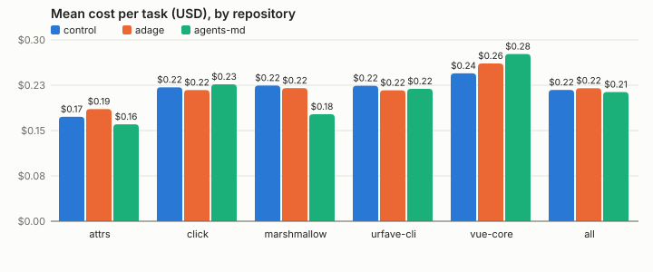
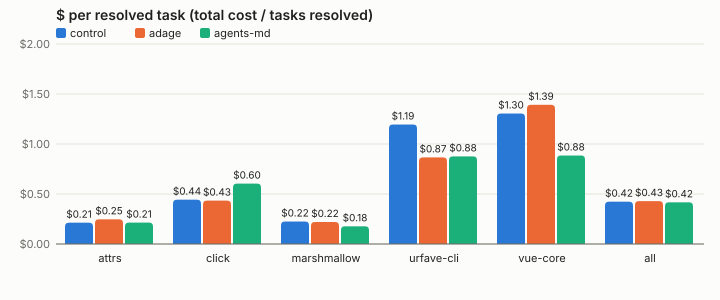
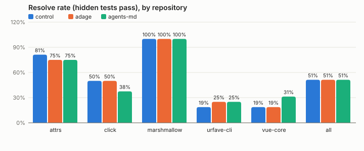
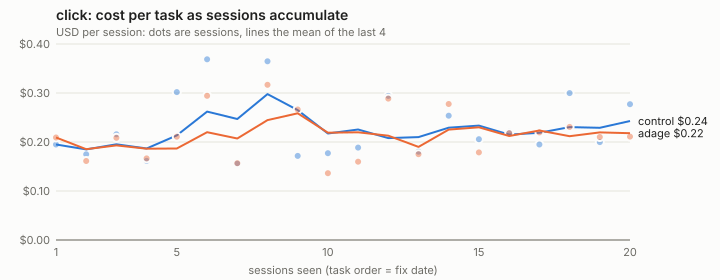
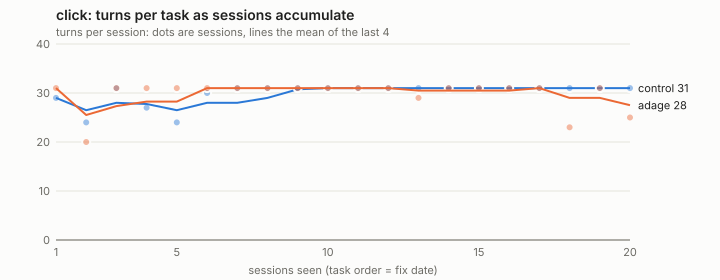
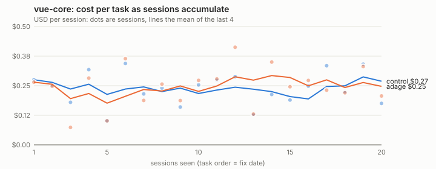
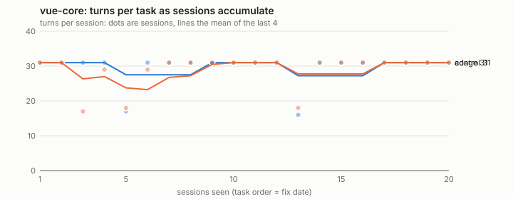

# RepoBench-Local: Adage on real repositories

2026-09-28. 501 real headless Claude Code sessions (`claude -p`, Claude Code 2.1.283) on five real
open-source repositories at pinned commits, working 100 real bug fixes mined from their history, plus
two documented evals/gen sandboxes. Code and task definitions: [evals/repobench](../../../repobench/README.md).

**The short version: on real repositories Adage learned nothing it could deliver, so it changed
nothing.** In an ordinary user's setting it was neither an upgrade nor a harm.

- **Nothing learned.** From 10 training traces per repository (and, offline, from all 43–102 traces
  each repository produced), `adage condition --demo` compiled **zero active reflexes** in all five
  repositories. The one delivered route in the whole headline was an *instinct* (vue-core, N1: "after
  `npm test` fails, run `pnpm test`"), which fired in 2 of 16 adage sessions and was ignored both times.
  In the other 62 Haiku adage sessions nothing was delivered at all. So the `adage` arm *was* the day-0
  (instincts-only) arm in every repository, and "day-0 value" is the adage row below.
- **Headline, Claude Haiku 4.5, pooled (38 test tasks x 2 repeats per arm):** resolve rate 0.51 with
  Adage vs 0.51 without (diff 0.00, 95% CI [-0.08, 0.08]); mean cost $0.22 vs $0.22; **$ per resolved
  task $0.43 vs $0.42** (diff +$0.01, CI [-0.07, 0.09]). The AGENTS.md baseline: 0.51 resolved,
  **$0.42 per resolved task**. No metric differs after Holm in any comparison.
- **Harm.** Adage resolved 3 of 38 tasks less often than the control and 4 more often: noise of the
  same size both ways. AGENTS.md: 6 worse, 7 better.
- **Learning curve: flat, because nothing was learned.** On click and vue-core, 20 sessions each in
  fix-date order, the adage sequence ended with 0 reflexes live. Cost per session rose in both arms
  over the sequence (later tasks are harder), and the adage line tracks the control line.
- **Discoverable conventions.** In two gen sandboxes with every convention written in a committed
  CLAUDE.md, Adage still learned the lookup, linked-files and finish-line reflexes, but they were worth
  ~1 turn (median 7 vs 8, Holm p = 0.26) and no cost: the −15.5 turns of the first corpus came from
  conventions a context file would have stated.
- **Sonnet 5 slice** (click and vue-core, 16 tasks x 1): adage 0.44 vs control 0.50 resolved, $1.04 vs
  $1.00 per resolved task; AGENTS.md 0.38 and $1.24. Nothing was delivered to Sonnet either.

**Why nothing was learned on real repositories, from `adage condition`'s own drop reasons.** Real
agents vary their commands. The test command, the one convention every repository has, appeared as
`python -m pytest tests/test_x.py -xvs`, `python -m pytest tests/ -q`, `source .venv/bin/activate &&
pytest …`, `go test -run TestX -v`, `npm test -- packages/…`: "exec python -m pytest {path} -xvs has a
variable argument" and "… is ambiguous" (no variant held the 80% dominance the compiler needs) account
for most drops. The repositories' environments also offered no dead end to learn: the prepared
`.venv`, `node_modules` and module cache made the obvious commands work (click, where pytest is only in the `.venv`: the first test run failed in 5 of 9
training sessions, then agents recovered in different ways). The only things that recurred exactly were per-task scratch
scripts (`python test_converter_tuple.py` after editing it), which the learner did compile, as nascent
reflexes (see the Adage bugs). A learner that needs one literal command repeated in most sessions
finds little in real traces; the conventions that did exist (`.venv`, `pnpm test <package>`) were
documented or discoverable, and Haiku found them within a turn or two.

**Caveats.** 174 of 228 headline sessions hit the 30-turn limit (Haiku on real bugs works long), so
median turns is censored at 30 in almost every cell and cost is effectively capped at ~$0.20–0.30;
resolve rate and $ per resolved task are the informative metrics. 38 tasks x 2 repeats detects only
large effects (see evals/external/README.md, Power). Prompts were written by Claude Sonnet 5 from the
commit message and the *test* diff, and filtered for leaks. The E1 arm was not run: E1 prefetches
approved lookups, and no repository produced a lookup (or any active) reflex to approve.

## Problems found in Adage during real use

1. **`adage condition --help` runs a real learn.** It prints no help: it conditioned the operator's
   own `~/.claude/projects` (2 traces) and wrote tracks and an index to `~/.local/share/adage`. Any
   unknown flag is ignored the same way (`condition` parses only the flags it knows).
2. **Test commands never compile.** On real traces the test step carries a path or test id
   (`python -m pytest tests/test_x.py::t -xvs`, `go test -run TestX -v`), so the graph compiler drops
   it as "has a variable argument" or "is ambiguous" (no variant ≥ 80%), or a step after an edit is "not an obligation, a sequence or an environment
   step" (19–233 candidate patterns dropped per repository), and 0 compiled into active reflexes in 5 of 5 repositories. The one convention
   every repository has (how to run its tests, and on which part) is the one Adage cannot express
   from real traces unless the agents type the same literal.
3. **Nascent reflexes from one task's scratch files.** Conditioning attrs on all 58 traces compiled 4
   nascent routes, all per-task scratch scripts: after editing `test_converter_tuple.py` run
   `python test_converter_tuple.py`, and after editing `src/attrs/*.pyi` run `python
   test_converter_tuple.py`. The support came from repeated sessions of the same task (arms x
   repeats); nothing requires distinct tasks or days. From the 10 training traces alone it compiled
   `run-801299`: "an environment step this repository needs after editing `src/attr/*.py`: `python3`"
   (a bare interpreter, from agents' `python3 -c …` checks). All were left nascent, so none was
   delivered, but a person reviewing them would see noise.
4. **Instinct N1 fires on a genuine test failure.** vue-core's bound dead end ("after `npm test`
   fails, run `pnpm test`", empty signature) fired whenever `npm test -- <spec>` exited non-zero,
   including when the spec failed because the bug was not fixed yet: 2 delivered in adage sessions,
   3 would-have in control and agents-md, all judged `ignored`. `pnpm test` runs the same failing
   spec; `npm test` works in vue-core (only `npm install` is refused). A dead end should need the
   runner's own failure signature, not any non-zero exit.
5. **Instincts skip Python repositories that use tox or uv.** In click, attrs and marshmallow every
   Python instinct was skipped: "P1: tox wraps pytest here, but tox is not in adage-core's command
   table", "P1: uv run would wrap pytest, but uv is not …", "U3: body refused: tox is not …". Modern
   Python projects (all three here) are exactly tox/uv projects.
6. **Declared files over 64 KiB are not read for instincts** (urfave-cli: `command_test.go`,
   `flag_test.go`: "larger than 64 KiB"), so a Go repository with large test files binds less.
7. **Automatic learning forgets history when sessions are sandboxed.** In the first click curve
   (hook learner on, `ADAGE_AUTO_LEARN=1`, sessions confined to their own run directory), the learn
   log's `sessions_read` climbed 1→7 and then fell back to 1, and `learn-queue/<repo>.sources.json`
   kept only the last 8 transcripts: the learner run from inside a confined session appears to drop
   the sources it cannot see. Anyone running agents in per-task containers or worktrees would hit
   the same. (The curves' conclusions do not depend on it: conditioning on the full history offline
   also found nothing.)
8. **`adage config set` needs a terminal even for a scratch `ADAGE_HOME`** in automation (there is
   `ADAGE_ALLOW_NONINTERACTIVE` for `install --write`, not for `config`); the curve driver runs it
   under `script`.

## Repositories, tasks and what Adage learned

| Repository | Pinned window | Tasks (train / buffer / test) | Split digest | Train sessions passed | Reflexes learned | Instinct routes | Conventions found (live index) | AGENTS.md lines |
| --- | --- | --- | --- | ---: | --- | ---: | --- | ---: |
| [attrs](https://github.com/python-attrs/attrs) | 2024-03-16 – 2026-08-01 | 10 / 2 / 8 | `48e41b37e15b` | 10/10 | none | 0 | 0/1 | 13 |
| [click](https://github.com/pallets/click) | 2025-05-20 – 2026-08-16 | 10 / 2 / 8 | `b343e9578d6a` | 7/10 | none | 1 | 0/1 | 12 |
| [marshmallow](https://github.com/marshmallow-code/marshmallow) | 2023-07-02 – 2026-08-08 | 7 / 2 / 6 | `9145453707f6` | 6/7 | none | 0 | 0/1 | 14 |
| [urfave-cli](https://github.com/urfave/cli) | 2026-06-28 – 2026-09-26 | 10 / 2 / 8 | `249b065bfef7` | 4/10 | none | 1 | 0/1 | 13 |
| [vue-core](https://github.com/vuejs/core) | 2026-07-16 – 2026-09-09 | 10 / 2 / 8 | `540417ac83eb` | 6/10 | none | 3 | 2/2 | 13 |

Why nothing (or little) was learned, from `adage condition`'s own report (reasons, deduplicated):

- **attrs**: 217 candidate patterns dropped ("pip install hypothesis -q" after an edit is not an obligation, a sequence or an environment step; "pip install pytest -q" after an edit is not an obligation, a sequence or an environment step; "python3" after an edit is not an obligation, a sequence or an environment step; an avoid names a check that fails and a check that works; exec python -m pytest {path} -xvs has a variable argument; exec python -m pytest {path} -xvs is ambiguous). Instincts not bound: P1: tox wraps pytest here, but tox is not in adage-core's command table; U3: body refused: tox is not in adage-core's command table
- **click**: 131 candidate patterns dropped ("cat" after an edit is not an obligation, a sequence or an environment step; "git status" after an edit is not an obligation, a sequence or an environment step; exec pip install -e . -q is ambiguous; exec python -m pytest {path} -xvs has a variable argument; exec python -m pytest {path} -xvs is ambiguous; git log is ambiguous). Instincts not bound: P1: tox wraps pytest here, but tox is not in adage-core's command table; P1: uv run would wrap pytest, but uv is not in adage-core's command table; U3: body refused: tox is not in adage-core's command table
- **marshmallow**: 233 candidate patterns dropped ("git status" after an edit is not an obligation, a sequence or an environment step; "pip install pytest -q" after an edit is not an obligation, a sequence or an environment step; "python3" after an edit is not an obligation, a sequence or an environment step; an avoid names a check that fails and a check that works; exec python -m pytest {path} -xvs is ambiguous; git diff is ambiguous). Instincts not bound: P1: tox wraps pytest here, but tox is not in adage-core's command table; U3: body refused: tox is not in adage-core's command table
- **urfave-cli**: 49 candidate patterns dropped ("go test -v" after an edit is not an obligation, a sequence or an environment step; "go test ... -v" after an edit is not an obligation, a sequence or an environment step; exec go test -v is ambiguous; exec go test ... -v is ambiguous). Instincts not bound: declared: command_test.go: larger than 64 KiB; declared: flag_test.go: larger than 64 KiB
- **vue-core**: 19 candidate patterns dropped (exec git diff {path} has a variable argument; exec npm test -- {path} has a variable argument; git diff is ambiguous; git log is ambiguous). Instincts not bound: U3: after npm test fails, pnpm test: already bound by N1

## Headline: pooled over repositories (Claude Haiku 4.5)

Arms run: control, adage, agents-md. Tasks are (repository, task) pairs; every table is task-clustered.

### adage vs control

| Metric | adage | control | diff | 95% CI (tasks) | p | p (Holm) | p (tasks, sign-flip) |
| --- | ---: | ---: | ---: | --- | ---: | ---: | ---: |
| pass_rate (avg) | 0.51 | 0.51 | 0.00 | [-0.08, 0.08] | 1.000 | 1.000 | 1.000 |
| cost_usd (avg) | 0.22 | 0.22 | 0.00 | [-0.01, 0.01] | 0.609 | 1.000 | 0.559 |
| total_turns (med) | 30.00 | 30.00 | 0.00 | [0.00, 0.00] | 0.541 | 1.000 | 0.379 |
| turns_to_first_edit (med) | 10.00 | 9.50 | 0.50 | [-1.50, 2.00] | 0.556 | 1.000 | 0.571 |
| elapsed_s (med) | 131.30 | 135.69 | -4.39 | [-25.29, 12.82] | 0.599 | 1.000 | 0.469 |
| dead_end_hits (avg) | 1.01 | 0.89 | 0.12 | [-0.20, 0.42] | 0.480 | 1.000 | 0.519 |
| follow_rate (avg) | 0.00 | 0.00 | 0.00 | – | – | – | – |
| $ per resolved task | 0.43 | 0.42 | 0.01 | [-0.07, 0.09] | – | – | – |

Tasks: 38; runs adage 76, control 76. Harm: 3 of 38 tasks resolved less often with adage than with control; 4 more often.

### agents-md vs control

| Metric | agents-md | control | diff | 95% CI (tasks) | p | p (Holm) | p (tasks, sign-flip) |
| --- | ---: | ---: | ---: | --- | ---: | ---: | ---: |
| pass_rate (avg) | 0.51 | 0.51 | 0.00 | [-0.11, 0.11] | 1.000 | 1.000 | 1.000 |
| cost_usd (avg) | 0.21 | 0.22 | -0.00 | [-0.02, 0.01] | 0.624 | 1.000 | 0.652 |
| total_turns (med) | 30.00 | 30.00 | 0.00 | [0.00, 0.00] | 0.711 | 1.000 | 0.717 |
| turns_to_first_edit (med) | 9.00 | 9.50 | -0.50 | [-2.00, 1.00] | 0.473 | 1.000 | 0.406 |
| elapsed_s (med) | 153.38 | 135.69 | 17.69 | [-5.40, 28.81] | 0.216 | 1.000 | 0.075 |
| dead_end_hits (avg) | 1.00 | 0.89 | 0.11 | [-0.22, 0.42] | 0.526 | 1.000 | 0.587 |
| follow_rate (avg) | 0.00 | 0.00 | 0.00 | – | – | – | – |
| $ per resolved task | 0.42 | 0.42 | -0.01 | [-0.10, 0.10] | – | – | – |

Tasks: 38; runs agents-md 76, control 76. Harm: 6 of 38 tasks resolved less often with agents-md than with control; 7 more often.

### adage vs agents-md

| Metric | adage | agents-md | diff | 95% CI (tasks) | p | p (Holm) | p (tasks, sign-flip) |
| --- | ---: | ---: | ---: | --- | ---: | ---: | ---: |
| pass_rate (avg) | 0.51 | 0.51 | 0.00 | [-0.08, 0.09] | 1.000 | 1.000 | 1.000 |
| cost_usd (avg) | 0.22 | 0.21 | 0.01 | [-0.01, 0.02] | 0.331 | 1.000 | 0.444 |
| total_turns (med) | 30.00 | 30.00 | 0.00 | [0.00, 0.00] | 0.924 | 1.000 | 0.938 |
| turns_to_first_edit (med) | 10.00 | 9.00 | 1.00 | [-1.00, 2.50] | 0.235 | 1.000 | 0.198 |
| elapsed_s (med) | 131.30 | 153.38 | -22.08 | [-36.47, -2.49] | 0.617 | 1.000 | 0.493 |
| dead_end_hits (avg) | 1.01 | 1.00 | 0.01 | [-0.34, 0.38] | 1.000 | 1.000 | 1.000 |
| follow_rate (avg) | 0.00 | 0.00 | 0.00 | – | – | – | – |
| $ per resolved task | 0.43 | 0.42 | 0.01 | [-0.07, 0.09] | – | – | – |

Tasks: 38; runs adage 76, agents-md 76. Harm: 4 of 38 tasks resolved less often with adage than with agents-md; 3 more often.

## Per repository

| Repository | Arm | Runs | Resolve rate | Mean cost | $ per resolved | Median turns | Median turns to first edit | Hit max turns | Follow rate |
| --- | --- | ---: | ---: | ---: | ---: | ---: | ---: | ---: | ---: |
| attrs | control | 16 | 0.81 | 0.173 | 0.21 | 30.0 | 6.0 | 13 | – |
| attrs | adage | 16 | 0.75 | 0.186 | 0.25 | 30.0 | 6.0 | 10 | – |
| attrs | agents-md | 16 | 0.75 | 0.160 | 0.21 | 30.0 | 6.0 | 9 | – |
| click | control | 16 | 0.50 | 0.222 | 0.44 | 30.0 | 9.5 | 12 | – |
| click | adage | 16 | 0.50 | 0.217 | 0.43 | 30.0 | 9.0 | 13 | – |
| click | agents-md | 16 | 0.38 | 0.227 | 0.60 | 30.0 | 8.5 | 15 | – |
| marshmallow | control | 12 | 1.00 | 0.225 | 0.22 | 30.0 | 8.5 | 7 | – |
| marshmallow | adage | 12 | 1.00 | 0.220 | 0.22 | 29.5 | 10.0 | 6 | – |
| marshmallow | agents-md | 12 | 1.00 | 0.177 | 0.18 | 28.0 | 8.5 | 3 | – |
| urfave-cli | control | 16 | 0.19 | 0.224 | 1.19 | 30.0 | 13.5 | 13 | – |
| urfave-cli | adage | 16 | 0.25 | 0.217 | 0.87 | 30.0 | 13.5 | 16 | – |
| urfave-cli | agents-md | 16 | 0.25 | 0.219 | 0.88 | 30.0 | 12.5 | 15 | – |
| vue-core | control | 16 | 0.19 | 0.245 | 1.30 | 30.0 | 15.0 | 12 | 0.00 |
| vue-core | adage | 16 | 0.19 | 0.261 | 1.39 | 30.0 | 11.5 | 14 | 0.00 |
| vue-core | agents-md | 16 | 0.31 | 0.277 | 0.88 | 30.0 | 11.0 | 16 | 0.00 |

## Claude Sonnet 5 slice

Repositories: click, vue-core; arms control, adage, agents-md.

### Sonnet 5: adage vs control

| Metric | adage | control | diff | 95% CI (tasks) | p | p (Holm) | p (tasks, sign-flip) |
| --- | ---: | ---: | ---: | --- | ---: | ---: | ---: |
| pass_rate (avg) | 0.44 | 0.50 | -0.06 | [-0.19, 0.00] | 1.000 | 1.000 | 1.000 |
| cost_usd (avg) | 0.46 | 0.50 | -0.04 | [-0.11, 0.01] | 0.171 | 1.000 | 0.166 |
| total_turns (med) | 28.50 | 29.50 | -1.00 | [-8.50, 2.00] | 0.317 | 1.000 | 0.312 |
| turns_to_first_edit (med) | 7.00 | 7.00 | 0.00 | [-2.00, 6.00] | 0.294 | 1.000 | 0.301 |
| elapsed_s (med) | 160.68 | 156.91 | 3.77 | [-42.03, 132.94] | 0.813 | 1.000 | 0.809 |
| dead_end_hits (avg) | 0.06 | 0.00 | 0.06 | [0.00, 0.19] | 1.000 | 1.000 | 1.000 |
| follow_rate (avg) | – | – | – | – | – | – | – |
| $ per resolved task | 1.04 | 1.00 | 0.04 | [-0.26, 0.66] | – | – | – |

Tasks: 16; runs adage 16, control 16. Harm: 1 of 16 tasks resolved less often with adage than with control; 0 more often.

### Sonnet 5: agents-md vs control

| Metric | agents-md | control | diff | 95% CI (tasks) | p | p (Holm) | p (tasks, sign-flip) |
| --- | ---: | ---: | ---: | --- | ---: | ---: | ---: |
| pass_rate (avg) | 0.38 | 0.50 | -0.12 | [-0.31, 0.00] | 0.504 | 1.000 | 0.500 |
| cost_usd (avg) | 0.46 | 0.50 | -0.04 | [-0.09, 0.02] | 0.231 | 1.000 | 0.227 |
| total_turns (med) | 29.50 | 29.50 | 0.00 | [-6.50, 2.00] | 0.906 | 1.000 | 0.902 |
| turns_to_first_edit (med) | 9.00 | 7.00 | 2.00 | [-2.50, 7.00] | 0.099 | 0.991 | 0.102 |
| elapsed_s (med) | 156.59 | 156.91 | -0.31 | [-64.22, 192.25] | 0.348 | 1.000 | 0.352 |
| dead_end_hits (avg) | 0.00 | 0.00 | 0.00 | [0.00, 0.00] | 1.000 | 1.000 | 1.000 |
| follow_rate (avg) | – | – | – | – | – | – | – |
| $ per resolved task | 1.24 | 1.00 | 0.24 | [-0.11, 1.73] | – | – | – |

Tasks: 16; runs agents-md 16, control 16. Harm: 2 of 16 tasks resolved less often with agents-md than with control; 0 more often.

### Sonnet 5: adage vs agents-md

| Metric | adage | agents-md | diff | 95% CI (tasks) | p | p (Holm) | p (tasks, sign-flip) |
| --- | ---: | ---: | ---: | --- | ---: | ---: | ---: |
| pass_rate (avg) | 0.44 | 0.38 | 0.06 | [0.00, 0.19] | 1.000 | 1.000 | 1.000 |
| cost_usd (avg) | 0.46 | 0.46 | -0.01 | [-0.06, 0.04] | 0.736 | 1.000 | 0.743 |
| total_turns (med) | 28.50 | 29.50 | -1.00 | [-5.00, 4.00] | 0.214 | 1.000 | 0.209 |
| turns_to_first_edit (med) | 7.00 | 9.00 | -2.00 | [-6.00, 4.00] | 0.376 | 1.000 | 0.373 |
| elapsed_s (med) | 160.68 | 156.59 | 4.09 | [-135.66, 125.76] | 0.339 | 1.000 | 0.339 |
| dead_end_hits (avg) | 0.06 | 0.00 | 0.06 | [0.00, 0.19] | 1.000 | 1.000 | 1.000 |
| follow_rate (avg) | – | – | – | – | – | – | – |
| $ per resolved task | 1.04 | 1.24 | -0.20 | [-1.46, 0.07] | – | – | – |

Tasks: 16; runs adage 16, agents-md 16. Harm: 0 of 16 tasks resolved less often with adage than with agents-md; 1 more often.

## Learning curve: does it get cheaper as you use it?

| Repository | Arm | Sessions | Resolve rate | Mean cost, sessions 1–5 | Mean cost, last 5 | Median turns, 1–5 | Median turns, last 5 | Reflexes live at the end |
| --- | --- | ---: | ---: | ---: | ---: | ---: | ---: | --- |
| click | control | 20 | 0.50 | 0.210 | 0.239 | 27 | 31 | – |
| click | adage | 20 | 0.55 | 0.191 | 0.218 | 31 | 31 | none |
| vue-core | control | 20 | 0.40 | 0.226 | 0.265 | 31 | 31 | – |
| vue-core | adage | 20 | 0.45 | 0.194 | 0.252 | 29 | 31 | none |

Per session (adage sequence): reflexes live before the session, from `curve.json`:

- **click**: 1:0, 2:0, 3:0, 4:0, 5:0, 6:0, 7:0, 8:0, 9:0, 10:0, 11:0, 12:0, 13:0, 14:0, 15:0, 16:0, 17:0, 18:0, 19:0, 20:0
- **vue-core**: 1:0, 2:0, 3:0, 4:0, 5:0, 6:0, 7:0, 8:0, 9:0, 10:0, 11:0, 12:0, 13:0, 14:0, 15:0, 16:0, 17:0, 18:0, 19:0, 20:0

## Discoverable-conventions control (evals/gen sandboxes with a committed CLAUDE.md)

- **gen-node-logistics-s21**: reflexes learned with the CLAUDE.md present: finish-line-04e5d4, lookup-work-item, read-linked-files; training passed 9/9
- **gen-py-clinic-s12**: reflexes learned with the CLAUDE.md present: finish-line-c83ca5, lookup-work-item, read-linked-files; training passed 9/9

### adage vs control, both with the documented conventions

| Metric | adage | control | diff | 95% CI (tasks) | p | p (Holm) | p (tasks, sign-flip) |
| --- | ---: | ---: | ---: | --- | ---: | ---: | ---: |
| pass_rate (avg) | 1.00 | 1.00 | 0.00 | [0.00, 0.00] | 1.000 | 1.000 | 1.000 |
| cost_usd (avg) | 0.04 | 0.04 | -0.00 | [-0.01, 0.00] | 0.169 | 1.000 | 0.188 |
| total_turns (med) | 7.00 | 8.00 | -1.00 | [-2.50, 0.00] | 0.022 | 0.259 | 0.125 |
| turns_to_first_edit (med) | 2.00 | 2.00 | 0.00 | [0.00, 0.51] | 0.506 | 1.000 | 0.500 |
| elapsed_s (med) | 27.76 | 27.57 | 0.18 | [-6.13, 5.48] | 0.486 | 1.000 | 0.562 |
| dead_end_hits (avg) | 0.00 | 0.00 | 0.00 | [0.00, 0.00] | 1.000 | 1.000 | 1.000 |
| follow_rate (avg) | 0.56 | 0.71 | -0.15 | [-0.24, -0.07] | 0.130 | 1.000 | 0.125 |
| $ per resolved task | 0.04 | 0.04 | -0.00 | [-0.01, 0.00] | – | – | – |

Tasks: 6; runs adage 12, control 12. Harm: 0 of 6 tasks resolved less often with adage than with control; 0 more often.

## Spend

| Item | Sessions or calls | USD (reported `total_cost_usd`) |
| --- | ---: | ---: |
| attrs | 58 | 10.22 |
| click | 58 | 12.77 |
| click-sonnet5 | 24 | 8.22 |
| gen-node-logistics-s21 | 21 | 0.85 |
| gen-py-clinic-s12 | 21 | 0.79 |
| marshmallow | 43 | 8.84 |
| urfave-cli | 58 | 12.90 |
| vue-core | 58 | 14.59 |
| vue-core-sonnet5 | 24 | 14.48 |
| curve click | 40 | 8.90 |
| curve vue-core | 40 | 9.67 |
| claude -p calls: agents-md | 5 | 0.37 |
| claude -p calls: probe | 1 | 0.01 |
| claude -p calls: prompts | 28 | 2.24 |
| Killed mid-session when the disk filled (estimated from token usage) | 11 | 1.03 |
| Killed mid-session: vue-core eval restarted without the instincts arm (estimated) | 3 | 0.07 |
| Killed mid-session by the container restart (estimated from token usage) | 8 | 1.55 |
| Pilot (2 click training sessions, before the final config) | 2 | 0.54 |
| **Total** | **503** | **108.04** |

