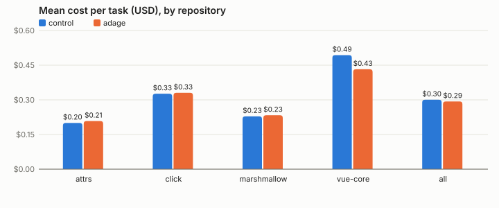
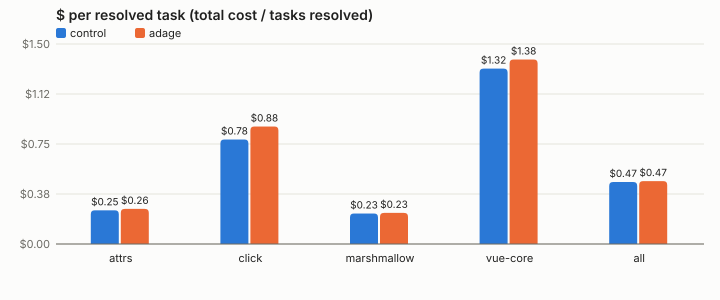
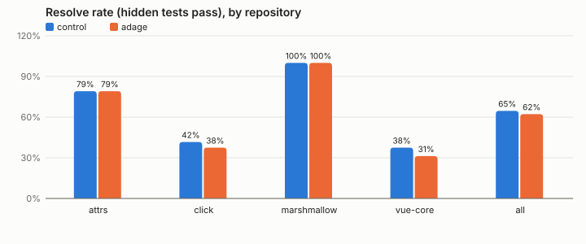

# RepoBench-Local: Adage on real repositories

2026-09-29. **RepoBench v2**, the rerun for the launch evaluation ([evals/launch](../../../launch/README.md)).
The same task definitions, chronological splits and archived training traces as
[v1](../2026-09-28-repobench/README.md), on click, attrs, marshmallow and vuejs/core, with three changes:
`max_turns` 60 (v1: 30, which censored 174 of 228 headline sessions), learning at the thresholds a
user's automatic learner uses (`learn.thresholds = default`; v1 used `--demo`), and instincts bound
against a fresh sandbox of the repository (its `.venv`, `node_modules`), as the zero-config bootstrap
binds them against a real checkout. Arms: `control` (hooks on, directives withheld) and `adage`.
Claude Haiku 4.5 at 3 repeats on the Python repositories and 2 on vuejs/core (164 sessions); a Claude
Sonnet 5 slice on click and vuejs/core (32 sessions). Claude Code 2.1.284. `evals/repobench/rerun.py`
seeds the roots; `configs/v2/` holds the configs.

**The short version: Adage now delivers something on real Python repositories, the agents follow it,
and it saves about two tool calls in the sessions that need it. That is too small to move any
session-level outcome, and nothing was learned from the traces.**

- **Learned: still nothing.** From the same 7–10 training traces per repository, `adage condition` at
  default thresholds compiled 0 reflexes in 4 of 4 repositories (the drop reasons are v1's: `python -m
  pytest {path} -xvs` "is ambiguous" or "has a variable argument"). Every directive below is an
  instinct.
- **Delivered: yes, on the Python repositories.** U11 ("after `python -m pytest` fails with `No module
  named pytest`, run `.venv/bin/python -m pytest`"), bound from each repository's own `.venv`, was
  delivered in 41 of 66 Haiku adage sessions on click, attrs and marshmallow (one directive each), and
  in 0 of 16 on vuejs/core (its N1 routes are now bound only to npm's own refusals, which never
  happened). Sonnet 5: 1 of 16.
- **Followed: every time, but Adage scored it as ignored.** In 41 of 41 sessions the agent's next test
  command ran `.venv/bin/python -m pytest …` with its own arguments; Adage's follow judge requires the
  directed command with options only, so it judged all 41 `ignored` (0 followed), and the instinct
  auto-extinguishes after 5 such judgements (see the launch report, bug 1).
- **The mechanism works.** In sessions that hit the dead end (63 of 82 adage, 58 of 82 control), the
  agent reached a test run that actually ran tests in **1.44 tool calls with Adage vs 3.29 without**
  (task-clustered diff −1.85, 95% CI [−2.56, −1.17], sign-flip p = 0.0001, 21 tasks), and its next
  test command used the project's environment in 71% vs 37% of them.
- **The outcome does not move.** Pooled Haiku: resolve rate 0.62 with Adage vs 0.65 without (diff
  −0.02, CI [−0.10, 0.04]); mean cost $0.29 vs $0.30; **$ per resolved task $0.47 vs $0.47** (CI
  [−0.06, 0.09]); median turns 35 vs 33.5; turns to first edit 8 vs 8. No metric differs after Holm.
  Harm: 3 of 30 tasks resolved less often with Adage, 2 more often (noise of the same size both ways).
  Two tool calls in sessions of 30–40 turns is about 1 turn and ~$0.01 at Haiku prices; the design can
  detect nothing near that.
- **A third of the dead ends are invisible to Adage.** 22 of the 63 Haiku adage sessions that hit U11's
  dead end, and 5 of 6 Sonnet ones, hit it only as `python -m pytest … 2>&1 | head`: the pipeline exits
  0, so `PostToolUseFailure` never fires and no failure-triggered instinct can match (bug 2).
- **Sonnet 5 slice.** Resolve rate 0.44 vs 0.44; mean cost $0.51 vs $0.64 (CI [−0.25, −0.01], Holm p =
  0.50), $ per resolved $1.17 vs $1.45. With one directive delivered in 16 adage sessions, that cost
  difference cannot be Adage's doing: it is task-level noise.
- **Censoring is fixed.** 18 of 164 Haiku sessions hit 60 turns (v1: 174 of 228 at 30); median turns and
  cost are now informative. Costs are higher than v1's (click $0.33 vs $0.22 a session) because the
  sessions are no longer cut off.

**Rerun details.** While the click and attrs held-out phases were running, an unconfined zero-config
E2E session (evals/launch) `pip install`ed pytest and an editable click into the container's system
Python; every click and attrs held-out run that ended after that moment (37 runs, $6.48) was
discarded and rerun once the packages were removed. The spend table below includes the reused v1
training sessions copied into each root ($11.70 over the six roots, not spent again); this run's own
spend is in the launch report.

## Repositories, tasks and what Adage learned

| Repository | Pinned window | Tasks (train / buffer / test) | Split digest | Train sessions passed | Reflexes learned | Instinct routes | Conventions found (live index) | AGENTS.md lines |
| --- | --- | --- | --- | ---: | --- | ---: | --- | ---: |
| [attrs](https://github.com/python-attrs/attrs) | 2024-03-16 – 2026-08-01 | 10 / 2 / 8 | `48e41b37e15b` | 10/10 | none | 15 | 1/1 | 13 |
| [click](https://github.com/pallets/click) | 2025-05-20 – 2026-08-16 | 10 / 2 / 8 | `b343e9578d6a` | 7/10 | none | 15 | 1/1 | 12 |
| [marshmallow](https://github.com/marshmallow-code/marshmallow) | 2023-07-02 – 2026-08-08 | 7 / 2 / 6 | `9145453707f6` | 6/7 | none | 14 | 1/1 | 14 |
| [vue-core](https://github.com/vuejs/core) | 2026-07-16 – 2026-09-09 | 10 / 2 / 8 | `540417ac83eb` | 6/10 | none | 5 | 2/2 | 13 |

Why nothing (or little) was learned, from `adage condition`'s own report (reasons, deduplicated):

- **attrs**: 14 candidate patterns dropped ("pip install pytest -q" after an edit is not an obligation, a sequence or an environment step; "python3 -c '<stdin>'" is not a fixed, plain command; pip is ambiguous; python -m pytest is ambiguous). Instincts not bound: P1: tox wraps pytest here, but body refused: tox's test commands depend on factors, so no one tox command runs them; U3: body refused: tox's test commands depend on factors, so no one tox command runs them
- **click**: 14 candidate patterns dropped (exec python -m pytest {path} -xvs has a variable argument; exec python -m pytest {path} -xvs is ambiguous). Instincts not bound: P1: after pytest fails with "No module named 'click'", tox -e py: already bound by U11; P1: after pytest fails with "command not found: pytest", tox -e py: already bound by U11; P1: after pytest fails with "pytest: command not found", tox -e py: already bound by U11; P1: after python -m pytest fails with "No module named 'click'", tox -e py: already bound by U11; P1: after python -m pytest fails with "No module named pytest", tox -e py: already bound by U11; P1: after python -m pytest fails with "command not found: python", tox -e py: already bound by U11; P1: after python -m pytest fails with "python: command not found", tox -e py: already bound by U11; P1: after python3 -m pytest fails with "No module named 'click'", tox -e py: already bound by U11; P1: after python3 -m pytest fails with "No module named pytest", tox -e py: already bound by U11; U3: after pytest fails with "No module named 'click'", tox -e py: already bound by U11; U3: after pytest fails with "command not found: pytest", tox -e py: already bound by U11; U3: after pytest fails with "pytest: command not found", tox -e py: already bound by U11; U3: after python -m pytest fails with "No module named 'click'", tox -e py: already bound by U11; U3: after python -m pytest fails with "No module named pytest", tox -e py: already bound by U11; U3: after python -m pytest fails with "command not found: python", tox -e py: already bound by U11; U3: after python -m pytest fails with "python: command not found", tox -e py: already bound by U11; U3: after python3 -m pytest fails with "No module named 'click'", tox -e py: already bound by U11; U3: after python3 -m pytest fails with "No module named pytest", tox -e py: already bound by U11
- **marshmallow**: 35 candidate patterns dropped ("pip install pytest -q" after an edit is not an obligation, a sequence or an environment step; "python3 -c '<stdin>'" is not a fixed, plain command; pip is ambiguous). Instincts not bound: P1: after pytest fails with "No module named 'marshmallow'", tox -e py: already bound by U11; P1: after pytest fails with "command not found: pytest", tox -e py: already bound by U11; P1: after pytest fails with "pytest: command not found", tox -e py: already bound by U11; P1: after python -m pytest fails with "No module named 'marshmallow'", tox -e py: already bound by U11; P1: after python -m pytest fails with "No module named pytest", tox -e py: already bound by U11; P1: after python -m pytest fails with "command not found: python", tox -e py: already bound by U11; P1: after python -m pytest fails with "python: command not found", tox -e py: already bound by U11; P1: after python3 -m pytest fails with "No module named 'marshmallow'", tox -e py: already bound by U11; P1: after python3 -m pytest fails with "No module named pytest", tox -e py: already bound by U11; U3: after pytest fails with "No module named 'marshmallow'", tox -e py: already bound by U11; U3: after pytest fails with "command not found: pytest", tox -e py: already bound by U11; U3: after pytest fails with "pytest: command not found", tox -e py: already bound by U11; U3: after python -m pytest fails with "No module named 'marshmallow'", tox -e py: already bound by U11; U3: after python -m pytest fails with "No module named pytest", tox -e py: already bound by U11; U3: after python -m pytest fails with "command not found: python", tox -e py: already bound by U11; U3: after python -m pytest fails with "python: command not found", tox -e py: already bound by U11; U3: after python3 -m pytest fails with "No module named 'marshmallow'", tox -e py: already bound by U11; U3: after python3 -m pytest fails with "No module named pytest", tox -e py: already bound by U11
- **vue-core**: 7 candidate patterns dropped (exec npm test -- {path} has a variable argument; npm run test is ambiguous). Instincts not bound: N1: npm test runs the same script as pnpm test, and nothing here makes npm refuse to; U3: pnpm test: no undeclared runners are known for this repository's stack

## Headline: pooled over repositories (Claude Haiku 4.5)

Arms run: control, adage. Tasks are (repository, task) pairs; every table is task-clustered.

### adage vs control

| Metric | adage | control | diff | 95% CI (tasks) | p | p (Holm) | p (tasks, sign-flip) |
| --- | ---: | ---: | ---: | --- | ---: | ---: | ---: |
| pass_rate (avg) | 0.62 | 0.65 | -0.02 | [-0.10, 0.04] | 0.588 | 1.000 | 0.689 |
| cost_usd (avg) | 0.29 | 0.30 | -0.01 | [-0.03, 0.01] | 0.333 | 1.000 | 0.447 |
| total_turns (med) | 35.00 | 33.50 | 1.50 | [-3.00, 5.00] | 0.654 | 1.000 | 0.699 |
| turns_to_first_edit (med) | 8.00 | 8.00 | 0.00 | [-1.00, 1.50] | 0.151 | 1.000 | 0.082 |
| elapsed_s (med) | 128.13 | 138.12 | -9.99 | [-26.98, 14.76] | 0.823 | 1.000 | 0.810 |
| dead_end_hits (avg) | 1.32 | 1.06 | 0.26 | [-0.11, 0.65] | 0.279 | 1.000 | 0.220 |
| follow_rate (avg) | 0.00 | 0.00 | 0.00 | [0.00, 0.00] | 1.000 | 1.000 | 1.000 |
| $ per resolved task | 0.47 | 0.47 | 0.01 | [-0.06, 0.09] | – | – | – |

Tasks: 30; runs adage 82, control 82. Harm: 3 of 30 tasks resolved less often with adage than with control; 2 more often.

## Per repository

| Repository | Arm | Runs | Resolve rate | Mean cost | $ per resolved | Median turns | Median turns to first edit | Hit max turns | Follow rate |
| --- | --- | ---: | ---: | ---: | ---: | ---: | ---: | ---: | ---: |
| attrs | control | 24 | 0.79 | 0.200 | 0.25 | 30.0 | 6.5 | 0 | 0.00 |
| attrs | adage | 24 | 0.79 | 0.208 | 0.26 | 29.0 | 7.5 | 1 | 0.00 |
| click | control | 24 | 0.42 | 0.326 | 0.78 | 37.5 | 7.0 | 3 | 0.00 |
| click | adage | 24 | 0.38 | 0.331 | 0.88 | 39.0 | 7.5 | 3 | 0.00 |
| marshmallow | control | 18 | 1.00 | 0.229 | 0.23 | 26.0 | 8.0 | 0 | 0.00 |
| marshmallow | adage | 18 | 1.00 | 0.233 | 0.23 | 27.0 | 11.0 | 0 | 0.00 |
| vue-core | control | 16 | 0.38 | 0.493 | 1.32 | 56.0 | 14.5 | 7 | – |
| vue-core | adage | 16 | 0.31 | 0.432 | 1.38 | 44.5 | 11.5 | 4 | – |

## Claude Sonnet 5 slice

Repositories: click, vue-core; arms control, adage.

### Sonnet 5: adage vs control

| Metric | adage | control | diff | 95% CI (tasks) | p | p (Holm) | p (tasks, sign-flip) |
| --- | ---: | ---: | ---: | --- | ---: | ---: | ---: |
| pass_rate (avg) | 0.44 | 0.44 | 0.00 | [-0.19, 0.19] | 1.000 | 1.000 | 1.000 |
| cost_usd (avg) | 0.51 | 0.64 | -0.13 | [-0.25, -0.01] | 0.060 | 0.500 | 0.059 |
| total_turns (med) | 28.00 | 28.00 | 0.00 | [-13.00, 10.50] | 0.056 | 0.500 | 0.054 |
| turns_to_first_edit (med) | 4.50 | 7.00 | -2.50 | [-4.00, 5.50] | 0.869 | 1.000 | 0.860 |
| elapsed_s (med) | 232.76 | 202.50 | 30.26 | [-118.66, 78.12] | 0.042 | 0.420 | 0.045 |
| dead_end_hits (avg) | 0.12 | 0.00 | 0.12 | [0.00, 0.38] | 1.000 | 1.000 | 1.000 |
| follow_rate (avg) | 1.00 | – | – | – | – | – | – |
| $ per resolved task | 1.17 | 1.45 | -0.29 | [-1.58, 0.29] | – | – | – |

Tasks: 16; runs adage 16, control 16. Harm: 1 of 16 tasks resolved less often with adage than with control; 1 more often.

## Spend

| Item | Sessions or calls | USD (reported `total_cost_usd`) |
| --- | ---: | ---: |
| attrs | 58 | 11.72 |
| click | 58 | 17.89 |
| click-sonnet5 | 26 | 8.39 |
| marshmallow | 43 | 9.70 |
| vue-core | 42 | 16.89 |
| vue-core-sonnet5 | 26 | 14.15 |
| **Total** | **253** | **78.73** |

